# SOFTWARE REQUIREMENTS SPECIFICATION (SRS)

**Ứng dụng Chợ Đồ Cũ Sinh Viên — C2C Mobile MVP**

| **Thuộc tính** | **Giá trị**                                                                        |
| -------------- | ---------------------------------------------------------------------------------- |
| Phiên bản      | 1.0 – Bản nâng cấp theo kiến trúc Flutter + FastAPI                                |
| Ngày           | 2026-11-27                                                                         |
| Trạng thái     | Dự thảo để nhóm rà soát và phê duyệt                                               |
| Tài liệu nguồn | `TASKS.md` (126 dòng); `SRS.pdf` phiên bản 0.1 (25 trang)                          |
| Backend        | Python + FastAPI, tự xây dựng API                                                  |
| Frontend       | Flutter Mobile App (Android MVP)                                                   |
| Database       | PostgreSQL – đã chốt (`OQ-03`)                                                     |
| Lưu trữ ảnh    | Storage do nhóm tự quản lý, truy cập qua FastAPI – **[Bổ sung hợp lý / Giả định]** |

> **Ràng buộc kiến trúc:** Flutter chỉ giao tiếp Backend thông qua HTTPS REST API và WebSocket do FastAPI cung cấp. Tuyệt đối không sử dụng Firebase Auth, Firestore, Realtime Database, Firebase Storage, Cloud Functions, Firebase Hosting hoặc BaaS làm backend thay thế. Flutter không truy cập trực tiếp database/storage nội bộ.
>
> **Nhãn nội dung:** **[Nguồn TASKS]** = có trực tiếp trong TASKS; **[Giữ từ SRS 0.1]** = có trong SRS cũ và được giữ sau rà soát; **[Bổ sung hợp lý / Giả định]** = chi tiết kỹ thuật/nghiệp vụ thêm, cần nhóm duyệt; **[Cần làm rõ]** = thiếu dữ liệu hoặc cần quyết định. **Must** = bắt buộc MVP; **Should** = ưu tiên; **Could** = tùy chọn.

## MỤC LỤC

### Tìm nhanh phần việc của từng thành viên

Bấm vào số mục để nhảy tới phần cần đọc (theo bảng phân công A.2).

| **Thành viên** | **Vai trò** | **Các mục cần chú ý** |
| --- | --- | --- |
| **TV1** | Backend & tích hợp | [2](#2-mô-tả-tổng-quan-và-kiến-trúc) · [3](#3-nền-tảng-và-tổ-chức-dự-án) · [4.1 (API/security)](#41-xác-thực-và-phiên-đăng-nhập--auth-tv1--tv2) · [4.2 (API/privacy)](#42-hồ-sơ-người-dùng-và-quyền-riêng-tư--profile-tv1--tv3) · [4.3 (read/search)](#43-khám-phá-sản-phẩm-tìm-kiếm-và-chi-tiết--browse-tv1--tv2) · [4.4 (upload/security support)](#44-đăng-tin-quản-lý-tin-và-upload-ảnh--product-tv1--tv3) · [4.5 (API/schema support)](#45-wishlist--wish-tv1--tv2) · [4.6 (WebSocket/auth)](#46-chat--chat-tv1--tv4) · [4.7 (transaction/review API)](#47-xác-nhận-giao-dịch-và-đánh-giá--txn--review-tv1--tv3--tv4) · [4.8 (public API/deep link)](#48-chia-sẻ-liên-kết-sản-phẩm--share-tv2--tv3--tv1) · [4.9](#49-báo-cáo-vi-phạm-tin-đăng--report-tv1--tv4) · [4.10](#410-admin-và-kiểm-duyệt--admin-tv1--tv4) · [7](#7-yêu-cầu-phi-chức-năng) · [8](#8-fastapi-api-contract--quy-ước-chung) · [10](#10-mô-hình-dữ-liệu-khái-niệm--erd-logic) · [11](#11-ma-trận-phân-quyền) · [12](#12-xử-lý-lỗi-offline-retry-và-đồng-bộ) · [13](#13-ma-trận-truy-vết-tasksmd--srs) |
| **TV2** | Buyer experience | [3 (Flutter foundation)](#3-nền-tảng-và-tổ-chức-dự-án) · [4.1 (UI/tích hợp)](#41-xác-thực-và-phiên-đăng-nhập--auth-tv1--tv2) · [4.3](#43-khám-phá-sản-phẩm-tìm-kiếm-và-chi-tiết--browse-tv1--tv2) · [4.5](#45-wishlist--wish-tv1--tv2) · [4.8 (share button)](#48-chia-sẻ-liên-kết-sản-phẩm--share-tv2--tv3--tv1) · [9.1–9.5 liên quan](#91-quy-ước-ui-dùng-chung) · [12](#12-xử-lý-lỗi-offline-retry-và-đồng-bộ) · [13](#13-ma-trận-truy-vết-tasksmd--srs) |
| **TV3** | Seller experience | [4.2](#42-hồ-sơ-người-dùng-và-quyền-riêng-tư--profile-tv1--tv3) · [4.4](#44-đăng-tin-quản-lý-tin-và-upload-ảnh--product-tv1--tv3) · [4.7 (review/seller)](#47-xác-nhận-giao-dịch-và-đánh-giá--txn--review-tv1--tv3--tv4) · [4.8](#48-chia-sẻ-liên-kết-sản-phẩm--share-tv2--tv3--tv1) · [9.6–9.9 liên quan](#96-wireframe--quên-mật-khẩu--đặt-lại-mật-khẩu) · [10 (Product fields)](#10-mô-hình-dữ-liệu-khái-niệm--erd-logic) · [13](#13-ma-trận-truy-vết-tasksmd--srs) · [15](#15-phụ-lục) |
| **TV4** | Communication & Safety | [1](#1-giới-thiệu) · [2 nghiệp vụ](#2-mô-tả-tổng-quan-và-kiến-trúc) · [4.6](#46-chat--chat-tv1--tv4) · [4.9](#49-báo-cáo-vi-phạm-tin-đăng--report-tv1--tv4) · [4.10](#410-admin-và-kiểm-duyệt--admin-tv1--tv4) · [5](#5-luồng-nghiệp-vụ-chính) · [6](#6-trạng-thái-đối-tượng-và-business-rules) · [9.10–9.13](#910-wireframe--tin-của-tôi) · [11](#11-ma-trận-phân-quyền) · [12](#12-xử-lý-lỗi-offline-retry-và-đồng-bộ) · [13](#13-ma-trận-truy-vết-tasksmd--srs) · [14](#14-ngoài-phạm-vi-giả-định-và-open-questions) · [15](#15-phụ-lục) |

### Mục lục đầy đủ

- [PHẦN A — TỔNG QUAN, MỤC LỤC VÀ PHÂN CÔNG](#phần-a--tổng-quan-mục-lục-và-phân-công)
  - [A.1. Mục lục SRS gắn người phụ trách](#a1-mục-lục-srs-gắn-người-phụ-trách)
  - [A.2. Bảng tổng hợp phân công theo 4 thành viên](#a2-bảng-tổng-hợp-phân-công-theo-4-thành-viên)
  - [A.3. Quy trình làm việc chung](#a3-quy-trình-làm-việc-chung)
- [1. GIỚI THIỆU](#1-giới-thiệu)
  - [1.1. Mục đích](#11-mục-đích)
  - [1.2. Phạm vi sản phẩm](#12-phạm-vi-sản-phẩm)
  - [1.3. Actor](#13-actor)
  - [1.4. Thuật ngữ](#14-thuật-ngữ)
  - [1.5. Quy ước ID và ưu tiên](#15-quy-ước-id-và-ưu-tiên)
- [2. MÔ TẢ TỔNG QUAN VÀ KIẾN TRÚC](#2-mô-tả-tổng-quan-và-kiến-trúc)
  - [2.1. Bối cảnh](#21-bối-cảnh)
  - [2.2. Kiến trúc logic bắt buộc](#22-kiến-trúc-logic-bắt-buộc)
  - [2.3. Công nghệ và ràng buộc](#23-công-nghệ-và-ràng-buộc)
  - [2.4. Môi trường vận hành](#24-môi-trường-vận-hành)
  - [2.5. Giả định nền tảng](#25-giả-định-nền-tảng)
- [3. NỀN TẢNG VÀ TỔ CHỨC DỰ ÁN](#3-nền-tảng-và-tổ-chức-dự-án)
  - [3.1. Flutter foundation và UI Kit — TV2](#31-flutter-foundation-và-ui-kit--tv2)
  - [3.2. FastAPI foundation, database và API Contract — TV1](#32-fastapi-foundation-database-và-api-contract--tv1)
- [4. YÊU CẦU CHỨC NĂNG THEO MODULE](#4-yêu-cầu-chức-năng-theo-module)
  - [4.1. Xác thực và phiên đăng nhập — AUTH (TV1 + TV2)](#41-xác-thực-và-phiên-đăng-nhập--auth-tv1--tv2)
  - [4.2. Hồ sơ người dùng và quyền riêng tư — PROFILE (TV1 + TV3)](#42-hồ-sơ-người-dùng-và-quyền-riêng-tư--profile-tv1--tv3)
  - [4.3. Khám phá sản phẩm, tìm kiếm và chi tiết — BROWSE (TV1 + TV2)](#43-khám-phá-sản-phẩm-tìm-kiếm-và-chi-tiết--browse-tv1--tv2)
  - [4.4. Đăng tin, quản lý tin và upload ảnh — PRODUCT (TV1 + TV3)](#44-đăng-tin-quản-lý-tin-và-upload-ảnh--product-tv1--tv3)
  - [4.5. Wishlist — WISH (TV1 + TV2)](#45-wishlist--wish-tv1--tv2)
  - [4.6. Chat — CHAT (TV1 + TV4)](#46-chat--chat-tv1--tv4)
  - [4.7. Xác nhận giao dịch và đánh giá — TXN / REVIEW (TV1 + TV3 + TV4)](#47-xác-nhận-giao-dịch-và-đánh-giá--txn--review-tv1--tv3--tv4)
  - [4.8. Chia sẻ liên kết sản phẩm — SHARE (TV2 + TV3 + TV1)](#48-chia-sẻ-liên-kết-sản-phẩm--share-tv2--tv3--tv1)
  - [4.9. Báo cáo vi phạm tin đăng — REPORT (TV1 + TV4)](#49-báo-cáo-vi-phạm-tin-đăng--report-tv1--tv4)
  - [4.10. Admin và kiểm duyệt — ADMIN (TV1 + TV4)](#410-admin-và-kiểm-duyệt--admin-tv1--tv4)
- [5. LUỒNG NGHIỆP VỤ CHÍNH](#5-luồng-nghiệp-vụ-chính)
  - [5.1. UC-01 – Đăng ký, đăng nhập và vào ứng dụng](#51-uc-01--đăng-ký-đăng-nhập-và-vào-ứng-dụng)
  - [5.2. UC-02 – Đăng tin](#52-uc-02--đăng-tin)
  - [5.3. UC-03 – Tìm, chat và trao đổi C2C](#53-uc-03--tìm-chat-và-trao-đổi-c2c)
  - [5.4. UC-04 – Wishlist và chia sẻ](#54-uc-04--wishlist-và-chia-sẻ)
  - [5.5. UC-05 – Review](#55-uc-05--review)
  - [5.6. UC-06 – Report và Admin review](#56-uc-06--report-và-admin-review)
- [6. TRẠNG THÁI ĐỐI TƯỢNG VÀ BUSINESS RULES](#6-trạng-thái-đối-tượng-và-business-rules)
  - [6.1. Product status](#61-product-status)
  - [6.2. User status](#62-user-status)
  - [6.3. Conversation status](#63-conversation-status)
  - [6.4. Transaction confirmation status (`ASM-07`)](#64-transaction-confirmation-status-asm-07)
  - [6.5. Report status](#65-report-status)
  - [6.6. Business Rules](#66-business-rules)
- [7. YÊU CẦU PHI CHỨC NĂNG](#7-yêu-cầu-phi-chức-năng)
  - [7.1. Bảo mật – SEC](#71-bảo-mật--sec)
  - [7.2. Quyền riêng tư – PRIV](#72-quyền-riêng-tư--priv)
  - [7.3. Hiệu năng – PERF](#73-hiệu-năng--perf)
  - [7.4. Khả dụng và UX – USA](#74-khả-dụng-và-ux--usa)
  - [7.5. Tương thích, tin cậy và bảo trì](#75-tương-thích-tin-cậy-và-bảo-trì)
- [8. FASTAPI API CONTRACT – QUY ƯỚC CHUNG](#8-fastapi-api-contract--quy-ước-chung)
  - [8.1. Base URL, Header và định dạng](#81-base-url-header-và-định-dạng)
  - [8.2. Response envelope](#82-response-envelope)
  - [8.3. HTTP Status Code](#83-http-status-code)
  - [8.4. Validation và bảo mật API](#84-validation-và-bảo-mật-api)
  - [8.5. Danh mục endpoint tổng hợp](#85-danh-mục-endpoint-tổng-hợp)
  - [8.6. Health check](#86-health-check)
  - [8.7. Ví dụ bổ sung cho endpoint không có body hoặc ít field](#87-ví-dụ-bổ-sung-cho-endpoint-không-có-body-hoặc-ít-field)
- [9. WIREFRAME LOW-FIDELITY VÀ HỢP ĐỒNG TƯƠNG TÁC FLUTTER](#9-wireframe-low-fidelity-và-hợp-đồng-tương-tác-flutter)
  - [9.1. Quy ước UI dùng chung](#91-quy-ước-ui-dùng-chung)
  - [9.2. Wireframe – Splash / kiểm tra phiên](#92-wireframe--splash--kiểm-tra-phiên)
  - [9.3. Wireframe – Đăng nhập](#93-wireframe--đăng-nhập)
  - [9.4. Wireframe – Đăng ký](#94-wireframe--đăng-ký)
  - [9.5. Wireframe – Xác minh email](#95-wireframe--xác-minh-email)
  - [9.6. Wireframe – Quên mật khẩu / đặt lại mật khẩu](#96-wireframe--quên-mật-khẩu--đặt-lại-mật-khẩu)
  - [9.7. Wireframe – Hồ sơ của tôi](#97-wireframe--hồ-sơ-của-tôi)
  - [9.8. Wireframe – Sửa hồ sơ](#98-wireframe--sửa-hồ-sơ)
  - [9.9. Wireframe – Hồ sơ công khai / đánh giá](#99-wireframe--hồ-sơ-công-khai--đánh-giá)
  - [9.10. Wireframe – Tin của tôi](#910-wireframe--tin-của-tôi)
  - [9.11. Wireframe – Danh sách hội thoại và phòng chat](#911-wireframe--danh-sách-hội-thoại-và-phòng-chat)
  - [9.12. Wireframe – Form báo cáo sản phẩm](#912-wireframe--form-báo-cáo-sản-phẩm)
  - [9.13. Wireframe – Admin](#913-wireframe--admin)
- [10. MÔ HÌNH DỮ LIỆU KHÁI NIỆM / ERD LOGIC](#10-mô-hình-dữ-liệu-khái-niệm--erd-logic)
  - [10.1. Nguyên tắc](#101-nguyên-tắc)
  - [10.2. Các thực thể](#102-các-thực-thể)
  - [10.3. ERD Mermaid](#103-erd-mermaid)
  - [10.4. Index và tính toàn vẹn](#104-index-và-tính-toàn-vẹn)
- [11. MA TRẬN PHÂN QUYỀN](#11-ma-trận-phân-quyền)
  - [11.1. Nguyên tắc Authorization tại FastAPI](#111-nguyên-tắc-authorization-tại-fastapi)
- [12. XỬ LÝ LỖI, OFFLINE, RETRY VÀ ĐỒNG BỘ](#12-xử-lý-lỗi-offline-retry-và-đồng-bộ)
  - [12.1. Error catalog](#121-error-catalog)
  - [12.2. Quy tắc Retry](#122-quy-tắc-retry)
  - [12.3. Cache và Outbox Flutter](#123-cache-và-outbox-flutter)
  - [12.4. Không có mạng / token refresh flow](#124-không-có-mạng--token-refresh-flow)
  - [12.5. Acceptance Criteria chung](#125-acceptance-criteria-chung)
- [13. MA TRẬN TRUY VẾT TASKS.MD ↔ SRS](#13-ma-trận-truy-vết-tasksmd--srs)
- [14. NGOÀI PHẠM VI, GIẢ ĐỊNH VÀ OPEN QUESTIONS](#14-ngoài-phạm-vi-giả-định-và-open-questions)
  - [14.1. Ngoài phạm vi MVP](#141-ngoài-phạm-vi-mvp)
  - [14.2. Danh sách nội dung ngoài TASKS được giữ lại](#142-danh-sách-nội-dung-ngoài-tasks-được-giữ-lại)
  - [14.3. Nội dung bị loại bỏ khỏi SRS cũ](#143-nội-dung-bị-loại-bỏ-khỏi-srs-cũ)
  - [14.4. Open Questions cần nhóm chốt](#144-open-questions-cần-nhóm-chốt)
  - [14.5. Nhật ký xác nhận của TV1](#145-nhật-ký-xác-nhận-của-tv1)
  - [14.6. Quyết định giả định cho câu hỏi của cả nhóm](#146-quyết-định-giả-định-cho-câu-hỏi-của-cả-nhóm)
- [15. PHỤ LỤC](#15-phụ-lục)
  - [15.1. Phụ lục A – Danh mục ban đầu (seed)](#151-phụ-lục-a--danh-mục-ban-đầu-seed)
  - [15.2. Phụ lục B – Tin nhắn nhanh](#152-phụ-lục-b--tin-nhắn-nhanh)
  - [15.3. Phụ lục C – Lý do báo cáo Product](#153-phụ-lục-c--lý-do-báo-cáo-product)
  - [15.4. Phụ lục D – Tình trạng sản phẩm](#154-phụ-lục-d--tình-trạng-sản-phẩm)
  - [15.5. Phụ lục E – Thông báo chuẩn](#155-phụ-lục-e--thông-báo-chuẩn)
  - [15.6. Phụ lục F – Mẹo giao dịch an toàn](#156-phụ-lục-f--mẹo-giao-dịch-an-toàn)
  - [15.7. Ma trận kiểm thử bàn giao tối thiểu](#157-ma-trận-kiểm-thử-bàn-giao-tối-thiểu)

## PHẦN A — TỔNG QUAN, MỤC LỤC VÀ PHÂN CÔNG

[⬆ Về mục lục](#mục-lục)

### A.1. Mục lục SRS gắn người phụ trách

| **Mục** | **Tên chương / nội dung**                                            | **Phụ trách chính**                                   |
| ------- | -------------------------------------------------------------------- | ----------------------------------------------------- |
| 1       | Giới thiệu, mục đích, phạm vi, thuật ngữ và quy ước                  | TV4 soạn thảo; cả nhóm duyệt                          |
| 2       | Bối cảnh, actor, giả định và kiến trúc tổng thể                      | TV1 Backend; TV2 Flutter foundation; TV4 nghiệp vụ    |
| 3       | Quy trình làm việc, công cụ và tích hợp                              | TV1 Backend/integration; TV2 Flutter foundation       |
| 4.1     | Xác thực, phiên đăng nhập và phân quyền                              | TV1 FastAPI; TV2 Flutter UI/integration               |
| 4.2     | Hồ sơ người dùng và quyền riêng tư                                   | TV3 UI/profile; TV1 API/security                      |
| 4.3     | Khám phá, tìm kiếm, lọc và chi tiết sản phẩm                         | TV2 Flutter; TV1 API; TV3 quy tắc dữ liệu tin         |
| 4.4     | Đăng tin, sửa/ẩn/xóa/đánh dấu đã bán và ảnh                          | TV3 Flutter/product; TV1 API/storage/security support |
| 4.5     | Wishlist                                                             | TV2 Flutter; TV1 schema/API                           |
| 4.6     | Chat và real-time                                                    | TV4 Flutter/chat; TV1 WebSocket/auth/API              |
| 4.7     | Xác nhận giao dịch và đánh giá                                       | TV3 review/seller; TV4 chat; TV1 API/transaction      |
| 4.8     | Chia sẻ liên kết sản phẩm                                            | TV3 share; TV2 tích hợp; TV1 public API/deep link     |
| 4.9     | Báo cáo vi phạm                                                      | TV4 UI/flow; TV1 API/authorization                    |
| 4.10    | Admin và kiểm duyệt                                                  | TV4 Admin UI/flow; TV1 API/role authorization         |
| 5       | Luồng nghiệp vụ chính và sequence/flowchart                          | Chủ trì theo module; TV4 tổng hợp                     |
| 6       | Vòng đời trạng thái và Business Rules                                | TV1 Backend; TV3/TV4 nghiệp vụ; cả nhóm duyệt         |
| 7       | Yêu cầu phi chức năng                                                | TV1 bảo mật/hiệu năng; TV2 UX; cả nhóm QA             |
| 8       | FastAPI API Contract và endpoint (8.1–8.7)                           | TV1 chủ sở hữu API; TV2–TV4 cung cấp nhu cầu          |
| 9       | Wireframe Low-Fidelity và tương tác Flutter                          | TV2 UI kit/buyer; TV3 seller; TV4 chat/report/Admin   |
| 10      | Mô hình dữ liệu khái niệm / ERD logic                                | TV1 chủ trì; TV2–TV4 review                           |
| 11      | Ma trận phân quyền                                                   | TV1 Backend; TV4 Admin/report; cả nhóm test           |
| 12      | Xử lý lỗi, offline, retry và đồng bộ                                 | TV1 API; TV2–TV4 Flutter                              |
| 13      | Ma trận truy vết `TASKS.md` ↔ SRS                                    | TV4 tài liệu; từng Assignee xác nhận                  |
| 14      | Ngoài phạm vi, giả định và Open Questions                            | TV4 tổng hợp; cả nhóm quyết định                      |
| 15      | Phụ lục danh mục, tình trạng, lý do report, quick replies, thông báo | TV2–TV4 theo module; TV1 rà schema                    |

### A.2. Bảng tổng hợp phân công theo 4 thành viên

| **Thành viên** | **Nhóm Task trong `TASKS.md`**                                                                                                                                                       | **Các mục SRS phụ trách (ID & tên mục)**                                                                                                                                                                                                 | **Phạm vi chính**                                    |
| -------------- | ------------------------------------------------------------------------------------------------------------------------------------------------------------------------------------ | ---------------------------------------------------------------------------------------------------------------------------------------------------------------------------------------------------------------------------------------- | ---------------------------------------------------- |
| TV1            | Setup Backend; ERD; API Contract; Backend Auth; Product Read; hỗ trợ Product Write; hỗ trợ Chat/Wishlist/Review/Report; Admin API/role; Privacy; QA API/database; Build APK/tích hợp | 2, 3, 4.1 (API/security), 4.2 (API/privacy), 4.3 (read/search), 4.4 (upload/security support), 4.5 (API/schema support), 4.6 (WebSocket/auth), 4.7 (transaction/review API), 4.8 (public API/deep link), 4.9, 4.10, 7, 8, 10, 11, 12, 13 | FastAPI + Database + Storage adapter + tích hợp      |
| TV2            | Setup Flutter; UI Kit; Screen 1–3; Wishlist; review UI consistency; QA buyer flows                                                                                                   | 3 (Flutter foundation), 4.1 (UI/tích hợp), 4.3, 4.5, 4.8 (share button), 9.1–9.5 liên quan, 12, 13                                                                                                                                       | Flutter – Buyer experience / foundation              |
| TV3            | Product Write; Upload; Screen 4–5; hồ sơ; quản lý tin; Review; Share; Privacy; QA seller flows                                                                                       | 4.2, 4.4, 4.7 (review/seller), 4.8, 9.6–9.9 liên quan, 10 (Product fields), 13, 15                                                                                                                                                       | Flutter – Seller experience; phối hợp API với TV1    |
| TV4            | Viết SRS; Figma Chat/Report/Admin; Chat; Report; Admin UI/flow; QA chat/report/Admin                                                                                                 | 1, 2 nghiệp vụ, 4.6, 4.9, 4.10, 5, 6, 9.10–9.13, 11, 12, 13, 14, 15                                                                                                                                                                      | Flutter – Communication & Safety; tài liệu/nghiệp vụ |

**Nguyên tắc phân công:** Mỗi task có một Assignee chính. TV1 sở hữu API Contract và quyền kiểm tra ở server; TV2–TV4 không tự tạo JSON khác tài liệu API đã duyệt. Người hỗ trợ phối hợp qua issue/PR, không tạo hai nhánh triển khai độc lập cho cùng module.

### A.3. Quy trình làm việc chung

1. Tất cả thành viên cài Flutter SDK, Android Studio/VS Code và chạy app mẫu trên Emulator.
2. Trước khi code, Assignee ghi rõ màn hình, endpoint, request/response, loading/error/empty, quyền và AC.
3. Tạo branch feat/\<ten-task\> hoặc fix/\<ten-loi\>; không commit trực tiếp lên main.
4. Pull Request có ảnh/video chạy thử, mô tả kiểm thử và reviewer. TV1 review Backend/API/DB; TV2–TV4 review Flutter.
5. Chỉ đánh dấu task hoàn thành sau merge và kiểm thử tích hợp thành công.
6. Thay đổi endpoint/schema sau khi API Contract duyệt phải có versioning hoặc thông báo breaking change.

## 1. GIỚI THIỆU

[⬆ Về mục lục](#mục-lục)

### 1.1. Mục đích

Tài liệu mô tả yêu cầu chức năng, phi chức năng, actor, luồng nghiệp vụ, dữ liệu, phân quyền, API contract, wireframe và tiêu chí nghiệm thu MVP. Đây là căn cứ để TV1 thiết kế FastAPI/database/API; TV2–TV4 thiết kế Flutter và tích hợp API; cả nhóm thống nhất ERD, Figma, test case và nghiệm thu. Tài liệu đặc tả hành vi và hợp đồng Flutter–FastAPI, không thay thế thiết kế chi tiết code hay tài liệu vận hành.

### 1.2. Phạm vi sản phẩm

Ứng dụng Android dùng Flutter hỗ trợ người dùng đăng bán/cho tặng đồ cũ, tìm kiếm sản phẩm, xem hồ sơ người bán, lưu wishlist, trao đổi qua chat, chia sẻ link sản phẩm, báo cáo tin vi phạm và Admin kiểm duyệt. Đánh giá uy tín người bán phải dựa trên một cơ chế xác nhận giao dịch có căn cứ.

**Ngoài MVP:** thanh toán trong app, ví, đặt cọc, checkout, giỏ hàng, đơn hàng mua bán, giao hàng tích hợp, địa chỉ nhận hàng, xử lý tiền hoặc vận chuyển. Hai bên tự thỏa thuận/gặp trực tiếp; app không bảo đảm giao nhận/thanh toán bên ngoài app.

### 1.3. Actor

| **Actor**                | **Định nghĩa**                                                         | **Quyền tổng quát**                                                   |
| ------------------------ | ---------------------------------------------------------------------- | --------------------------------------------------------------------- |
| Khách                    | Người chưa đăng nhập                                                   | Xem nội dung công khai (chỉ đọc, `OQ-01`); không ghi dữ liệu          |
| Người dùng chưa xác minh | Đã đăng ký nhưng email chưa xác minh – **[Bổ sung hợp lý / Giả định]** | Xác minh email; chỉ xem cho đến khi xác minh nếu policy bật           |
| Thành viên               | User đăng nhập, `ACTIVE`                                               | Tìm kiếm, đăng tin, wishlist, chat, report và review theo điều kiện   |
| Người mua                | Thành viên tương tác về Product do người khác sở hữu                   | Chat, xác nhận mua và review nếu đủ điều kiện                         |
| Người bán                | Thành viên sở hữu Product trong ngữ cảnh tin                           | Tạo/sửa/ẩn/đánh dấu `SOLD`; phản hồi xác nhận giao dịch               |
| Admin                    | Tài khoản role `ADMIN`                                                 | Xem report, ngữ cảnh cần thiết, gỡ tin hoặc khóa tài khoản theo quyền |
| Hệ thống                 | Flutter, FastAPI, database và storage do nhóm quản lý                  | Xác thực, lưu trữ, phân quyền, nghiệp vụ và trả kết quả               |

Một thành viên có thể đồng thời là người mua trong hội thoại này và người bán ở tin khác.

### 1.4. Thuật ngữ

| **Thuật ngữ**      | **Định nghĩa**                                              |
| ------------------ | ----------------------------------------------------------- |
| Product / Tin đăng | Một món đồ được đăng bán hoặc cho tặng                      |
| Cho tặng           | Product có `price_vnd` = 0                                  |
| Conversation       | Hội thoại giữa buyer và seller về một Product               |
| Message            | Tin nhắn TEXT hoặc nội dung hệ thống SYSTEM                 |
| Wishlist           | Danh sách Product người dùng đã lưu                         |
| Review             | Đánh giá seller gắn với bằng chứng xác nhận giao dịch       |
| Report             | Báo cáo Product có dấu hiệu vi phạm                         |
| Access Token       | JWT ngắn hạn dùng xác thực API                              |
| Refresh Token      | Token dùng cấp lại access token, được Backend quản lý       |
| Idempotency        | Nhận diện request gửi lặp để không tạo bản ghi trùng        |
| Soft Delete        | Xóa logic/đổi trạng thái, giữ dữ liệu theo retention policy |
| API Contract       | Endpoint, request, response, auth, validation và lỗi        |

### 1.5. Quy ước ID và ưu tiên

- FR: `FR-AUTH`, `FR-PROFILE`, `FR-PRODUCT`, `FR-BROWSE`, `FR-WISH`, `FR-CHAT`, `FR-TXN`, `FR-REVIEW`, `FR-SHARE`, `FR-REPORT`, `FR-ADMIN` + số.
- NFR: `NFR-SEC`, `NFR-PRIV`, `NFR-PERF`, `NFR-REL`, `NFR-USA`, `NFR-COMP`, `NFR-MAINT` + số.
- Business Rule `BR-nn`; Error/Exception `E-nn`; Open Question `OQ-nn`; Assumption `ASM-nn`.
- **Must**: bắt buộc nghiệm thu MVP; **Should**: ưu tiên; **Could**: tùy chọn.
- Mỗi FR **Must** cần AC có thể chuyển trực tiếp thành test case.

## 2. MÔ TẢ TỔNG QUAN VÀ KIẾN TRÚC

[⬆ Về mục lục](#mục-lục)

### 2.1. Bối cảnh

Ứng dụng tạo kênh C2C cho người dùng thanh lý đồ cũ. Trọng tâm là đăng tin nhanh, tìm kiếm, chat gắn với Product, đánh giá người bán có căn cứ và báo cáo nội dung vi phạm. Trường/cơ sở học tập trên hồ sơ là thông tin tự khai báo; email bất kỳ được đăng ký – **[Giữ từ SRS 0.1; cần xác nhận vì TASKS không quy định xác minh sinh viên]**.

### 2.2. Kiến trúc logic bắt buộc

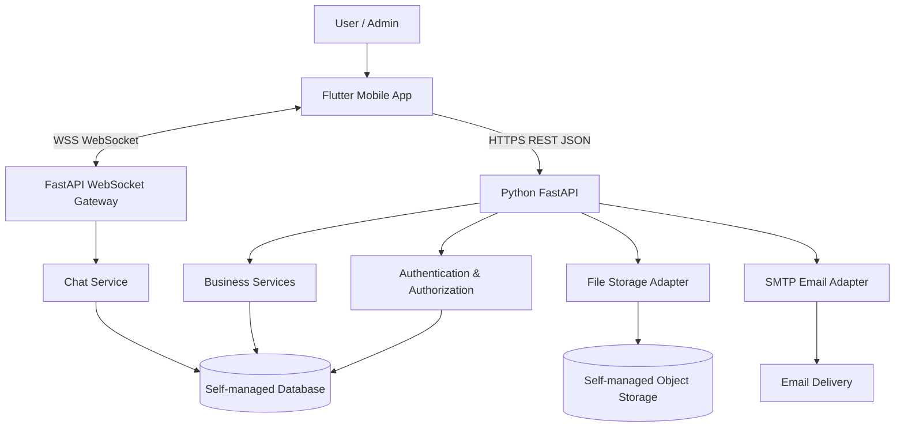

**Trách nhiệm:** Flutter hiển thị UI, validate sơ bộ, quản lý state/cache/outbox và gọi API; FastAPI xác thực, phân quyền, validate, điều phối nghiệp vụ, giao dịch DB, upload và chat; database lưu entity; storage do nhóm quản lý; Flutter upload và tải file qua API FastAPI, Backend mới được phép truy cập storage nội bộ bằng server-side adapter. SMTP (nếu có) chỉ là kênh vận chuyển email, không thay thế Backend – **[Bổ sung hợp lý / Giả định]**.

**Cấm:** Firebase Auth, Firestore, Realtime Database, Firebase Storage, Cloud Functions, Firebase Hosting hoặc Flutter truy cập trực tiếp database. Không dùng Cloudinary hoặc dịch vụ lưu trữ bên ngoài trong MVP mặc định; nếu nhóm muốn thay đổi, phải cập nhật ràng buộc và vẫn proxy toàn bộ luồng file qua FastAPI.

### 2.3. Công nghệ và ràng buộc

| **ID** | **Ràng buộc**                                                                      | **Trạng thái**                  |
| ------ | ---------------------------------------------------------------------------------- | ------------------------------- |
| `C-01` | Flutter stable; dùng provider, `image_picker`, dio hoặc http theo TASKS            | **[Nguồn TASKS]**               |
| `C-02` | Python + FastAPI; REST API và WebSocket                                            | Bắt buộc                        |
| `C-03` | Database tự quản lý; đề xuất PostgreSQL                                            | Đã chốt (`OQ-03`)               |
| `C-04` | Không Firebase/BaaS làm backend, auth, DB, real-time, file storage hoặc serverless | Bắt buộc                        |
| `C-05` | Không commit secret, password, private key, signing key hoặc token thật lên Git    | **[Nguồn TASKS]**               |
| `C-06` | MVP Android; APK qua GitHub Releases; không Google Play                            | **[Nguồn TASKS]**               |
| `C-07` | JSON UTF-8, datetime ISO-8601 UTC, tiền integer VND                                | **[Bổ sung hợp lý / Giả định]** |
| `C-08` | HTTPS staging/production; localhost cho dev                                        | **[Bổ sung hợp lý / Giả định]** |

### 2.4. Môi trường vận hành

- Android 7.0 (API 24)+ – **[Giữ từ SRS 0.1; TASKS chưa chốt min SDK]**.
- Tiếng Việt; tiền VND; múi giờ hiển thị Asia/Ho_Chi_Minh.
- Có Internet cho đồng bộ; offline hiển thị cache và outbox cho message; thao tác ghi khác phải thể hiện trạng thái chưa đồng bộ.
- Màn hình dọc, co giãn, cuộn được, không có RenderFlex overflow.

### 2.5. Giả định nền tảng

| **ID**   | **Nội dung**                                                                                                    | **Trạng thái**                                                       |
| -------- | --------------------------------------------------------------------------------------------------------------- | -------------------------------------------------------------------- |
| `ASM-01` | Email bất kỳ; trường học tự khai báo                                                                            | **[Giữ từ SRS 0.1]**, cả nhóm xác nhận                               |
| `ASM-02` | Email verification trước thao tác ghi                                                                           | Đã chốt (`OQ-02`): không bắt buộc; không dùng `PENDING_VERIFICATION` |
| `ASM-03` | PostgreSQL và migration có version                                                                              | Đã chốt (`OQ-03`)                                                    |
| `ASM-04` | Ảnh lưu storage nhóm quản lý; DB lưu metadata/storage key                                                       | **[Bổ sung hợp lý / Giả định]**                                      |
| `ASM-05` | Chat dùng WebSocket FastAPI; REST lấy lịch sử/đồng bộ                                                           | **[Bổ sung hợp lý / Giả định]**                                      |
| `ASM-06` | Guest xem read-only một phần nội dung để mở share link                                                          | **[Giữ từ OI-05 SRS 0.1]**, đã chốt (`OQ-01`)                        |
| `ASM-07` | Xác nhận giao dịch hai bên là căn cứ tối thiểu để mở review; không phải Order/Payment và không xác minh độc lập | Đã chốt (`OQ-07`)                                                    |
| `ASM-08` | Mỗi cặp Product + Buyer có một Conversation                                                                     | **[Giữ từ SRS 0.1]**, xác nhận với TASKS                             |

## 3. NỀN TẢNG VÀ TỔ CHỨC DỰ ÁN

[⬆ Về mục lục](#mục-lục)

### 3.1. Flutter foundation và UI Kit — TV2

- **`FR-FOUND-01` [Must, Nguồn TASKS]:** Khởi tạo Flutter project, feature-based, routing, state management và naming conventions.
- **`FR-FOUND-02` [Must, Nguồn TASKS]:** UI Kit chung gồm màu, typography, button, input, loading, empty, error, card/list.
- **`FR-FOUND-03` [Must, Nguồn TASKS]:** Cài package đã thống nhất provider, dio/http, `image_picker`; package mới cần review.
- **`FR-FOUND-04` [Must, Nguồn TASKS]:** Cả nhóm chạy cùng project/Flutter version, branch/PR mẫu.

#### Sequence – Khởi tạo nền tảng

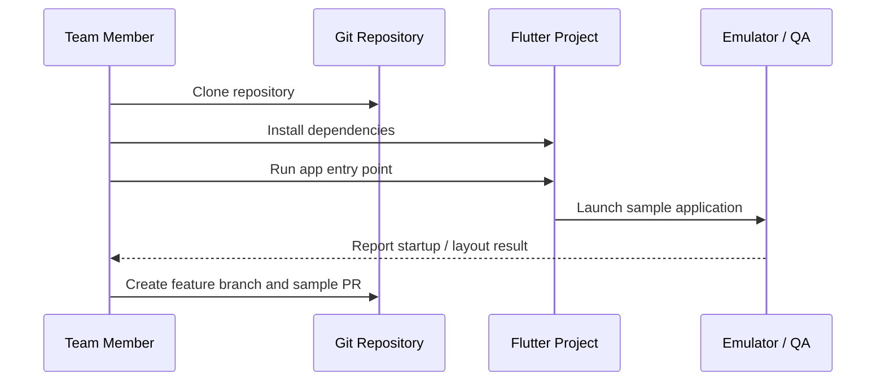

#### Acceptance Criteria

- `AC-FOUND-01`: Từng thành viên chạy app mẫu trên Emulator.
- `AC-FOUND-02`: Router, state management, theme và shared components được dùng chung.
- `AC-FOUND-03`: flutter analyze không có lỗi; PR có mô tả test và ảnh/video.
- `AC-FOUND-04`: Không chứa secret/API key thật trong repository.

### 3.2. FastAPI foundation, database và API Contract — TV1

- **`FR-CORE-01` [Must]:** FastAPI khởi động trong môi trường dev, có health endpoint và mẫu env config.
- **`FR-CORE-02` [Must]:** Database tự quản lý kết nối Backend; schema version hóa bằng migration.
- **`FR-CORE-03` [Must]:** API Contract mô tả endpoint, quyền, request/response, HTTP errors, pagination và upload.
- **`FR-CORE-04` [Must]:** TV1 công bố API Contract/JSON mẫu trước tích hợp Flutter.
- **`FR-CORE-05` [Must]:** Backend kiểm tra quyền ở server; ẩn nút UI không phải bảo mật.

#### Sequence – Flutter gọi FastAPI

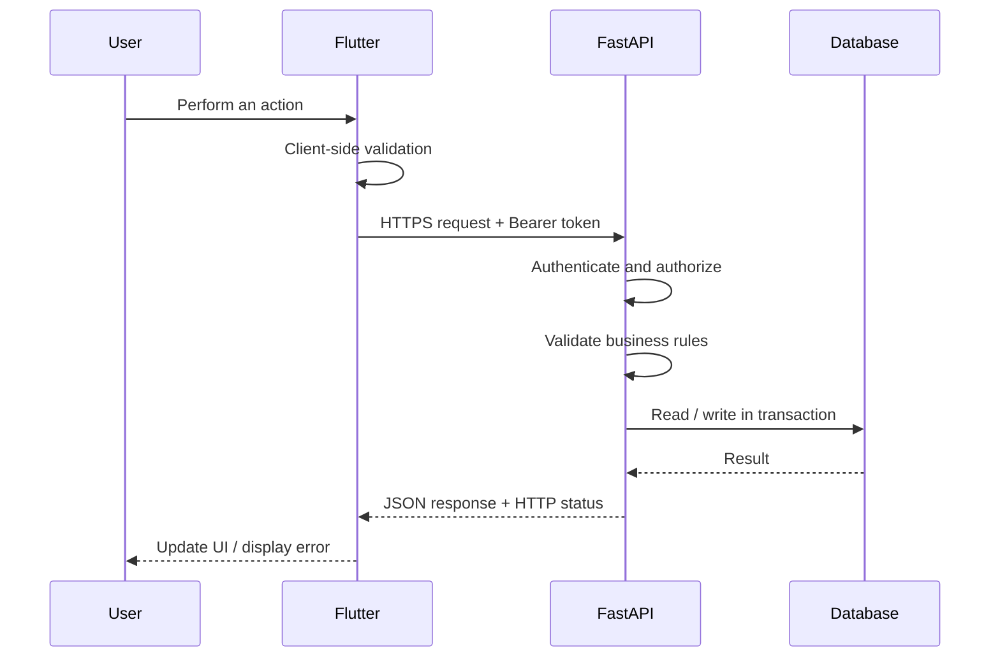

#### Acceptance Criteria

- `AC-CORE-01`: Flutter chỉ gọi host API, không kết nối DB/storage private trực tiếp.
- `AC-CORE-02`: Request sai schema bị FastAPI từ chối bằng error response chuẩn.
- `AC-CORE-03`: Thiếu/sai token trả `401`; không đủ quyền trả `403`.
- `AC-CORE-04`: API Contract và migration được quản lý trong Git; không có secret.

## 4. YÊU CẦU CHỨC NĂNG THEO MODULE

[⬆ Về mục lục](#mục-lục)

### 4.1. Xác thực và phiên đăng nhập — AUTH (TV1 + TV2)

#### 4.1.1. Functional Requirements

| **ID**       | **Yêu cầu**                                                       | **Ưu tiên** | **Nguồn**                                       |
| ------------ | ----------------------------------------------------------------- | ----------- | ----------------------------------------------- |
| `FR-AUTH-01` | Đăng ký tên hiển thị, email, mật khẩu, nhập lại mật khẩu          | **Must**    | **[Giữ từ SRS 0.1]**; TASKS chưa chi tiết       |
| `FR-AUTH-02` | Đăng nhập email/password; Backend cấp token và user info          | **Must**    | **[Nguồn TASKS]**                               |
| `FR-AUTH-03` | Duy trì phiên; endpoint lấy hồ sơ hiện tại                        | **Must**    | **[Nguồn TASKS]**                               |
| `FR-AUTH-04` | Refresh token hết hạn và xử lý refresh thất bại                   | **Must**    | **[Nguồn TASKS + bổ sung kỹ thuật]**            |
| `FR-AUTH-05` | Đăng xuất và thu hồi refresh session hiện tại                     | **Must**    | **[Nguồn TASKS về logout; thu hồi là bổ sung]** |
| `FR-AUTH-06` | Quên/đặt lại mật khẩu qua email                                   | **Should**  | **[Giữ từ SRS 0.1; cần xác nhận]**              |
| `FR-AUTH-07` | Email verification và kích hoạt tài khoản (tùy chọn, làm sau MVP) | **Could**   | **[Bổ sung hợp lý / Giả định]**                 |
| `FR-AUTH-08` | `BANNED` không được ghi; Flutter hiển thị lý do từ Backend        | **Must**    | **[Giữ từ SRS 0.1]**                            |
| `FR-AUTH-09` | Đổi mật khẩu khi đã đăng nhập                                     | **Could**   | **[Giữ từ SRS 0.1; chưa phải task rõ ràng]**    |

#### 4.1.2. Sequence – Đăng nhập / refresh

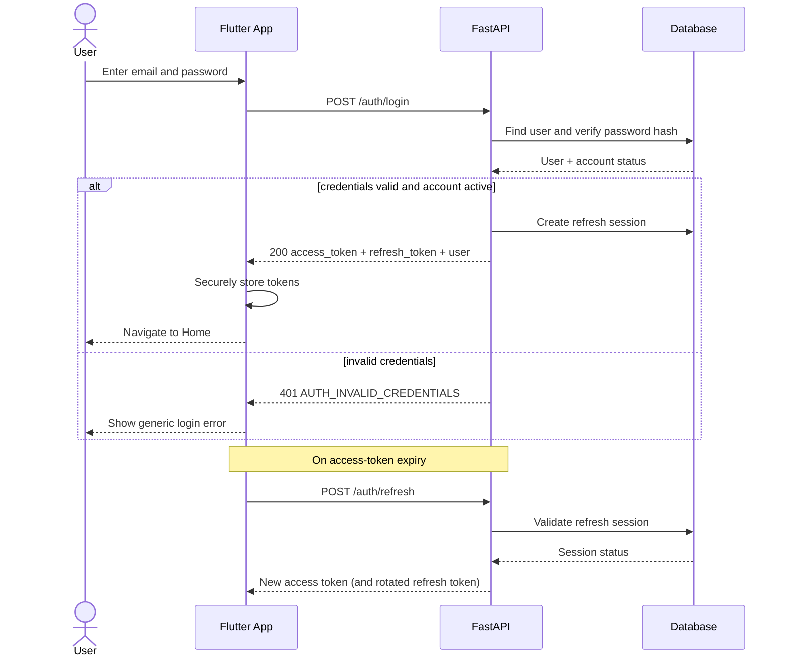

#### 4.1.3. Flowchart – Auth state

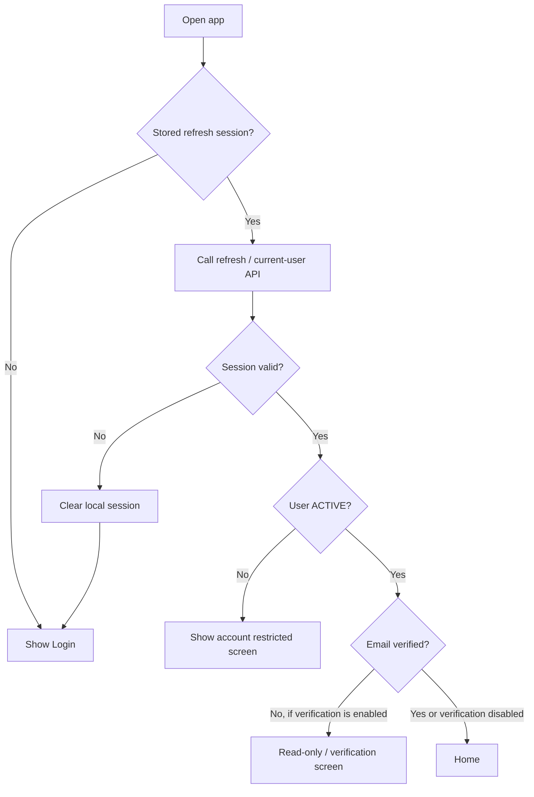

#### 4.1.4. API Contract

| **ID**        | **Method + Endpoint**               | **Auth**           | **Mục đích**                           |
| ------------- | ----------------------------------- | ------------------ | -------------------------------------- |
| `API-AUTH-01` | `POST /api/v1/auth/register`        | Public             | Tạo tài khoản                          |
| `API-AUTH-02` | `POST /api/v1/auth/login`           | Public             | Đăng nhập                              |
| `API-AUTH-03` | `POST /api/v1/auth/refresh`         | Refresh token      | Cấp access token mới                   |
| `API-AUTH-04` | `POST /api/v1/auth/logout`          | Bearer             | Thu hồi refresh session                |
| `API-AUTH-05` | `GET /api/v1/auth/me`               | Bearer             | User hiện tại                          |
| `API-AUTH-06` | `POST /api/v1/auth/password/forgot` | Public             | Gửi email reset                        |
| `API-AUTH-07` | `POST /api/v1/auth/password/reset`  | Reset token        | Đặt lại mật khẩu                       |
| `API-AUTH-08` | `POST /api/v1/auth/email/verify`    | Verification token | Xác minh email (tùy chọn, làm sau MVP) |

**Request – Register**

```json
{
  "display_name": "Nguyen Van A",
  "email": "a@example.com",
  "password": "Example123",
  "password_confirmation": "Example123"
}
```

**Response `201` – Register**

```json
{
  "data": {
    "user": {
      "id": "usr_01JABC123",
      "display_name": "Nguyen Van A",
      "email": "a@example.com",
      "status": "ACTIVE",
      "role": "USER",
      "email_verified": false,
      "created_at": "2026-11-27T03:00:00Z"
    },
    "verification_required": false
  },
  "meta": {}
}
```

**Request – Login**

```json
{
  "email": "a@example.com",
  "password": "Example123"
}
```

**Response `200` – Login**

```json
{
  "data": {
    "access_token": "<jwt-access-token>",
    "token_type": "Bearer",
    "expires_in": 900,
    "refresh_token": "<opaque-refresh-token>",
    "refresh_expires_at": "2026-12-27T03:00:00Z",
    "user": {
      "id": "usr_01JABC123",
      "display_name": "Nguyen Van A",
      "role": "USER",
      "status": "ACTIVE",
      "email_verified": true
    }
  },
  "meta": {}
}
```

**Request – Refresh**

```json
{
  "refresh_token": "<opaque-refresh-token>"
}
```

**Response `200` – Refresh**

```json
{
  "data": {
    "access_token": "<new-jwt-access-token>",
    "token_type": "Bearer",
    "expires_in": 900,
    "refresh_token": "<rotated-refresh-token>"
  },
  "meta": {}
}
```

**Request – Logout**

```json
{
  "refresh_token": "<opaque-refresh-token>"
}
```

Response: `204`, không body.

**Request – Forgot password**

```json
{
  "email": "a@example.com"
}
```

**Response 202 – Forgot password**

```json
{
  "data": {
    "message": "Nếu email hợp lệ, hướng dẫn đặt lại mật khẩu sẽ được gửi."
  },
  "meta": {}
}
```

**Request – Reset password**

```json
{
  "reset_token": "<single-use-reset-token>",
  "new_password": "NewExample456",
  "password_confirmation": "NewExample456"
}
```

**Response `200` – Reset password**

```json
{
  "data": {
    "password_reset": true
  },
  "meta": {}
}
```

**Request – Verify email**

```json
{
  "verification_token": "<single-use-verification-token>"
}
```

**Response `200` – Verify email**

```json
{
  "data": {
    "email_verified": true,
    "status": "ACTIVE"
  },
  "meta": {}
}
```

**Lỗi:** `401` `AUTH_INVALID_CREDENTIALS` khi sai credentials hoặc token không hợp lệ; `403` `ACCOUNT_BANNED` / `EMAIL_NOT_VERIFIED`; `404` `AUTH_USER_NOT_FOUND` khi có target user; `409` `AUTH_EMAIL_EXISTS` khi email đăng ký đã tồn tại; `422` `VALIDATION_ERROR`. `404` `AUTH_USER_NOT_FOUND` khi có target user; `422` `VALIDATION_ERROR`; email trùng register trả `409` `AUTH_EMAIL_EXISTS` – **[Bổ sung hợp lý / Giả định]**. Response Error Envelope xem mục 8.2.

| **Trường**              | **Kiểu**          | **Bắt buộc** | **Quy tắc**                                                         |
| ----------------------- | ----------------- | ------------ | ------------------------------------------------------------------- |
| `display_name`          | string            | Required     | 2–50 ký tự sau trim – **[Giữ từ SRS 0.1]**                          |
| email                   | string            | Required     | Email hợp lệ; normalize lowercase – **[Bổ sung hợp lý / Giả định]** |
| password                | string            | Required     | Tối thiểu 8 ký tự, chữ và số – **[Giữ từ SRS 0.1; cần duyệt]**      |
| `password_confirmation` | string            | Required     | Phải trùng password; không lưu                                      |
| `expires_in`            | int               | Response     | Thời hạn access token (giây)                                        |
| `email_verified`        | boolean           | Response     | Trạng thái xác minh                                                 |
| `created_at`            | datetime ISO-8601 | Response     | UTC, hậu tố Z                                                       |

**Token policy (đã chốt `OQ-04`):** access token 15 phút; refresh token opaque, lưu hash trong DB, xoay vòng mỗi lần refresh; logout thu hồi session hiện tại. Refresh token 30 ngày; reset mật khẩu thu hồi toàn bộ refresh session. Không lưu password/refresh token dạng plaintext trong Flutter; dùng secure storage thay vì SharedPreferences thuần.

#### 4.1.5. Wireframe – Đăng nhập

```text
+----------------------------------+
|          CHO DO CU SV             |
|----------------------------------|
| Email                            |
| [ a@example.com               ]  |
| Mat khau                         |
| [ **************              ]  |
| [          DANG NHAP           ] |
| Quen mat khau?                   |
| Chua co tai khoan? Dang ky       |
+----------------------------------+
```

| **Thành phần / Nút** | **Loại UI** | **Hành vi & API**                                       |
| -------------------- | ----------- | ------------------------------------------------------- |
| Email                | Input       | Validate; submit gọi POST /auth/login                   |
| Mật khẩu             | Input       | Ẩn ký tự; không log                                     |
| Đăng nhập            | Button      | `API-AUTH-02`; `200` vào Home, `401` hiển thị lỗi chung |
| Quên mật khẩu        | Link/Button | Mở form; `API-AUTH-06`                                  |
| Đăng ký              | Link/Button | Mở form; `API-AUTH-01`                                  |

#### 4.1.6. Acceptance Criteria

- `AC-AUTH-01`: Register validate tên/email/password/confirmation; lỗi hiện đúng field.
- `AC-AUTH-02`: Email trùng không tạo user trùng; không lộ thông tin tài khoản ngoài mức cần thiết.
- `AC-AUTH-03`: Sai email/password trả thông báo tổng quát, không tiết lộ tài khoản tồn tại.
- `AC-AUTH-04`: Token hết hạn được refresh một lần; refresh thất bại thì xóa session và về Login.
- `AC-AUTH-05`: Nhiều request cùng gặp `401` không tạo nhiều refresh đồng thời (single-flight) – **[Bổ sung hợp lý / Giả định]**.
- `AC-AUTH-06`: Logout thu hồi session ở Backend và xóa cache riêng tư.
- `AC-AUTH-07`: `BANNED` bị chặn write; API trả `403` `ACCOUNT_BANNED` và lý do nếu có.
- `AC-AUTH-08`: Nếu bật email verification, write của user chưa verified trả `403` `EMAIL_NOT_VERIFIED`.
- `AC-AUTH-09`: Reset token dùng một lần và có expiry – **[Bổ sung hợp lý / Giả định]**.

### 4.2. Hồ sơ người dùng và quyền riêng tư — PROFILE (TV1 + TV3)

#### 4.2.1. Functional Requirements

| **ID**          | **Yêu cầu**                                                                                               | **Ưu tiên** | **Nguồn**                                       |
| --------------- | --------------------------------------------------------------------------------------------------------- | ----------- | ----------------------------------------------- |
| `FR-PROFILE-01` | Xem hồ sơ của mình: avatar, tên, email riêng, trường/cơ sở, giới thiệu, khu vực mặc định, ngày tham gia   | **Must**    | **[Giữ từ SRS 0.1]**                            |
| `FR-PROFILE-02` | Sửa avatar, tên, trường, giới thiệu, khu vực mặc định                                                     | **Must**    | **[Nguồn TASKS về hồ sơ; chi tiết từ SRS 0.1]** |
| `FR-PROFILE-03` | Hồ sơ công khai hiển thị tên, avatar, trường tự khai báo, ngày tham gia, thống kê review và tin công khai | **Must**    | **[Giữ từ SRS 0.1]**                            |
| `FR-PROFILE-04` | Không trả email hoặc dữ liệu nhạy cảm trong API public                                                    | **Must**    | **[Nguồn TASKS – privacy]**                     |

#### Sequence – Xem / sửa hồ sơ

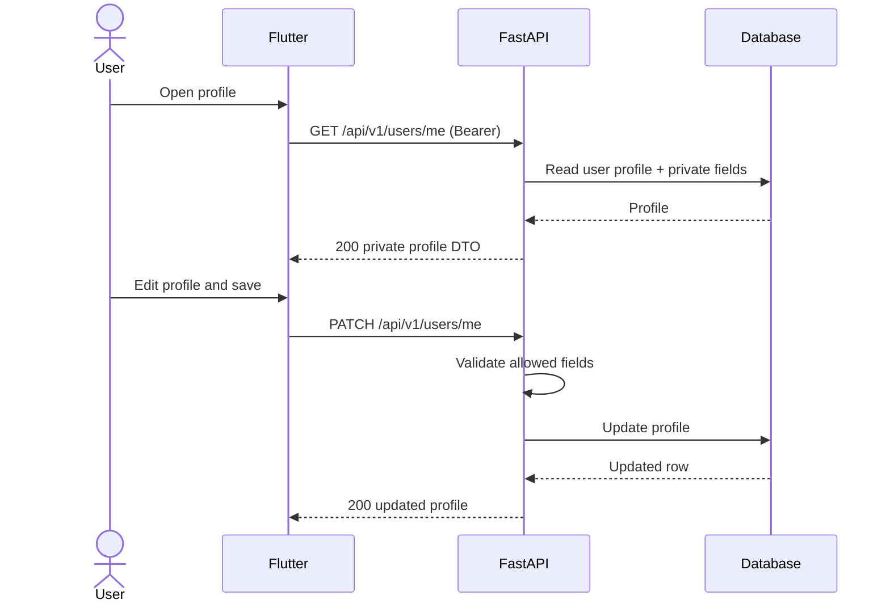

#### API Contract

| **ID**           | **Method + Endpoint**         | **Auth**           | **Mục đích**    |
| ---------------- | ----------------------------- | ------------------ | --------------- |
| `API-PROFILE-01` | `GET /api/v1/users/me`        | Bearer             | Hồ sơ của mình  |
| `API-PROFILE-02` | `PATCH /api/v1/users/me`      | Bearer             | Cập nhật hồ sơ  |
| `API-PROFILE-03` | `GET /api/v1/users/{user_id}` | Public hoặc Bearer | Hồ sơ công khai |

**Request – `API-PROFILE-02`**

```json
{
  "display_name": "Nguyen Van A",
  "school": "Truong Dai hoc A",
  "bio": "Sinh vien, co mot so mon do can thanh ly.",
  "default_area": "Khu vuc Thu Duc",
  "avatar_file_id": "fil_01JAVATAR"
}
```

**Response `200` – `API-PROFILE-02`**

```json
{
  "data": {
    "id": "usr_01JABC123",
    "display_name": "Nguyen Van A",
    "school": "Truong Dai hoc A",
    "school_disclaimer": "Thong tin do nguoi dung tu khai bao",
    "bio": "Sinh vien, co mot so mon do can thanh ly.",
    "default_area": "Khu vuc Thu Duc",
    "avatar_url": "https://api.example.invalid/api/v1/files/fil_01JAVATAR/content",
    "created_at": "2026-11-20T10:00:00Z"
  },
  "meta": {}
}
```

**Response `200` – `API-PROFILE-03` (Public DTO)**

```json
{
  "data": {
    "id": "usr_01JABC123",
    "display_name": "Nguyen Van A",
    "avatar_url": "https://api.example.invalid/api/v1/files/fil_01JAVATAR/content",
    "school": "Truong Dai hoc A",
    "school_disclaimer": "Tu khai bao",
    "bio": "Sinh vien",
    "created_at": "2026-11-20T10:00:00Z",
    "review_average": 4.7,
    "review_count": 12,
    "completed_confirmations_count": 9,
    "products": []
  },
  "meta": {}
}
```

GET không có request body. Lỗi: `400` `PROFILE_INVALID_DATA`; `401` `AUTH_REQUIRED`; `404` `USER_NOT_FOUND`; `422` `VALIDATION_ERROR`. Public endpoint tuyệt đối không trả email, password hash, refresh token, private address hoặc nội dung chat.

| **Trường**       | **Kiểu**          | **Bắt buộc**     | **Validate**                      |
| ---------------- | ----------------- | ---------------- | --------------------------------- |
| `display_name`   | string            | Optional ở PATCH | 2–50 ký tự sau trim               |
| school           | string            | Optional         | Tối đa 80 ký tự                   |
| bio              | string            | Optional         | Tối đa 200 ký tự                  |
| `default_area`   | string            | Optional         | 2–60 ký tự; chỉ khu vực tổng quát |
| `avatar_file_id` | string            | Optional         | File ID hợp lệ do API upload cấp  |
| `review_average` | float             | Response         | 0.0–5.0; làm tròn 1 chữ số        |
| `review_count`   | int               | Response         | \>= 0                             |
| `created_at`     | datetime ISO-8601 | Response         | UTC                               |

#### Wireframe – Hồ sơ cá nhân / chỉnh sửa

```text
+----------------------------------+
| <  CA NHAN                       |
|----------------------------------|
|          ( AVATAR )              |
|       Nguyen Van A               |
|       a***@example.com           |
|----------------------------------|
| Truong: [Truong Dai hoc A     ]  |
| Gioi thieu:                      |
| [ Sinh vien...                 ] |
| Khu vuc: [Khu vuc Thu Duc      ] |
|                                  |
| [          LUU THAY DOI         ] |
|----------------------------------|
| Tin cua toi | Da luu | Bao cao   |
+----------------------------------+
```

| **Thành phần / Nút**   | **Loại UI**  | **Hành vi & API**                                         |
| ---------------------- | ------------ | --------------------------------------------------------- |
| Avatar                 | Image/Button | Chọn ảnh, upload qua `API-FILE-01`; nhận `avatar_file_id` |
| Tên/Trường/Bio/Khu vực | Input        | Validate; chỉ sửa các field cho phép                      |
| Lưu thay đổi           | Button       | PATCH /users/me                                           |
| Tin của tôi            | Tab          | GET /users/me/products                                    |
| Đã lưu                 | Tab          | GET /me/wishlist                                          |
| Báo cáo của tôi        | Tab          | GET /me/reports                                           |

#### Acceptance Criteria

- `AC-PROFILE-01`: User chỉ xem/sửa hồ sơ của mình qua /users/me.
- `AC-PROFILE-02`: Server từ chối field role, status, email, `created_at` nếu client gửi trong PATCH.
- `AC-PROFILE-03`: Public profile không chứa email hoặc trường private.
- `AC-PROFILE-04`: Avatar chỉ nhận JPG/PNG/WebP; lỗi upload không làm mất form.
- `AC-PROFILE-05`: `BANNED` không được ghi; policy đọc hồ sơ của chính mình phải thống nhất ở Backend.

### 4.3. Khám phá sản phẩm, tìm kiếm và chi tiết — BROWSE (TV1 + TV2)

#### 4.3.1. Functional Requirements

| **ID**         | **Yêu cầu**                                                                                                | **Ưu tiên** | **Nguồn**                       |
| -------------- | ---------------------------------------------------------------------------------------------------------- | ----------- | ------------------------------- |
| `FR-BROWSE-01` | Trang chủ hiển thị Product `AVAILABLE`, mới nhất trước, phân trang và kéo để làm mới                       | **Must**    | **[Giữ từ SRS 0.1]**            |
| `FR-BROWSE-02` | Lọc danh mục                                                                                               | **Must**    | **[Nguồn TASKS]**               |
| `FR-BROWSE-03` | Tìm theo từ khóa tiêu đề                                                                                   | **Must**    | **[Nguồn TASKS]**               |
| `FR-BROWSE-04` | Lọc khoảng giá, tình trạng, chỉ đồ cho tặng                                                                | **Should**  | **[Giữ từ SRS 0.1; cần duyệt]** |
| `FR-BROWSE-05` | Sắp xếp mới nhất/giá tăng/giá giảm                                                                         | **Should**  | **[Giữ từ SRS 0.1; cần duyệt]** |
| `FR-BROWSE-06` | Chi tiết gồm ảnh, giá, tiêu đề, condition, category, mô tả, khu vực, người bán, Chat/Wishlist/Share/Report | **Must**    | **[Nguồn TASKS]**               |
| `FR-BROWSE-07` | Product của mình thay nút Chat bằng Quản lý tin                                                            | **Must**    | **[Giữ từ SRS 0.1]**            |
| `FR-BROWSE-08` | Product `SOLD` hiển thị nhãn và không cho tạo chat mới                                                     | **Must**    | **[Giữ từ SRS 0.1]**            |
| `FR-BROWSE-09` | Product `HIDDEN`/`BLOCKED`/`DELETED` không xuất hiện trong public browse; link báo không khả dụng          | **Must**    | **[Giữ từ SRS 0.1]**            |

#### Sequence – Tìm kiếm và xem chi tiết

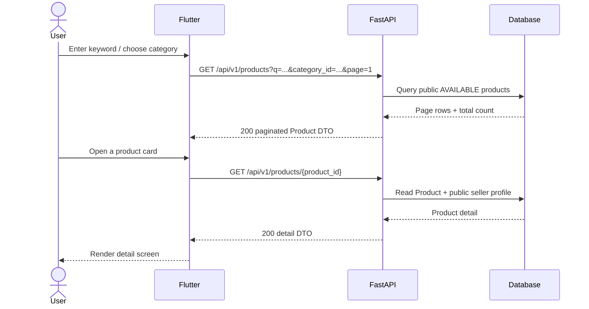

#### API Contract

| **ID**          | **Method + Endpoint**                  | **Auth** | **Mục đích**                  |
| --------------- | -------------------------------------- | -------- | ----------------------------- |
| `API-BROWSE-01` | `GET /api/v1/categories`               | Public   | Danh mục active               |
| `API-BROWSE-02` | `GET /api/v1/products`                 | Public   | List/search/filter/pagination |
| `API-BROWSE-03` | `GET /api/v1/products/{product_id}`    | Public   | Product detail                |
| `API-BROWSE-04` | `GET /api/v1/users/{user_id}/products` | Public   | Product public của seller     |

**Request – `API-BROWSE-02` (query, không body)**

```http
GET /api/v1/products?q=giao%20trinh&category_id=cat_books&page=1&page_size=20&sort=created_desc
Authorization: Bearer <access-token-if-signed-in>
```

**Response `200` – `API-BROWSE-02`**

```json
{
  "data": [
    {
      "id": "prd_01JPRODUCT1",
      "title": "Giao trinh Giai tich 1",
      "price_vnd": 45000,
      "condition": "GOOD",
      "category": {"id": "cat_books", "name": "Sach & giao trinh"},
      "cover_image_url": "https://api.example.invalid/api/v1/files/fil_01JIMAGE123/content",
      "area": "Thu Duc",
      "seller": {"id": "usr_01JABC123", "display_name": "Nguyen Van A", "avatar_url": null},
      "status": "AVAILABLE",
      "created_at": "2026-11-27T02:30:00Z"
    }
  ],
  "meta": {"page": 1, "page_size": 20, "total_items": 1, "total_pages": 1}
}
```

**Request – `API-BROWSE-03`:** Không body; path `product_id` kiểu string.

**Response `200` – `API-BROWSE-03`**

```json
{
  "data": {
    "id": "prd_01JPRODUCT1",
    "seller_id": "usr_01JABC123",
    "title": "Giao trinh Giai tich 1",
    "description": "Sach con tot, co ghi chu mot so trang.",
    "price_vnd": 45000,
    "negotiable": true,
    "condition": "GOOD",
    "category": {"id": "cat_books", "name": "Sach & giao trinh"},
    "area": "Thu Duc",
    "images": [{"id": "img_01", "url": "https://api.example.invalid/api/v1/files/fil_01JIMAGE123/content", "position": 0}],
    "status": "AVAILABLE",
    "seller": {"id": "usr_01JABC123", "display_name": "Nguyen Van A", "avatar_url": null, "school": "Truong Dai hoc A", "review_average": 4.7, "review_count": 12},
    "created_at": "2026-11-27T02:30:00Z",
    "updated_at": "2026-11-27T02:30:00Z"
  },
  "meta": {}
}
```

Lỗi: `400` `PRODUCT_QUERY_INVALID`; `401` chỉ khi endpoint yêu cầu auth theo cấu hình; `404` `PRODUCT_NOT_FOUND`/`PRODUCT_UNAVAILABLE`; `422` `VALIDATION_ERROR`.

| **Query/field**          | **Kiểu**          | **Required** | **Quy tắc**                                                  |
| ------------------------ | ----------------- | ------------ | ------------------------------------------------------------ |
| q                        | string            | Optional     | Trim, 1–100 ký tự; tìm trong title                           |
| `category_id`            | string            | Optional     | Category tồn tại và active                                   |
| page                     | int               | Optional     | Mặc định 1, min 1                                            |
| `page_size`              | int               | Optional     | Mặc định 20, min 1, max 50 – **[Bổ sung hợp lý / Giả định]** |
| sort                     | enum string       | Optional     | `created_desc`, `price_asc`, `price_desc`                    |
| `min_price`, `max_price` | int               | Optional     | 0–100.000.000 VND (`OQ-12`)                                  |
| condition                | enum string       | Optional     | NEW, `LIKE_NEW`, GOOD, FAIR, POOR                            |
| `created_at`             | datetime ISO-8601 | Response     | UTC                                                          |

#### Flowchart – Quy tắc hiển thị Product

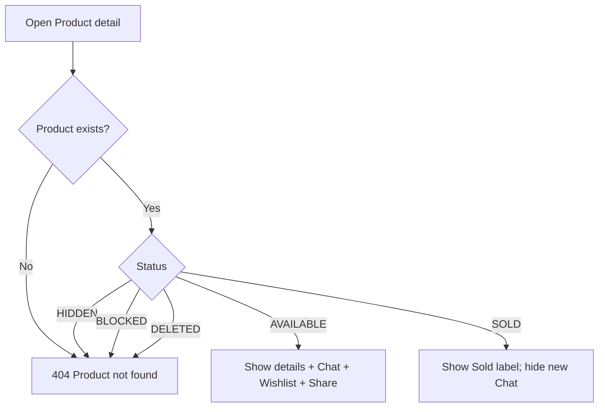

#### Wireframe – Trang chủ / tìm kiếm

```text
+----------------------------------+
| CHO DO CU SV              (Bell) |
| [ Tim theo ten san pham       ]  |
| [Tat ca] [Sach] [Dien tu] [Khac] |
|----------------------------------|
| +------------------------------+ |
| | [IMG] Giao trinh Giai tich   | |
| |       45.000 d   [♡]         | |
| |       Thu Duc                | |
| +------------------------------+ |
| +------------------------------+ |
| | [IMG] Den ban                 | |
| |       80.000 d   [♡]         | |
| |       Binh Thanh             | |
| +------------------------------+ |
|----------------------------------|
| [Home] [Dang tin] [Tin nhan] [Toi]|
+----------------------------------+
```

| **Thành phần / Nút**   | **Loại UI**   | **Hành vi & API**                                                         |
| ---------------------- | ------------- | ------------------------------------------------------------------------- |
| Ô tìm kiếm             | Input         | Debounce 300–500ms – **[Bổ sung hợp lý / Giả định]**; gọi `API-BROWSE-02` |
| Chip danh mục          | Filter chips  | `API-BROWSE-02` với `category_id`                                         |
| Bộ lọc nâng cao        | Bottom sheet  | `API-BROWSE-02` với giá/condition nếu **Should** được duyệt               |
| Thẻ Product            | Card/List     | Chạm gọi `API-BROWSE-03`                                                  |
| Wishlist heart         | Button        | PUT/DELETE wishlist; optimistic update/rollback                           |
| Bottom navigation      | Navigation    | Home/Post/Chat/Profile                                                    |
| Pull refresh/load more | List behavior | `API-BROWSE-02` với pagination                                            |

#### Wireframe – Chi tiết sản phẩm

```text
+----------------------------------+
| <  CHI TIET SAN PHAM        [⋮]  |
|----------------------------------|
|        [  IMAGE CAROUSEL  ]      |
|            (1/4)                 |
|  Giao trinh Giai tich 1          |
|  45.000 d        [Co thuong luong]|
|  Tinh trang: Tot                 |
|  Danh muc: Sach & giao trinh     |
|----------------------------------|
| Mo ta:                           |
| Sach con tot, co ghi chu...      |
| Khu vuc giao dich: Thu Duc       |
|----------------------------------|
| (Avatar) Nguyen Van A   ★ 4.7    |
| [ Xem ho so nguoi ban ]          |
|----------------------------------|
| [Nhan tin] [♡] [Chia se]         |
+----------------------------------+
```

| **Thành phần / Nút** | **Loại UI** | **Hành vi & API**                                                                  |
| -------------------- | ----------- | ---------------------------------------------------------------------------------- |
| Gallery              | Carousel    | Dùng images[]; chạm mở viewer                                                      |
| Nhắn tin             | Button      | Nếu seller khác và Product `AVAILABLE`: POST /conversations; `SOLD` thì ẩn/disable |
| Wishlist             | Button      | PUT/DELETE /me/wishlist/{`product_id`}                                             |
| Chia sẻ              | Button      | GET `API-SHARE-01`, mở native share sheet                                          |
| Hồ sơ seller         | Link        | GET /users/{`user_id`}                                                             |
| Báo cáo              | Menu item   | POST /reports/products sau form                                                    |
| Quản lý tin          | Button      | Chỉ owner; điều hướng quản lý                                                      |

#### Acceptance Criteria

- `AC-BROWSE-01`: Trang đầu có loading/success/empty/error; tải theo trang, không lấy toàn bộ dữ liệu.
- `AC-BROWSE-02`: Public DTO không có email/private address.
- `AC-BROWSE-03`: Keyword tìm trong title, không phân biệt hoa/thường; không dấu nếu normalization được duyệt – **[Bổ sung hợp lý / Giả định]**.
- `AC-BROWSE-04`: Filter gửi đến Backend; Flutter không giả lập kết quả toàn cục từ phần dữ liệu đã tải.
- `AC-BROWSE-05`: Product của mình không có Chat; Product `SOLD` không tạo Conversation mới.
- `AC-BROWSE-06`: `HIDDEN`/`BLOCKED`/`DELETED` không xuất hiện public; deep link báo không khả dụng.
- `AC-BROWSE-07`: Lỗi mạng tải trang sau không xóa dữ liệu đã tải; có Retry.

### 4.4. Đăng tin, quản lý tin và upload ảnh — PRODUCT (TV1 + TV3)

#### Functional Requirements

| **ID**          | **Yêu cầu**                                                                    | **Ưu tiên** | **Nguồn**                                                |
| --------------- | ------------------------------------------------------------------------------ | ----------- | -------------------------------------------------------- |
| `FR-PRODUCT-01` | Đăng tin gồm ảnh, tiêu đề, giá, danh mục, tình trạng, mô tả, khu vực giao dịch | **Must**    | **[Nguồn TASKS]**                                        |
| `FR-PRODUCT-02` | Chọn/chụp nhiều ảnh; sắp xếp; ảnh đầu là cover                                 | **Must**    | **[Giữ từ SRS 0.1]**                                     |
| `FR-PRODUCT-03` | Sửa tin của mình                                                               | **Must**    | **[Nguồn TASKS]**                                        |
| `FR-PRODUCT-04` | Ẩn/hiện lại tin                                                                | **Must**    | **[Nguồn TASKS]**                                        |
| `FR-PRODUCT-05` | Đánh dấu `SOLD` thủ công khi bán ngoài app                                     | **Must**    | **[Nguồn TASKS]**                                        |
| `FR-PRODUCT-06` | Xóa tin theo soft delete                                                       | **Must**    | **[Nguồn TASKS về xóa; soft delete là bổ sung an toàn]** |
| `FR-PRODUCT-07` | Danh sách Tin của tôi, sửa/xóa/ẩn/đã bán                                       | **Must**    | **[Nguồn TASKS]**                                        |
| `FR-PRODUCT-08` | Tin bị Admin gỡ hiển thị trạng thái/lý do; owner không tự bật lại              | **Must**    | **[Giữ từ SRS 0.1]**, gắn Admin task                     |
| `FR-PRODUCT-09` | Upload qua FastAPI; server kiểm tra file type/dung lượng                       | **Must**    | **[Nguồn TASKS + kiến trúc]**                            |

#### Sequence – Đăng Product và upload

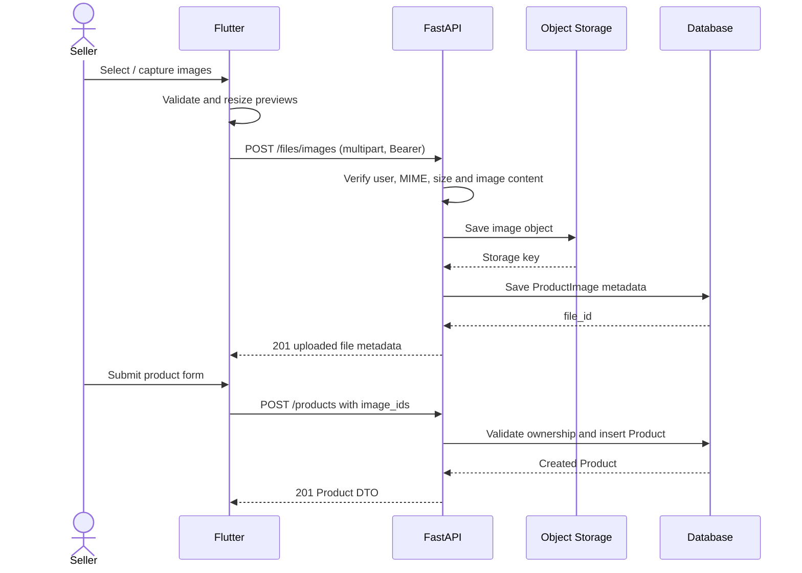

#### State diagram – Product lifecycle

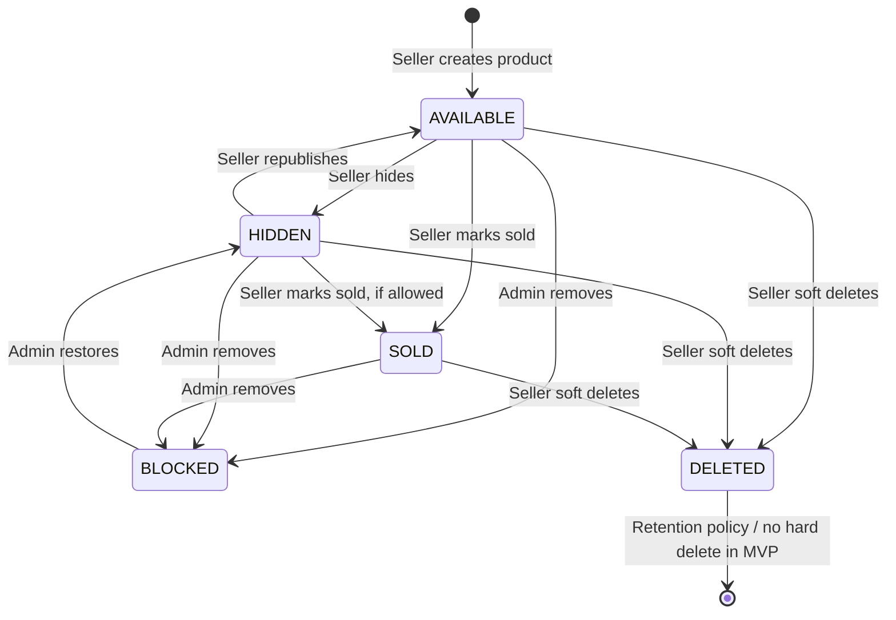

`BLOCKED` -\> `HIDDEN` sau restore giúp owner tự publish lại – **[Giữ từ SRS 0.1]**. `RESERVED` bị bỏ vì TASKS không có task tương ứng.

#### API Contract

| **ID**           | **Method + Endpoint**                          | **Auth**                                               | **Mục đích**                                                      |
| ---------------- | ---------------------------------------------- | ------------------------------------------------------ | ----------------------------------------------------------------- |
| `API-FILE-01`    | `POST /api/v1/files/images`                    | Bearer                                                 | Upload ảnh                                                        |
| `API-FILE-02`    | `DELETE /api/v1/files/{file_id}`               | Bearer + owner                                         | Xóa file tạm chưa gắn Product – **[Bổ sung hợp lý / Giả định]**   |
| `API-FILE-03`    | `GET /api/v1/files/{file_id}/content`          | Public nếu file public; nếu private thì Bearer + quyền | Stream file qua FastAPI; Flutter không truy cập Storage trực tiếp |
| `API-PRODUCT-01` | `POST /api/v1/products`                        | Bearer                                                 | Tạo tin                                                           |
| `API-PRODUCT-02` | `PATCH /api/v1/products/{product_id}`          | Bearer + Owner                                         | Sửa tin                                                           |
| `API-PRODUCT-03` | `POST /api/v1/products/{product_id}/hide`      | Bearer + Owner                                         | Ẩn                                                                |
| `API-PRODUCT-04` | `POST /api/v1/products/{product_id}/publish`   | Bearer + Owner                                         | Hiện lại                                                          |
| `API-PRODUCT-05` | `POST /api/v1/products/{product_id}/mark-sold` | Bearer + Owner                                         | Đánh dấu `SOLD`                                                   |
| `API-PRODUCT-06` | `DELETE /api/v1/products/{product_id}`         | Bearer + Owner                                         | Soft delete                                                       |
| `API-PRODUCT-07` | `GET /api/v1/users/me/products`                | Bearer                                                 | Tin của tôi                                                       |

**Request – `API-FILE-01`:** multipart/form-data, field file kiểu binary, Header Bearer; không gửi JSON. FastAPI kiểm tra file và ghi vào storage server-side.

**`API-FILE-03`:** GET không có body; thành công trả bytes của ảnh với Content-Type: image/jpeg\|image/png\|image/webp, Cache-Control phù hợp và ETag nếu được hỗ trợ. Flutter chỉ tải ảnh từ URL FastAPI dạng `/api/v1/files/{file_id}/content`; tuyệt đối không nhận storage key hoặc URL nội bộ để gọi trực tiếp.

**Response `201` – `API-FILE-01`**

```json
{
  "data": {
    "id": "fil_01JIMAGE123",
    "file_name": "product_01.webp",
    "mime_type": "image/webp",
    "size_bytes": 420000,
    "width": 1280,
    "height": 960,
    "status": "TEMPORARY",
    "created_at": "2026-11-27T03:15:00Z"
  },
  "meta": {}
}
```

**Request – `API-PRODUCT-01`**

```json
{
  "title": "Giao trinh Giai tich 1",
  "description": "Sach con tot, co ghi chu mot so trang.",
  "price_vnd": 45000,
  "category_id": "cat_books",
  "condition": "GOOD",
  "area": "Thu Duc",
  "negotiable": true,
  "image_ids": ["fil_01JIMAGE123", "fil_01JIMAGE124"]
}
```

**Response `201` – `API-PRODUCT-01`**

```json
{
  "data": {
    "id": "prd_01JPRODUCT1",
    "seller_id": "usr_01JABC123",
    "title": "Giao trinh Giai tich 1",
    "price_vnd": 45000,
    "category_id": "cat_books",
    "condition": "GOOD",
    "area": "Thu Duc",
    "negotiable": true,
    "status": "AVAILABLE",
    "images": [
      {"id": "img_01", "url": "https://api.example.invalid/api/v1/files/fil_01JIMAGE123/content", "position": 0},
      {"id": "img_02", "url": "https://api.example.invalid/api/v1/files/fil_01JIMAGE124/content", "position": 1}
    ],
    "created_at": "2026-11-27T03:20:00Z"
  },
  "meta": {}
}
```

**Request – `API-PRODUCT-02` (PATCH)**

```json
{
  "title": "Giao trinh Giai tich 1 - ban moi",
  "description": "Mo ta da cap nhat.",
  "price_vnd": 40000,
  "image_ids": ["fil_01JIMAGE123", "fil_01JIMAGE125"]
}
```

**Response `200` – `API-PRODUCT-02`**

```json
{
  "data": {
    "id": "prd_01JPRODUCT1",
    "title": "Giao trinh Giai tich 1 - ban moi",
    "price_vnd": 40000,
    "status": "AVAILABLE",
    "updated_at": "2026-11-27T03:30:00Z"
  },
  "meta": {}
}
```

**Request – `API-PRODUCT-03`/04/05:**

```json
{
  "reason": "Seller action from My Products screen"
}
```

optional. Server không tin `seller_id`, status, `created_at` do client gửi.

**Response `200` – status action**

```json
{
  "data": {
    "id": "prd_01JPRODUCT1",
    "status": "SOLD",
    "updated_at": "2026-11-27T03:35:00Z"
  },
  "meta": {}
}
```

**Response `200` – `API-PRODUCT-06`:**

```json
{
  "data": {
    "id": "prd_01JPRODUCT1",
    "status": "DELETED"
  },
  "meta": {}
}
```

khi triển khai phải chốt response `200` hoặc `204`, không dùng lẫn.

**Lỗi:** `400` `PRODUCT_STATE_CONFLICT`; `401` `AUTH_REQUIRED`; `404` `PRODUCT_NOT_FOUND`; `422` `VALIDATION_ERROR`; owner khác nhận `403` `PRODUCT_FORBIDDEN`; file sai trả `422` `FILE_INVALID`; file quá dung lượng trả `413` `FILE_TOO_LARGE`.

| **Field**     | **Kiểu**      | **Required**                     | **Quy tắc**                                                   |
| ------------- | ------------- | -------------------------------- | ------------------------------------------------------------- |
| title         | string        | Required create / Optional patch | 5–100 ký tự – **[Giữ từ SRS 0.1]**                            |
| description   | string        | Required create / Optional patch | 10–2000 ký tự (`OQ-12`)                                       |
| `price_vnd`   | int           | Required create / Optional patch | 0–100.000.000; số nguyên; 0 = Cho tặng – **[Giữ từ SRS 0.1]** |
| `category_id` | string        | Required create                  | Category tồn tại và active                                    |
| condition     | enum string   | Required create                  | NEW, `LIKE_NEW`, GOOD, FAIR, POOR                             |
| area          | string        | Required create                  | 2–60 ký tự; khu vực chung, không phải địa chỉ nhà             |
| negotiable    | boolean       | Required create                  | true/false                                                    |
| `image_ids`   | array[string] | Required create                  | 1–5 ảnh (`OQ-12`); mọi file thuộc user                        |
| file          | binary        | Required upload                  | JPG/PNG/WebP; tối đa 5 MB (`OQ-12`)                           |
| status        | enum string   | Server only                      | `AVAILABLE`, `HIDDEN`, `SOLD`, `BLOCKED`, `DELETED`           |

#### Wireframe – Đăng / sửa tin

```text
+----------------------------------+
| <  DANG TIN                      |
|----------------------------------|
| [ + Them anh ] [IMG] [IMG]       |
| Toi da 6 anh; anh dau la anh bia |
|----------------------------------|
| Tieu de [ Giao trinh...         ]|
| Gia (VND) [ 45000              ] |
| Danh muc [ Sach & giao trinh  v ]|
| Tinh trang [ Tot              v ]|
| Mo ta                            |
| [                              ] |
| [                              ] |
| Khu vuc [ Thu Duc              ] |
| [x] Co the thuong luong          |
| [            DANG TIN          ] |
+----------------------------------+
```

| **Thành phần / Nút**      | **Loại UI**         | **Hành vi & API**                                       |
| ------------------------- | ------------------- | ------------------------------------------------------- |
| Thêm ảnh                  | Button/Image picker | `image_picker`; upload qua `API-FILE-01`; show progress |
| Sắp xếp ảnh               | Reorderable list    | Sắp `image_ids`; ảnh đầu là cover                       |
| Tiêu đề/Giá/Mô tả/Khu vực | Input               | Client validate; Backend validate lại                   |
| Danh mục/Tình trạng       | Dropdown            | GET categories; condition enum trong contract           |
| Thương lượng              | Checkbox            | Set negotiable boolean                                  |
| Đăng tin                  | Button              | POST `API-PRODUCT-01`; giữ form nếu lỗi                 |
| Sửa tin                   | Button              | PATCH `API-PRODUCT-02`                                  |

#### Wireframe – Tin của tôi

```text
+----------------------------------+
| TIN CUA TOI                      |
|----------------------------------|
| [Dang ban] [Da ban] [Da an]      |
|----------------------------------|
| [IMG] Giao trinh Giai tich       |
|       45.000 d                   |
|       [Sua] [An] [Da ban] [Xoa]  |
|----------------------------------|
| [IMG] Den ban                    |
|       80.000 d                   |
|       [Sua] [An] [Da ban] [Xoa]  |
+----------------------------------+
```

| **Thành phần / Nút** | **Loại UI** | **Hành vi & API**                 |
| -------------------- | ----------- | --------------------------------- |
| Tab trạng thái       | Tabs        | GET `API-PRODUCT-07` theo status  |
| Sửa                  | Button      | Mở form; PATCH `API-PRODUCT-02`   |
| Ẩn/Hiện              | Button      | `API-PRODUCT-03`/04; refresh list |
| Đã bán               | Button      | Confirm dialog; `API-PRODUCT-05`  |
| Xóa                  | Button      | Confirm dialog; `API-PRODUCT-06`  |

#### Acceptance Criteria

- `AC-PRODUCT-01`: Chỉ user `ACTIVE` tạo/sửa Product.
- `AC-PRODUCT-02`: Seller chỉ sửa/xóa Product có `seller_id` trùng user hiện tại.
- `AC-PRODUCT-03`: Server kiểm tra nội dung file thực tế, không chỉ tin extension/MIME do client gửi.
- `AC-PRODUCT-04`: Product chỉ tạo sau khi ảnh cần thiết upload thành công; lỗi giữ form và cho retry.
- `AC-PRODUCT-05`: Create thất bại sau upload thì file temporary được cleanup; client không thể xóa file user khác.
- `AC-PRODUCT-06`: Client không gán `seller_id`, status, `created_at`, `blocked_reason` hoặc field hệ thống.
- `AC-PRODUCT-07`: `SOLD` không tự chuyển về `AVAILABLE` bằng thao tác user thường; đăng bán lại cần quy tắc riêng nếu muốn.
- `AC-PRODUCT-08`: `BLOCKED` không thể chỉnh sửa/hiện lại bởi owner.
- `AC-PRODUCT-09`: Soft delete không xóa vật lý ngay; chat liên quan theo BR/retention policy.

### 4.5. Wishlist — WISH (TV1 + TV2)

#### Functional Requirements

| **ID**       | **Yêu cầu**                                                    | **Ưu tiên** |
| ------------ | -------------------------------------------------------------- | ----------- |
| `FR-WISH-01` | Thêm/bỏ Product yêu thích từ card và detail                    | **Must**    |
| `FR-WISH-02` | Liệt kê wishlist theo tài khoản, mới lưu trước                 | **Must**    |
| `FR-WISH-03` | Không lưu trùng Product cho cùng user                          | **Must**    |
| `FR-WISH-04` | Product `SOLD`/không khả dụng hiển thị nhãn và vẫn bỏ lưu được | **Should**  |

#### Sequence

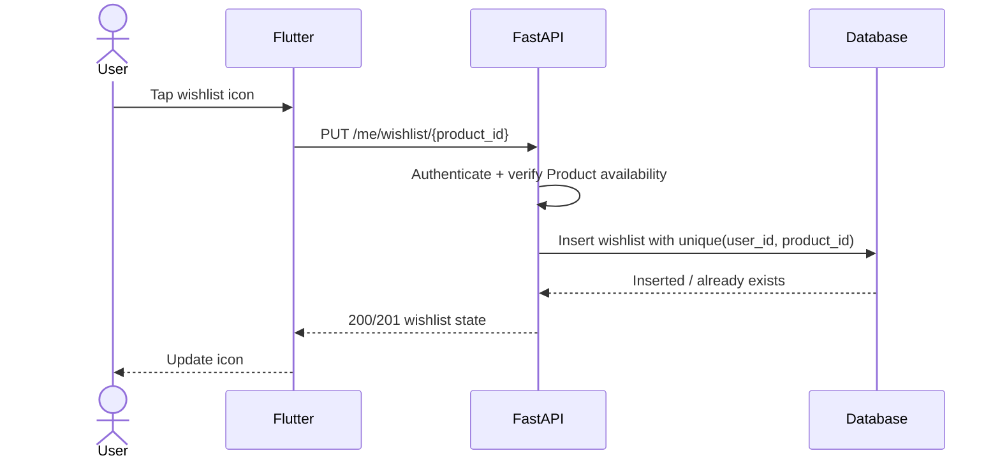

#### API Contract

| **ID**        | **Method + Endpoint**                     | **Auth** | **Mục đích**                |
| ------------- | ----------------------------------------- | -------- | --------------------------- |
| `API-WISH-01` | `GET /api/v1/me/wishlist`                 | Bearer   | Wishlist phân trang         |
| `API-WISH-02` | `PUT /api/v1/me/wishlist/{product_id}`    | Bearer   | Thêm yêu thích (idempotent) |
| `API-WISH-03` | `DELETE /api/v1/me/wishlist/{product_id}` | Bearer   | Bỏ yêu thích                |

`API-WISH-02`/03 không có request body.

**Response `200` – `API-WISH-02`**

```json
{
  "data": {
    "product_id": "prd_01JPRODUCT1",
    "is_favorite": true,
    "created_at": "2026-11-27T03:40:00Z"
  },
  "meta": {}
}
```

**Response `200` – `API-WISH-01`**

```json
{
  "data": [
    {
      "product_id": "prd_01JPRODUCT1",
      "title": "Giao trinh Giai tich 1",
      "price_vnd": 45000,
      "product_status": "SOLD",
      "cover_image_url": "https://api.example.invalid/api/v1/files/fil_01JIMAGE123/content",
      "saved_at": "2026-11-27T03:40:00Z"
    }
  ],
  "meta": {"page": 1, "page_size": 20, "total_items": 1}
}
```

Lỗi: `400` `WISHLIST_INVALID`; `401` `AUTH_REQUIRED`; `404` `PRODUCT_NOT_FOUND`; `422` `VALIDATION_ERROR`; `409` `WISHLIST_SELF_PRODUCT` nếu lưu tin của chính mình.

| **Trường**    | **Kiểu**          | **Required**  | **Validate**        |
| ------------- | ----------------- | ------------- | ------------------- |
| `product_id`  | string            | Path required | Product ID hợp lệ   |
| `is_favorite` | boolean           | Response      | Trạng thái hiện tại |
| `saved_at`    | datetime ISO-8601 | Response      | UTC                 |

#### Wireframe – Đã lưu

```text
+----------------------------------+
| DA LUU                           |
|----------------------------------|
| [IMG] Giao trinh Giai tich       |
|       45.000 d        [♡]        |
|       [AVAILABLE]                |
|----------------------------------|
| [IMG] Den ban                    |
|       80.000 d        [♡]        |
|       [DA BAN]                   |
|----------------------------------|
| [Home] [Dang tin] [Tin nhan] [Toi]|
+----------------------------------+
```

| **Thành phần / Nút** | **Loại UI** | **Hành vi & API**                                   |
| -------------------- | ----------- | --------------------------------------------------- |
| Danh sách đã lưu     | List/Card   | GET `API-WISH-01`                                   |
| Tim                  | Button      | DELETE `API-WISH-03`; optimistic update và rollback |
| Thẻ Product          | Card        | GET `API-BROWSE-03` khi mở detail                   |

#### Acceptance Criteria

- `AC-WISH-01`: Một user không thể tạo hai wishlist row cho cùng Product; DB có unique (`user_id`, `product_id`).
- `AC-WISH-02`: Tap heart cập nhật UI tức thì; lỗi API thì rollback.
- `AC-WISH-03`: Guest tap heart được điều hướng Login; sau login không tự gửi thao tác nếu chưa xác nhận lại.
- `AC-WISH-04`: Product không khả dụng vẫn có thể bỏ lưu.

### 4.6. Chat — CHAT (TV1 + TV4)

#### Functional Requirements

| **ID**       | **Yêu cầu**                                                                             | **Ưu tiên**                                  | **Nguồn** |
| ------------ | --------------------------------------------------------------------------------------- | -------------------------------------------- | --------- |
| `FR-CHAT-01` | Mở chat từ detail; mỗi cặp Product + Buyer có tối đa một Conversation                   | **Must**                                     |           |
| `FR-CHAT-02` | Member `ACTIVE`, không phải seller, mới mở chat với Product `AVAILABLE`                 | **Must**                                     |           |
| `FR-CHAT-03` | Danh sách Conversation có ảnh Product, đối phương, title, tin cuối, thời gian và unread | **Must**                                     |           |
| `FR-CHAT-04` | Badge số tin chưa đọc                                                                   | **Should**                                   |           |
| `FR-CHAT-05` | Header chat có Product card và thông tin đối phương                                     | **Must**                                     |           |
| `FR-CHAT-06` | Gửi/nhận tin nhắn văn bản real-time                                                     | **Must**                                     |           |
| `FR-CHAT-07` | Trạng thái gửi: đang gửi/đã gửi/lỗi; offline outbox và retry                            | **Must**                                     |           |
| `FR-CHAT-08` | Lịch sử tải theo trang/cursor; phân cách ngày                                           | **Must**                                     |           |
| `FR-CHAT-09` | Mở chat đánh dấu đã đọc; read receipt cho tin cuối                                      | **Should**                                   |           |
| `FR-CHAT-10` | Tin nhắn nhanh theo vai trò; chip chỉ điền nội dung                                     | **Must**                                     |           |
| `FR-CHAT-11` | Chat cũ read-only khi Product `BLOCKED`/`DELETED` hoặc một bên `BANNED`                 | **Must**                                     |           |
| `FR-CHAT-12` | Product `SOLD` không chat mới; chat cũ có thể đọc                                       | **Must**                                     |           |
| `FR-CHAT-13` | Chỉ hai participant đọc/gửi; Admin không đọc nội dung riêng tư                          | **Must**                                     |           |
| `FR-CHAT-14` | Banner mẹo an toàn trong chat                                                           | **Should** – **[Giữ từ SRS 0.1; cần duyệt]** |           |
| `FR-CHAT-15` | Menu chat có link hồ sơ; report user bị loại khỏi MVP do chưa có task                   |                                              |           |
| `FR-CHAT-16` | Tin hệ thống cho sự kiện xác nhận giao dịch (`ASM-07`)        | **Should** / phụ thuộc `ASM-07`              |           |

#### Sequence – WebSocket chat

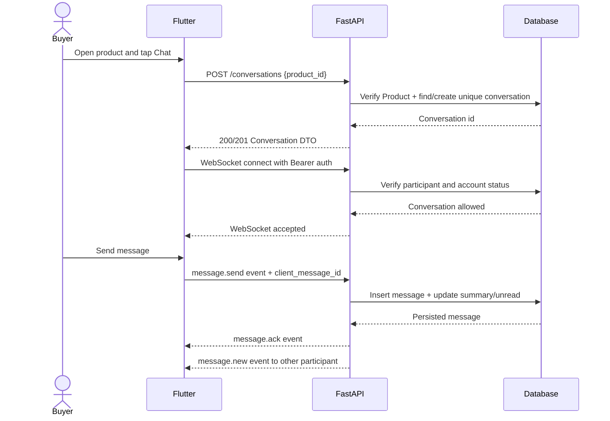

#### Flowchart – Offline send

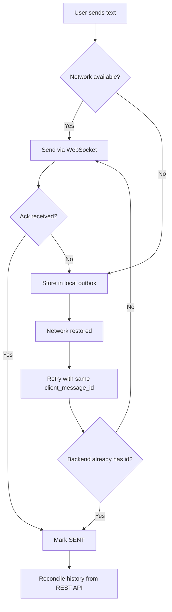

#### API Contract

| **ID**        | **Method + Endpoint**                     | **Auth**             | **Mục đích**        |
| ------------- | ----------------------------------------- | -------------------- | ------------------- |
| `API-CHAT-01` | `GET /api/v1/conversations`               | Bearer               | Danh sách hội thoại |
| `API-CHAT-02` | `POST /api/v1/conversations`              | Bearer               | Tìm/tạo hội thoại   |
| `API-CHAT-03` | `GET /api/v1/conversations/{id}/messages` | Bearer + Participant | Lịch sử             |
| `API-CHAT-04` | `POST /api/v1/conversations/{id}/read`    | Bearer + Participant | Đánh dấu đã đọc     |
| `API-CHAT-05` | WS `/api/v1/ws/chat`                      | Bearer handshake     | Real-time events    |

**Request – `API-CHAT-02`**

```json
{
  "product_id": "prd_01JPRODUCT1"
}
```

**Response `201` – `API-CHAT-02`**

```json
{
  "data": {
    "id": "cnv_01JCONV1",
    "product_id": "prd_01JPRODUCT1",
    "buyer_id": "usr_01JBUYER1",
    "seller_id": "usr_01JABC123",
    "created_at": "2026-11-27T04:00:00Z",
    "is_new": true
  },
  "meta": {}
}
```

**Request – `API-CHAT-03`:** query limit=30&before=\<`message_id`\>; không body.

**Response `200` – `API-CHAT-03`**

```json
{
  "data": [
    {
      "id": "msg_01JMESSAGE1",
      "conversation_id": "cnv_01JCONV1",
      "sender_id": "usr_01JBUYER1",
      "type": "TEXT",
      "text": "Mon nay con khong ban?",
      "client_message_id": "local-uuid-123",
      "created_at": "2026-11-27T04:01:00Z",
      "read_at": null
    }
  ],
  "meta": {"next_cursor": null, "has_more": false}
}
```

WebSocket handshake: wss://\<api-host\>`/api/v1/ws/chat`; Authorization qua secure WebSocket subprotocol hoặc cơ chế handshake TV1 quy định; không đặt token trong URL query – **[Bổ sung hợp lý / Giả định]**.

**Client event**

```json
{
  "event": "message.send",
  "data": {
    "conversation_id": "cnv_01JCONV1",
    "client_message_id": "local-uuid-123",
    "text": "Mon nay con khong ban?"
  }
}
```

**Server event – ack**

```json
{
  "event": "message.ack",
  "data": {
    "client_message_id": "local-uuid-123",
    "message_id": "msg_01JMESSAGE1",
    "status": "SENT",
    "created_at": "2026-11-27T04:01:00Z"
  }
}
```

**Server event – new message**

```json
{
  "event": "message.new",
  "data": {
    "conversation_id": "cnv_01JCONV1",
    "message": {
      "id": "msg_01JMESSAGE1",
      "sender_id": "usr_01JBUYER1",
      "type": "TEXT",
      "text": "Mon nay con khong ban?",
      "created_at": "2026-11-27T04:01:00Z"
    }
  }
}
```

REST errors: `400` `CHAT_INVALID_REQUEST`; `401` `AUTH_REQUIRED`; `404` `CONVERSATION_NOT_FOUND`/`PRODUCT_NOT_FOUND`; `422` `VALIDATION_ERROR`. WebSocket lỗi dùng event error có code, message, retryable; close code `4401` (chưa xác thực/hết hạn), `4403` (không có quyền) – `OQ-06`.

| **Field**           | **Kiểu**          | **Required**      | **Validate**                                            |
| ------------------- | ----------------- | ----------------- | ------------------------------------------------------- |
| `product_id`        | string            | Required          | Product tồn tại, `AVAILABLE`, buyer khác seller         |
| text                | string            | Required với TEXT | 1–1000 ký tự sau trim – **[Giữ từ SRS 0.1; cần duyệt]** |
| `client_message_id` | string            | Required          | UUID do Flutter sinh; unique theo sender                |
| type                | enum string       | Server/response   | TEXT, SYSTEM; client không gửi SYSTEM                   |
| `created_at`        | datetime ISO-8601 | Response          | Server timestamp UTC                                    |
| limit               | int               | Optional          | Default 30, max 100 – **[Bổ sung hợp lý / Giả định]**   |

#### Wireframe – Danh sách hội thoại

```text
+----------------------------------+
| TIN NHAN                         |
| [ Tim hoi thoai               ]  |
|----------------------------------|
| [IMG] Giao trinh Giai tich       |
|       Nguyen Van A               |
|       Mon nay con khong?   09:30 |
|----------------------------------|
| [IMG] Den ban                    |
|       Tran Thi B                 |
|       Minh hen 5h nhe      08:12 |
|----------------------------------|
| [Home] [Dang tin] [Tin nhan] [Toi]|
+----------------------------------+
```

| **Thành phần / Nút** | **Loại UI** | **Hành vi & API**                               |
| -------------------- | ----------- | ----------------------------------------------- |
| Conversation list    | List        | GET `API-CHAT-01`; pagination                   |
| Conversation item    | Card        | Mở room; GET `API-CHAT-03` và kết nối WebSocket |
| Unread badge         | Badge       | Hiển thị unread count trong DTO                 |
| Pull refresh         | Gesture     | GET `API-CHAT-01`                               |

#### Wireframe – Phòng chat

```text
+----------------------------------+
| < Nguyen Van A              [⋮]  |
| [IMG] Giao trinh - 45.000 d      |
|----------------------------------|
|       --- Hom nay ---            |
| [Buyer] Mon nay con khong?       |
|                    [Seller] Con  |
|                    nhe ban       |
| [Tin nhan nhanh v]               |
|----------------------------------|
| [Nhap tin nhan...          ] [>] |
+----------------------------------+
```

| **Thành phần / Nút** | **Loại UI** | **Hành vi & API**                              |
| -------------------- | ----------- | ---------------------------------------------- |
| Product header       | Card        | Tap GET `API-BROWSE-03`                        |
| Message list         | List        | GET `API-CHAT-03`; WebSocket message.new       |
| Quick reply chips    | Chips       | Chọn chip chỉ điền input, không gửi            |
| Input                | Text input  | Trim 1–1000 ký tự; gửi message.send            |
| Send                 | Button      | WebSocket; offline thì outbox/idempotent retry |
| Read state           | Text/status | `API-CHAT-04`; read receipt nếu bật            |
| Menu                 | Popup       | Xem hồ sơ; không report user trong MVP         |

#### Acceptance Criteria

- `AC-CHAT-01`: Không tạo Conversation trùng (`product_id`, `buyer_id`); DB unique constraint.
- `AC-CHAT-02`: Không chat mới nếu Product không `AVAILABLE`, user là seller/`BANNED` hoặc chưa verified khi policy yêu cầu.
- `AC-CHAT-03`: Chỉ buyer/seller đọc Conversation/Messages; Admin không xem nội dung.
- `AC-CHAT-04`: Tin nhắn rỗng/chỉ khoảng trắng bị từ chối; length theo giới hạn.
- `AC-CHAT-05`: Persist message trước khi phát message.new; chỉ báo SENT khi Backend ACK.
- `AC-CHAT-06`: Retry cùng `client_message_id` không tạo tin trùng.
- `AC-CHAT-07`: WebSocket reconnect có backoff; tải phần thiếu qua REST history.
- `AC-CHAT-08`: Offline message ở trạng thái `PENDING`/FAILED; logout không gửi queue tài khoản khác.
- `AC-CHAT-09`: Khi một bên `BANNED` hoặc Product bị gỡ/xóa, room read-only theo server rule.
- `AC-CHAT-10`: WebSocket kiểm tra quyền khi handshake và trước mỗi message write.

### 4.7. Xác nhận giao dịch và đánh giá — TXN / REVIEW (TV1 + TV3 + TV4)

#### 4.7.1. Quyết định phạm vi

`TASKS.md` yêu cầu review 1–5 sao, không gửi trùng review cho cùng một giao dịch, đồng thời nhắc rõ không được xem việc seller tự chuyển Product sang `SOLD` là bằng chứng giao dịch đã xác minh. SRS 0.1 đề xuất Buyer tạo yêu cầu và Seller xác nhận. Cơ chế hai bên dưới đây được giữ như **[Bổ sung hợp lý / Giả định – `ASM-07`]**, không phải checkout/Order/Payment. Cả nhóm phải phê duyệt trước khi đưa vào MVP chính thức.

#### 4.7.2. Functional Requirements

| **ID**         | **Yêu cầu**                                                                                        | **Ưu tiên**                                  |
| -------------- | -------------------------------------------------------------------------------------------------- | -------------------------------------------- |
| `FR-TXN-01`    | Buyer trong Conversation tạo yêu cầu xác nhận đã giao dịch cho Product                             | **Should** – `ASM-07` đã chốt                |
| `FR-TXN-02`    | Seller của Product xác nhận hoặc từ chối yêu cầu                                                   | **Should** – `ASM-07` đã chốt                |
| `FR-TXN-03`    | Khi Seller xác nhận, Backend đánh dấu confirmation `COMPLETED`; không tạo Order hay ghi thanh toán | **Should** – `ASM-07` đã chốt                |
| `FR-TXN-04`    | Một Product tối đa một confirmation `COMPLETED`                                                    | **Should** – `ASM-07` đã chốt                |
| `FR-REVIEW-01` | Buyer của confirmation `COMPLETED` được đánh giá seller 1–5 sao và nhận xét                        | **Must**                                     |
| `FR-REVIEW-02` | Mỗi confirmation tối đa một review                                                                 | **Must**                                     |
| `FR-REVIEW-03` | Hạn review 30 ngày từ `COMPLETED`                                                                  | **Should** – **[Giữ từ SRS 0.1; cần duyệt]** |
| `FR-REVIEW-04` | Lối vào review từ chat và mục Chờ đánh giá                                                         | **Must** nếu có confirmation                 |
| `FR-REVIEW-05` | Hồ sơ seller hiển thị average, count và review mới nhất                                            | **Must**                                     |
| `FR-REVIEW-06` | Nhãn: “Đánh giá sau khi hai bên xác nhận”, không dùng “đã xác minh”                                | **Must**                                     |
| `FR-REVIEW-07` | Không sửa/xóa review trong MVP                                                                     | **Should** – **[Giữ từ SRS 0.1; cần duyệt]** |

#### Sequence – Buyer request, Seller confirms, Buyer reviews

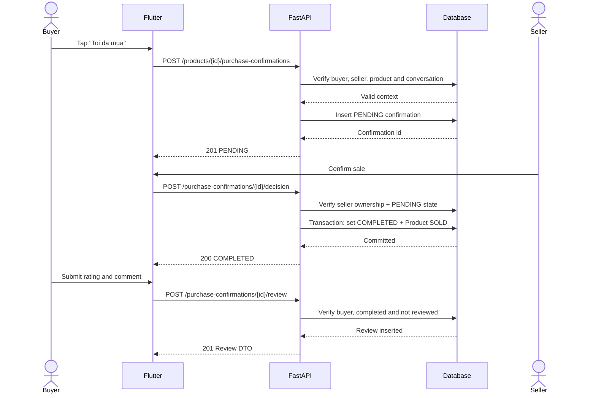

#### State diagram – Confirmation

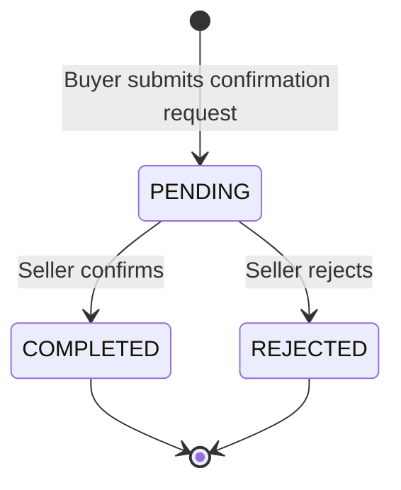

Không tự đặt expiry 7 ngày hoặc giới hạn retry 3 lần vì TASKS chưa quy định. Cách tạo request mới sau `REJECTED` là **[Cần làm rõ]**.

#### API Contract

| **ID**          | **Method + Endpoint**                                       | **Auth**        | **Mục đích**           |
| --------------- | ----------------------------------------------------------- | --------------- | ---------------------- |
| `API-TXN-01`    | `POST /api/v1/products/{product_id}/purchase-confirmations` | Bearer + Buyer  | Buyer yêu cầu xác nhận |
| `API-TXN-02`    | `POST /api/v1/purchase-confirmations/{id}/decision`         | Bearer + Seller | Seller confirm/reject  |
| `API-TXN-03`    | `GET /api/v1/me/pending-reviews`                            | Bearer          | Danh sách chờ review   |
| `API-REVIEW-01` | `POST /api/v1/purchase-confirmations/{id}/review`           | Bearer + Buyer  | Tạo review             |
| `API-REVIEW-02` | `GET /api/v1/users/{user_id}/reviews`                       | Public          | Review của seller      |

**Request – `API-TXN-01`**

```json
{
  "conversation_id": "cnv_01JCONV1",
  "buyer_note": "Hai ben da gap va nhan hang truc tiep."
}
```

**Response `201` – `API-TXN-01`**

```json
{
  "data": {
    "id": "txn_01JCONFIRM1",
    "product_id": "prd_01JPRODUCT1",
    "conversation_id": "cnv_01JCONV1",
    "buyer_id": "usr_01JBUYER1",
    "seller_id": "usr_01JABC123",
    "status": "PENDING",
    "created_at": "2026-11-27T05:00:00Z"
  },
  "meta": {}
}
```

**Request – `API-TXN-02`**

```json
{
  "decision": "CONFIRM",
  "note": null
}
```

**Response `200` – `API-TXN-02`**

```json
{
  "data": {
    "id": "txn_01JCONFIRM1",
    "status": "COMPLETED",
    "product_id": "prd_01JPRODUCT1",
    "product_status": "SOLD",
    "decided_at": "2026-11-27T05:10:00Z"
  },
  "meta": {}
}
```

**Request – `API-REVIEW-01`**

```json
{
  "rating": 5,
  "comment": "Nguoi ban giao dich dung hen, thong tin san pham ro rang."
}
```

**Response `201` – `API-REVIEW-01`**

```json
{
  "data": {
    "id": "rev_01JREVIEW1",
    "confirmation_id": "txn_01JCONFIRM1",
    "seller_id": "usr_01JABC123",
    "buyer_id": "usr_01JBUYER1",
    "rating": 5,
    "comment": "Nguoi ban giao dich dung hen, thong tin san pham ro rang.",
    "created_at": "2026-11-27T05:15:00Z"
  },
  "meta": {}
}
```

**Response `200` – `API-REVIEW-02`**

```json
{
  "data": {
    "average_rating": 4.7,
    "review_count": 12,
    "items": [
      {
        "id": "rev_01JREVIEW1",
        "buyer_display_name": "Nguyen B",
        "rating": 5,
        "comment": "Giao dich dung hen.",
        "product_title": "Giao trinh Giai tich 1",
        "created_at": "2026-11-27T05:15:00Z"
      }
    ]
  },
  "meta": {"page": 1, "page_size": 20}
}
```

**Lỗi:** `400` `TRANSACTION_STATE_INVALID`; `401` `AUTH_REQUIRED`; `404` `CONFIRMATION_NOT_FOUND`; `422` `VALIDATION_ERROR`; `403` nếu không đúng buyer/seller; `409` `REVIEW_ALREADY_EXISTS` hoặc `PRODUCT_ALREADY_COMPLETED`.

| **Field**                  | **Kiểu**          | **Required** | **Validate**                                                      |
| -------------------------- | ----------------- | ------------ | ----------------------------------------------------------------- |
| `conversation_id`          | string            | Required     | Conversation có buyer hiện tại, seller khớp owner Product         |
| `buyer_note`               | string            | Optional     | 0–500 ký tự – **[Bổ sung hợp lý / Giả định]**                     |
| decision                   | enum string       | Required     | CONFIRM hoặc REJECT                                               |
| note                       | string/null       | Optional     | 0–500 ký tự; chủ yếu cho REJECT – **[Bổ sung hợp lý / Giả định]** |
| rating                     | int               | Required     | 1–5                                                               |
| comment                    | string            | Optional     | 0–500 ký tự                                                       |
| `created_at`, `decided_at` | datetime ISO-8601 | Response     | UTC                                                               |

#### Wireframe – Xác nhận và review

```text
+----------------------------------+
| XAC NHAN GIAO DICH               |
|----------------------------------|
| San pham: Giao trinh Giai tich   |
| Nguoi mua: Nguyen B              |
|                                  |
| Buyer: [Toi da nhan hang]        |
| Seller: [Xac nhan] [Tu choi]     |
|----------------------------------|
| DANH GIA NGUOI BAN               |
| Sao:       (1) (2) (3) (4) (5)   |
| Nhan xet:                        |
| [                                ]|
| [                                ]|
| [          GUI DANH GIA         ] |
+----------------------------------+
```

| **Thành phần / Nút** | **Loại UI**  | **Hành vi & API**                            |
| -------------------- | ------------ | -------------------------------------------- |
| Tôi đã mua           | Button       | `API-TXN-01`; hiển thị theo `ASM-07`         |
| Xác nhận/Từ chối     | Button       | `API-TXN-02`; chỉ Seller hiện tại            |
| Chọn sao             | Rating input | Chọn integer 1–5                             |
| Nhận xét             | Textarea     | Tối đa 500 ký tự                             |
| Gửi đánh giá         | Button       | `API-REVIEW-01`; sau `201` quay chat/profile |
| Chờ đánh giá         | List         | GET `API-TXN-03`                             |

#### Acceptance Criteria

- `AC-TXN-01`: Buyer không xác nhận cho Product do mình sở hữu.
- `AC-TXN-02`: Seller chỉ quyết định request `PENDING` thuộc Product mình sở hữu.
- `AC-TXN-03`: Confirmation `COMPLETED` và Product `SOLD` cập nhật trong một DB transaction; lỗi thì rollback.
- `AC-TXN-04`: Product tối đa một confirmation `COMPLETED`; request đồng thời không thể cùng hoàn tất.
- `AC-REVIEW-01`: Chỉ buyer thuộc confirmation `COMPLETED` được tạo review.
- `AC-REVIEW-02`: Một confirmation tối đa một review; DB unique constraint.
- `AC-REVIEW-03`: Rating integer 1–5; comment tối đa 500 ký tự.
- `AC-REVIEW-04`: Không gọi review là “đã xác minh”; chỉ “sau khi hai bên xác nhận”.
- `AC-REVIEW-05`: Chưa có review thì hiển thị “Chưa có đánh giá”.
- `AC-REVIEW-06`: Không tự tạo review chỉ vì Product chuyển `SOLD` thủ công.

### 4.8. Chia sẻ liên kết sản phẩm — SHARE (TV2 + TV3 + TV1)

#### Functional Requirements

| **ID**        | **Yêu cầu**                                                         | **Ưu tiên** | **Nguồn**                               |
| ------------- | ------------------------------------------------------------------- | ----------- | --------------------------------------- |
| `FR-SHARE-01` | Native share sheet chia sẻ tiêu đề, giá và link sản phẩm            | **Must**    | **[Nguồn TASKS]**                       |
| `FR-SHARE-02` | Link chỉ chứa Product ID/slug công khai, không có PII/địa chỉ riêng | **Must**    | **[Nguồn TASKS]**                       |
| `FR-SHARE-03` | App đã cài thì link mở Product detail qua Android App Links         | **Should**  | **[Nguồn TASKS – nếu nhóm triển khai]** |
| `FR-SHARE-04` | Landing page web tối giản là tùy chọn; không Firebase Hosting       | **Could**   | **[Nguồn TASKS – nếu nhóm triển khai]** |
| `FR-SHARE-05` | Link Product ẩn/gỡ/xóa báo không còn khả dụng                       | **Must**    | **[Giữ từ SRS 0.1]**                    |

#### Sequence

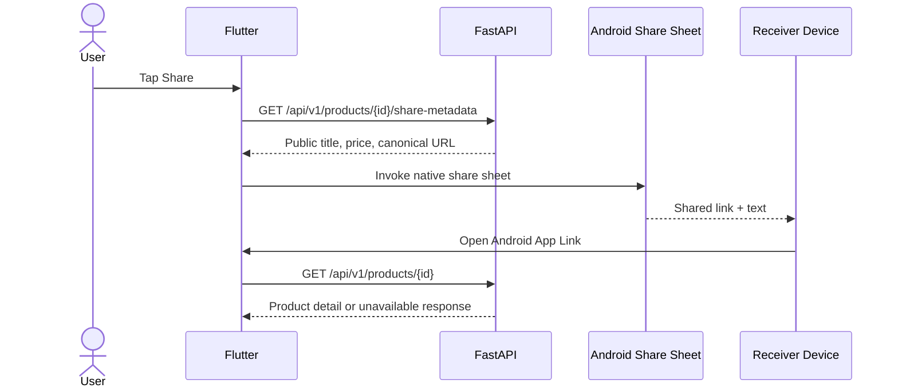

#### API Contract

| **ID**         | **Method + Endpoint**                              | **Auth** | **Mục đích**     |
| -------------- | -------------------------------------------------- | -------- | ---------------- |
| `API-SHARE-01` | `GET /api/v1/products/{product_id}/share-metadata` | Public   | Metadata chia sẻ |

Request: không body.

**Response `200` – `API-SHARE-01`**

```json
{
  "data": {
    "title": "Giao trinh Giai tich 1",
    "price_text": "45.000 d",
    "canonical_url": "https://app.example.invalid/p/prd_01JPRODUCT1",
    "availability": "AVAILABLE"
  },
  "meta": {}
}
```

Lỗi: `400` `SHARE_INVALID_PRODUCT_ID`; `401` không bắt buộc cho public metadata; `404` `PRODUCT_UNAVAILABLE`; `422` `VALIDATION_ERROR`.

| **Field**       | **Kiểu** | **Required**  | **Validate**                   |
| --------------- | -------- | ------------- | ------------------------------ |
| `product_id`    | string   | Path required | ID public hợp lệ               |
| `canonical_url` | string   | Response      | HTTPS, chỉ ID/slug, không PII  |
| availability    | enum     | Response      | `AVAILABLE`/`SOLD`/UNAVAILABLE |

#### Wireframe – Share fallback

```text
+----------------------------------+
| CHIA SE SAN PHAM                 |
|----------------------------------|
| Giao trinh Giai tich 1           |
| Gia: 45.000 d                    |
| Link: app.example.invalid/p/...   |
|----------------------------------|
| [Sao chep link]                  |
| [Chia se qua ung dung khac]      |
| [Mo trong ung dung]              |
+----------------------------------+
```

| **Thành phần / Nút** | **Loại UI**       | **Hành vi & API**                          |
| -------------------- | ----------------- | ------------------------------------------ |
| Chia sẻ              | Button            | GET `API-SHARE-01`, gọi native share sheet |
| Sao chép link        | Button            | Copy canonical URL                         |
| Open App Link        | Android intent    | Mở detail; GET `API-BROWSE-03`             |
| Link invalid         | Empty/error state | Hiển thị “Tin không còn tồn tại”           |

#### Acceptance Criteria

- `AC-SHARE-01`: Share không chứa email, số điện thoại, địa chỉ nhà hoặc PII.
- `AC-SHARE-02`: Link HTTPS chỉ chứa Product ID/slug.
- `AC-SHARE-03`: Product unavailable không lộ dữ liệu riêng.
- `AC-SHARE-04`: Nếu không có landing page, link có fallback mở app/thông báo; domain lấy từ config, không hard-code tuỳ tiện.

### 4.9. Báo cáo vi phạm tin đăng — REPORT (TV1 + TV4)

MVP chỉ bắt buộc báo cáo Product theo TASKS. Báo cáo người dùng, message hoặc review bị loại khỏi MVP để tránh mở rộng ngoài nguồn; có thể xem xét khi cập nhật scope.

#### Functional Requirements

| **ID**         | **Yêu cầu**                                                                                 | **Ưu tiên**                                  | **Nguồn**                                   |
| -------------- | ------------------------------------------------------------------------------------------- | -------------------------------------------- | ------------------------------------------- |
| `FR-REPORT-01` | Báo cáo Product từ màn chi tiết                                                             | **Must**                                     | **[Nguồn TASKS]**                           |
| `FR-REPORT-02` | Form có tóm tắt Product, một lý do, mô tả tùy chọn và nút gửi                               | **Must**                                     | **[Giữ từ SRS 0.1]**                        |
| `FR-REPORT-03` | Backend lưu reporter, Product, owner, reason, description, snapshot, status và `created_at` | **Must**                                     | **[Nguồn TASKS; snapshot bổ sung hữu ích]** |
| `FR-REPORT-04` | Một user không có hai report `PENDING` cho cùng Product                                     | **Must**                                     | **[Giữ từ SRS 0.1]**                        |
| `FR-REPORT-05` | User chỉ xem report mình gửi                                                                | **Must**                                     | **[Nguồn TASKS]**                           |
| `FR-REPORT-06` | Người bị report không biết reporter là ai                                                   | **Must**                                     | **[Giữ từ SRS 0.1]**                        |
| `FR-REPORT-07` | User xem trạng thái report của mình                                                         | **Should**                                   | **[Giữ từ SRS 0.1]**                        |
| `FR-REPORT-08` | Limit 10 report/24 giờ                                                                      | **Should** – **[Bổ sung hợp lý / Giả định]** |                                             |

#### Sequence – Report Product

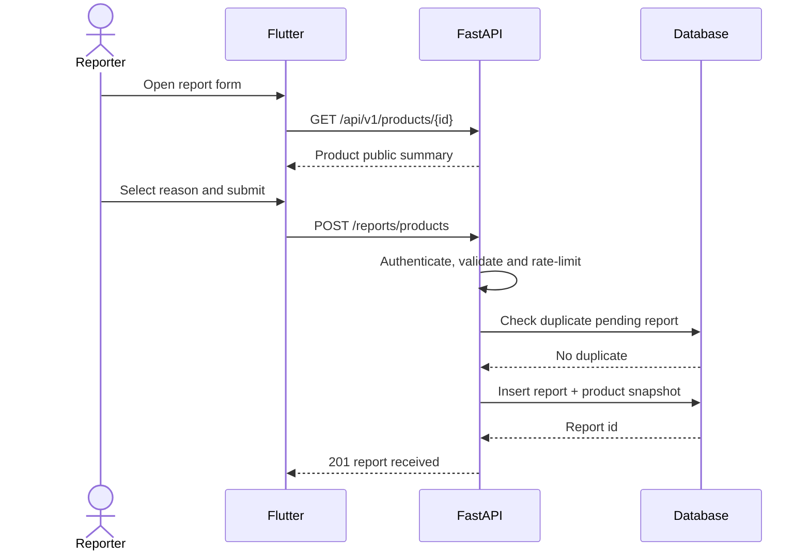

#### API Contract

| **ID**          | **Method + Endpoint**                | **Auth**          | **Mục đích**       |
| --------------- | ------------------------------------ | ----------------- | ------------------ |
| `API-REPORT-01` | `POST /api/v1/reports/products`      | Bearer            | Tạo report Product |
| `API-REPORT-02` | `GET /api/v1/me/reports`             | Bearer            | Report của tôi     |
| `API-REPORT-03` | `GET /api/v1/me/reports/{report_id}` | Bearer + Reporter | Chi tiết report    |

**Request – `API-REPORT-01`**

```json
{
  "product_id": "prd_01JPRODUCT1",
  "reason": "MISLEADING",
  "description": "Anh va mo ta khong trung khop voi san pham nhan duoc trong thong tin dang ban."
}
```

**Response `201` – `API-REPORT-01`**

```json
{
  "data": {
    "id": "rpt_01JREPORT1",
    "product_id": "prd_01JPRODUCT1",
    "reason": "MISLEADING",
    "status": "PENDING",
    "created_at": "2026-11-27T06:00:00Z"
  },
  "meta": {}
}
```

**Response `200` – `API-REPORT-02`**

```json
{
  "data": [
    {
      "id": "rpt_01JREPORT1",
      "product_id": "prd_01JPRODUCT1",
      "product_title_snapshot": "Giao trinh Giai tich 1",
      "reason": "MISLEADING",
      "status": "PENDING",
      "created_at": "2026-11-27T06:00:00Z",
      "resolved_at": null
    }
  ],
  "meta": {"page": 1, "page_size": 20, "total_items": 1}
}
```

Lỗi: `400` `REPORT_INVALID_TARGET`; `401` `AUTH_REQUIRED`; `404` `PRODUCT_NOT_FOUND`; `422` `VALIDATION_ERROR`; `409` `REPORT_ALREADY_PENDING`; `429` `REPORT_RATE_LIMITED` (giới hạn 10 report/24 giờ, `OQ-13`).

| **Field**    | **Kiểu**          | **Required** | **Validate**                               |
| ------------ | ----------------- | ------------ | ------------------------------------------ |
| `product_id` | string            | Required     | Product tồn tại; reporter không phải owner |
| reason       | enum string       | Required     | Mã Appendix C dành cho PRODUCT             |
| description  | string            | Optional     | 0–500 ký tự; OTHER tối thiểu 10            |
| status       | enum              | Response     | `PENDING`/RESOLVED/`REJECTED`              |
| `created_at` | datetime ISO-8601 | Response     | UTC                                        |

#### Wireframe – Form báo cáo

```text
+----------------------------------+
| <  BAO CAO TIN DANG              |
|----------------------------------|
| San pham: Giao trinh Giai tich   |
| Ly do:                           |
| ( ) Hang cam / vi pham           |
| ( ) Co dau hieu lua dao           |
| ( ) Hang gia                     |
| ( ) Thong tin sai su that        |
| ( ) Noi dung khong phu hop        |
| ( ) Khac                         |
| Mo ta them:                      |
| [                              ] |
| [          GUI BAO CAO          ] |
+----------------------------------+
```

| **Thành phần / Nút** | **Loại UI** | **Hành vi & API**                           |
| -------------------- | ----------- | ------------------------------------------- |
| Product summary      | Card        | Hiển thị target reporter xác nhận           |
| Lý do                | Radio group | Chọn đúng một mã enum                       |
| Mô tả                | Textarea    | 0–500; OTHER \>= 10                         |
| Gửi báo cáo          | Button      | POST `API-REPORT-01`; loading; lỗi giữ form |
| Báo cáo của tôi      | List        | GET `API-REPORT-02`                         |

#### Acceptance Criteria

- `AC-REPORT-01`: Không báo cáo Product do chính mình sở hữu.
- `AC-REPORT-02`: Chỉ chọn một reason enum hợp lệ.
- `AC-REPORT-03`: Snapshot lưu title, price, description, cover image, status tại thời điểm báo cáo; không lưu PII thừa.
- `AC-REPORT-04`: Một user không tạo hai report `PENDING` cùng Product; xử lý đồng thời an toàn.
- `AC-REPORT-05`: User A không đọc report User B; target owner không thấy reporter identity.
- `AC-REPORT-06`: Submit khóa nút; lỗi mạng giữ form; retry không tạo report trùng.
- `AC-REPORT-07`: Rate limit 10/24h (`OQ-13`); Backend trả `429`.

### 4.10. Admin và kiểm duyệt — ADMIN (TV1 + TV4)

#### Phạm vi MVP

Admin xem report Product, mở chi tiết và chọn: không vi phạm, gỡ Product, hoặc gỡ Product và khóa chủ tin. Backend kiểm tra role `ADMIN` ở mọi endpoint. Không xây dashboard thống kê nâng cao, quản lý danh mục, nhiều cấp Admin hoặc quyền đọc chat.

#### Functional Requirements

| **ID**        | **Yêu cầu**                                                             | **Ưu tiên** | **Nguồn**                            |
| ------------- | ----------------------------------------------------------------------- | ----------- | ------------------------------------ |
| `FR-ADMIN-01` | Tab Admin chỉ hiển thị cho role `ADMIN`; API luôn kiểm tra quyền server | **Must**    | **[Nguồn TASKS]**                    |
| `FR-ADMIN-02` | Xem danh sách report Product, lọc status và phân trang                  | **Must**    | **[Nguồn TASKS + chi tiết hợp lý]**  |
| `FR-ADMIN-03` | Xem report detail, snapshot và Product state hiện tại                   | **Must**    | **[Nguồn TASKS]**                    |
| `FR-ADMIN-04` | Kết luận không vi phạm hoặc gỡ Product                                  | **Must**    | **[Nguồn TASKS]**                    |
| `FR-ADMIN-05` | Khóa chủ Product theo quyền và ghi lý do                                | **Must**    | **[Nguồn TASKS]**                    |
| `FR-ADMIN-06` | Remove/ban atomic; ghi audit event                                      | **Must**    | [Audit là Bổ sung hợp lý / Giả định] |
| `FR-ADMIN-07` | Admin không đọc nội dung chat riêng tư                                  | **Must**    | **[Giữ từ SRS 0.1]**                 |

#### Sequence – Admin xử lý report

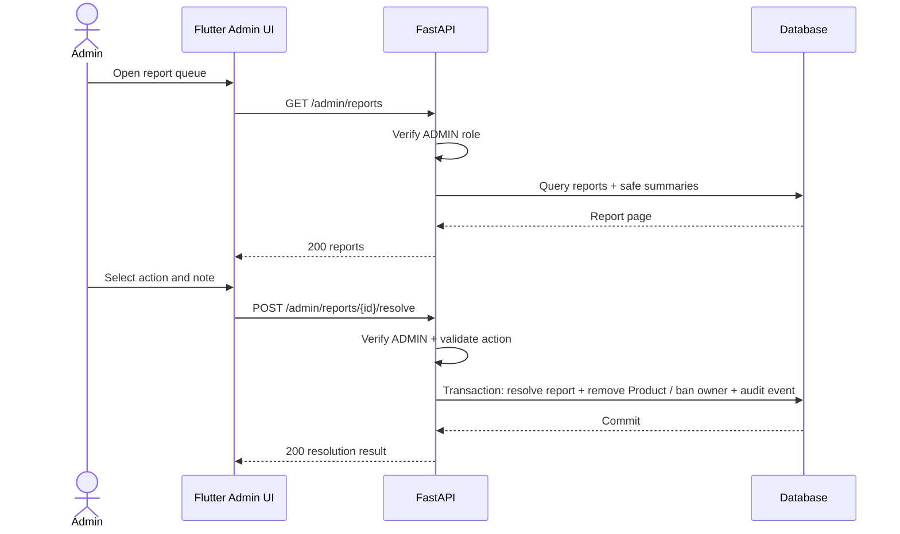

#### Flowchart – Report resolution

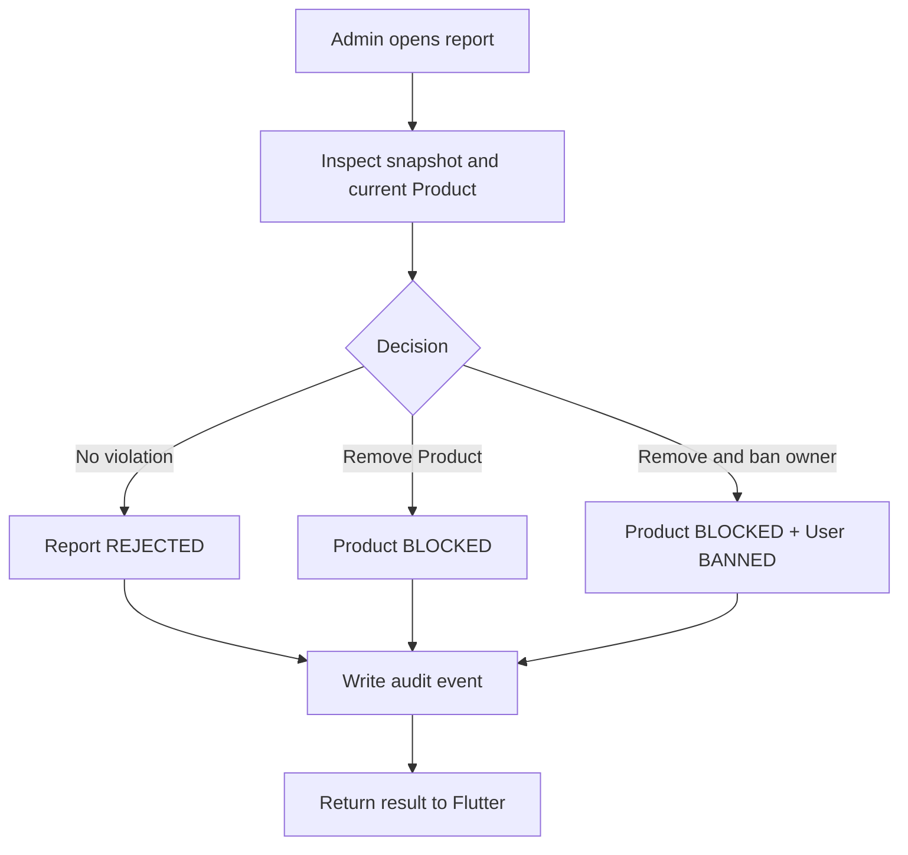

#### API Contract

| **ID**         | **Method + Endpoint**                              | **Auth**         | **Mục đích**                                                  |
| -------------- | -------------------------------------------------- | ---------------- | ------------------------------------------------------------- |
| `API-ADMIN-01` | `GET /api/v1/admin/reports`                        | Bearer + `ADMIN` | Report list                                                   |
| `API-ADMIN-02` | `GET /api/v1/admin/reports/{report_id}`            | Bearer + `ADMIN` | Report detail                                                 |
| `API-ADMIN-03` | `POST /api/v1/admin/reports/{report_id}/resolve`   | Bearer + `ADMIN` | Resolve report                                                |
| `API-ADMIN-04` | `POST /api/v1/admin/users/{user_id}/ban`           | Bearer + `ADMIN` | Ban user                                                      |
| `API-ADMIN-05` | `POST /api/v1/admin/products/{product_id}/restore` | Bearer + `ADMIN` | Restore tin gỡ nhầm – **[Bổ sung hợp lý / Giả định; Should]** |

**Request – `API-ADMIN-03`**

```json
{
  "action": "REMOVE_PRODUCT_AND_BAN_OWNER",
  "note": "Product co dau hieu lua dao; da kiem tra snapshot va thong tin hien tai."
}
```

Enum action: `REJECT_REPORT`, `REMOVE_PRODUCT`, `REMOVE_PRODUCT_AND_BAN_OWNER`.

**Response `200` – `API-ADMIN-03`**

```json
{
  "data": {
    "report_id": "rpt_01JREPORT1",
    "report_status": "RESOLVED",
    "action": "REMOVE_PRODUCT_AND_BAN_OWNER",
    "product_status": "BLOCKED",
    "owner_status": "BANNED",
    "resolved_at": "2026-11-27T07:00:00Z"
  },
  "meta": {}
}
```

**Request – `API-ADMIN-04`**

```json
{
  "reason": "Tai khoan co hanh vi vi pham lap lai."
}
```

**Response `200` – `API-ADMIN-04`**

```json
{
  "data": {
    "user_id": "usr_01JABC123",
    "status": "BANNED",
    "ban_reason": "Tai khoan co hanh vi vi pham lap lai.",
    "banned_at": "2026-11-27T07:05:00Z"
  },
  "meta": {}
}
```

Lỗi: `400` `ADMIN_ACTION_INVALID`; `401` `AUTH_REQUIRED`; `404` `REPORT_NOT_FOUND`/`USER_NOT_FOUND`; `422` `VALIDATION_ERROR`; `403` `ADMIN_REQUIRED`; `409` `REPORT_ALREADY_RESOLVED` hoặc `ADMIN_SELF_BAN_FORBIDDEN`.

| **Field**                  | **Kiểu**          | **Required**     | **Validate**                                        |
| -------------------------- | ----------------- | ---------------- | --------------------------------------------------- |
| action                     | enum string       | Required         | Một trong enum action                               |
| note                       | string            | Required         | Tối thiểu 5 ký tự – **[Giữ từ SRS 0.1; cần duyệt]** |
| reason                     | string            | Required khi ban | Tối thiểu 5 ký tự – **[Giữ từ SRS 0.1]**            |
| `resolved_at`, `banned_at` | datetime ISO-8601 | Response         | UTC                                                 |

#### Wireframe – Admin report queue / detail

```text
+----------------------------------+
| QUAN TRI - BAO CAO               |
| [Cho xu ly v] [Moi nhat v]       |
|----------------------------------|
| [!] Giao trinh Giai tich         |
|     MISLEADING | 09:10           |
|     [XEM CHI TIET]               |
|----------------------------------|
| CHI TIET BAO CAO                 |
| Snapshot Product: [IMG]          |
| Ly do: Thong tin sai su that     |
| Mo ta: ...                       |
|----------------------------------|
| Ghi chu xu ly:                   |
| [                              ] |
| [Khong vi pham] [Go tin]         |
| [Go tin + Khoa chu tin]          |
+----------------------------------+
```

| **Thành phần / Nút** | **Loại UI**      | **Hành vi & API**                                                  |
| -------------------- | ---------------- | ------------------------------------------------------------------ |
| Report list          | List             | GET `API-ADMIN-01`; filter/page                                    |
| Report detail        | Card/detail      | GET `API-ADMIN-02`                                                 |
| Resolution note      | Textarea         | Bắt buộc min length                                                |
| Không vi phạm        | Button           | `API-ADMIN-03` `REJECT_REPORT`                                     |
| Gỡ tin               | Button           | `API-ADMIN-03` `REMOVE_PRODUCT`                                    |
| Gỡ + khóa            | Button           | `API-ADMIN-03` `REMOVE_PRODUCT_AND_BAN_OWNER`                      |
| User management      | Ngoài MVP cơ bản | Chỉ thêm nếu nhóm chốt endpoint riêng; hiện khóa từ report context |

#### Acceptance Criteria

- `AC-ADMIN-01`: USER gọi `/admin/*` nhận `403`; test bằng request trực tiếp, không chỉ UI.
- `AC-ADMIN-02`: Admin chỉ thấy queue/snapshot cần thiết; không có endpoint đọc Message content.
- `AC-ADMIN-03`: Report chỉ xử lý một lần; request đồng thời dùng version/concurrency check.
- `AC-ADMIN-04`: Report, Product, User (nếu ban), audit event ghi trong cùng DB transaction.
- `AC-ADMIN-05`: Ban cần lý do; `BANNED` bị chặn write và Product public bị ẩn.
- `AC-ADMIN-06`: Admin không tự khóa chính mình – **[Bổ sung hợp lý / Giả định]**.
- `AC-ADMIN-07`: Nếu restore được duyệt, Product về `HIDDEN`; owner tự publish lại.

## 5. LUỒNG NGHIỆP VỤ CHÍNH

[⬆ Về mục lục](#mục-lục)

### 5.1. UC-01 – Đăng ký, đăng nhập và vào ứng dụng

1. User mở Flutter App.
2. Nếu chưa có phiên, nhập email/password hoặc đăng ký.
3. Flutter gọi FastAPI; Backend validate, tạo user/verify password hash và cấp token nếu đủ điều kiện.
4. Nếu email verification được bật, user phải xác minh trước thao tác ghi.
5. Flutter lưu token bằng secure storage, gọi /auth/me, điều hướng theo account status.
6. Access token hết hạn thì Flutter refresh; refresh không hợp lệ thì xóa local session.

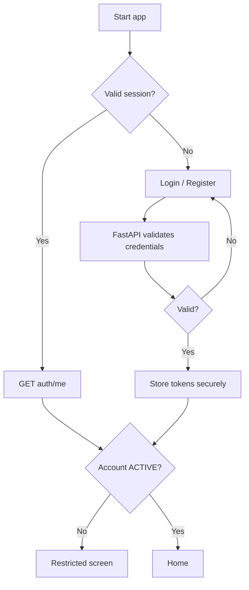

### 5.2. UC-02 – Đăng tin

1. Seller mở tab Đăng tin.
2. Chọn/chụp ảnh; Flutter preview và sắp xếp ảnh.
3. Flutter upload tới FastAPI; Backend kiểm tra quyền, file type và dung lượng.
4. Flutter gửi Product fields tới POST /products kèm file IDs.
5. Backend validate category, seller, image ownership; ghi Product + ProductImages trong transaction.
6. Flutter mở Product detail khi nhận `201`.

### 5.3. UC-03 – Tìm, chat và trao đổi C2C

1. Buyer tìm Product và mở detail.
2. Nếu Product `AVAILABLE` và không thuộc buyer, chọn Nhắn tin.
3. FastAPI tìm/tạo Conversation duy nhất theo Product + Buyer.
4. Flutter mở WebSocket và tải history qua REST.
5. Hai bên trao đổi; offline thì Flutter giữ outbox và retry bằng `client_message_id`.
6. Hai bên tự hẹn gặp/thanh toán ngoài app; app không ghi nhận thanh toán.
7. Buyer tạo confirmation request và Seller xác nhận (`ASM-07`).

### 5.4. UC-04 – Wishlist và chia sẻ

1. User bấm tim; Flutter gọi PUT wishlist.
2. Backend lưu duy nhất theo (`user_id`, `product_id`).
3. Chia sẻ: Flutter lấy metadata public, mở native share sheet, chia sẻ canonical URL.

### 5.5. UC-05 – Review

1. Chỉ hiện khi có confirmation `COMPLETED` theo `ASM-07`.
2. Buyer gửi rating/comment.
3. Backend kiểm tra buyer, trạng thái confirmation, hạn review và chưa có review.
4. Backend tạo Review; profile seller đọc thống kê review.

### 5.6. UC-06 – Report và Admin review

1. Member mở Report từ Product detail.
2. Chọn lý do/mô tả, gửi API.
3. Backend chống trùng, chụp snapshot, lưu report `PENDING`.
4. Admin mở queue, xem snapshot/current state và xử lý.
5. FastAPI kiểm tra role, ghi quyết định và thay đổi đối tượng trong transaction.
6. User xem trạng thái trong Báo cáo của tôi; owner không thấy reporter identity.

## 6. TRẠNG THÁI ĐỐI TƯỢNG VÀ BUSINESS RULES

[⬆ Về mục lục](#mục-lục)

### 6.1. Product status

| **Trạng thái** | **Public thấy?**                                                             | **Owner sửa?**                  | **Chat mới?**            | **Ghi chú**                                 |
| -------------- | ---------------------------------------------------------------------------- | ------------------------------- | ------------------------ | ------------------------------------------- |
| `AVAILABLE`    | Có                                                                           | Có                              | Có, nếu buyer khác owner | Đang đăng bán                               |
| `HIDDEN`       | Không                                                                        | Có                              | Không                    | Owner chủ động ẩn                           |
| `SOLD`         | Có qua profile/link/wishlist nếu policy cho phép; không ở trang chủ mặc định | Không hoặc metadata theo policy | Không                    | Seller đánh dấu hoặc confirmation completed |
| `BLOCKED`      | Không                                                                        | Không                           | Không                    | Admin gỡ                                    |
| `DELETED`      | Không                                                                        | Không                           | Không                    | Soft delete                                 |

Không dùng `RESERVED` trong MVP vì TASKS không có task tương ứng.

### 6.2. User status

- `PENDING_VERIFICATION` không dùng trong MVP (`OQ-02`).
- `ACTIVE` tài khoản hoạt động.
- `BANNED` không được ghi; dữ liệu public bị ẩn theo policy.
- role: USER hoặc `ADMIN`; user thường không tự sửa.

### 6.3. Conversation status

- OPEN: hai participant có thể gửi message nếu Product/account đủ điều kiện.
- `READ_ONLY`: một bên `BANNED` hoặc Product `BLOCKED`/`DELETED`; chỉ đọc lịch sử.
- CLOSED: chỉ dùng nếu nhóm thêm quy tắc; mặc định chưa dùng.

### 6.4. Transaction confirmation status (`ASM-07`)

`PENDING` -\> `COMPLETED` hoặc `PENDING` -\> `REJECTED`. Không expiry tự động vì nguồn không quy định.

### 6.5. Report status

`PENDING` -\> RESOLVED khi Admin hành động lên đối tượng; `PENDING` -\> `REJECTED` khi Admin kết luận không vi phạm.

### 6.6. Business Rules

| **ID**  | **Quy tắc**                                                                                       | **Nguồn/trạng thái**                 |
| ------- | ------------------------------------------------------------------------------------------------- | ------------------------------------ |
| `BR-01` | Chỉ user đăng nhập và `ACTIVE` được ghi.                                                          | **[Giữ từ SRS 0.1]**                 |
| `BR-02` | Chỉ owner sửa/ẩn/mark `SOLD`/xóa Product của mình                                                 | **[Nguồn TASKS]**                    |
| `BR-03` | Owner không chat hoặc wishlist Product của mình                                                   | **[Giữ từ SRS 0.1]**                 |
| `BR-04` | Mỗi cặp Product + Buyer tối đa một Conversation                                                   | **[Giữ từ SRS 0.1]**                 |
| `BR-05` | Chỉ participant đọc/ghi chat; Admin không đọc                                                     | **[Nguồn TASKS + privacy]**          |
| `BR-06` | Message đã gửi không sửa/xóa trong MVP                                                            | **[Giữ từ SRS 0.1; cần duyệt]**      |
| `BR-07` | Chỉ Admin BLOCK/restore Product                                                                   | **[Bổ sung hợp lý / Giả định]**      |
| `BR-08` | Buyer không review nếu không có căn cứ giao dịch được duyệt; `SOLD` tự thân không phải bằng chứng | **[Nguồn TASKS]**                    |
| `BR-09` | Mỗi confirmation tối đa một Review (`ASM-07`)                                                     | **[Nguồn TASKS – dedupe giao dịch]** |
| `BR-10` | Một user tối đa một Report `PENDING` cho cùng Product                                             | **[Giữ từ SRS 0.1]**                 |
| `BR-11` | Người bị report không thấy danh tính reporter                                                     | **[Giữ từ SRS 0.1]**                 |
| `BR-12` | Product của user `BANNED` không hiển thị public                                                   | **[Giữ từ SRS 0.1]**                 |
| `BR-13` | Không thu thập điện thoại/địa chỉ nhà; chỉ khu vực chung                                          | **[Giữ từ SRS 0.1 + TASKS Privacy]** |
| `BR-14` | Giá là integer VND; 0 = Cho tặng                                                                  | **[Giữ từ SRS 0.1; max cần duyệt]**  |
| `BR-15` | Danh mục ban đầu từ Appendix A; quản lý động không thuộc MVP                                      | **[Nguồn TASKS]**                    |
| `BR-16` | Client không quyết định role, `owner_id`, status hệ thống, timestamps hoặc resolution             | **[Bổ sung hợp lý / Giả định]**      |
| `BR-17` | Request ghi có nguy cơ lặp cần idempotency/unique constraint                                      | **[Bổ sung hợp lý / Giả định]**      |

## 7. YÊU CẦU PHI CHỨC NĂNG

[⬆ Về mục lục](#mục-lục)

### 7.1. Bảo mật – SEC

| **ID**       | **Yêu cầu**                                                             | **Ưu tiên**                                  |
| ------------ | ----------------------------------------------------------------------- | -------------------------------------------- |
| `NFR-SEC-01` | API protected xác thực token ở FastAPI                                  | **Must**                                     |
| `NFR-SEC-02` | Quyền USER/`ADMIN`/owner/participant được kiểm tra ở Backend            | **Must**                                     |
| `NFR-SEC-03` | Password lưu bằng password hashing an toàn; không plaintext             | **Must**                                     |
| `NFR-SEC-04` | Refresh token lưu dạng hash, rotation/revocation                        | **Should** – **[Bổ sung hợp lý / Giả định]** |
| `NFR-SEC-05` | Validate dữ liệu ở Flutter và FastAPI; Backend là nguồn quyết định cuối | **Must**                                     |
| `NFR-SEC-06` | Không log password/token/PII hoặc nội dung chat không cần thiết         | **Must**                                     |
| `NFR-SEC-07` | Admin API cấm USER; hành động moderation ghi audit event                | **Must**                                     |
| `NFR-SEC-08` | Upload kiểm tra MIME thực, extension, size và nội dung file             | **Must**                                     |
| `NFR-SEC-09` | CORS giới hạn origin; HTTPS staging/production                          | **Should**                                   |
| `NFR-SEC-10` | Rate limit login/report/upload                                          | **Should** – **[Bổ sung hợp lý / Giả định]** |

### 7.2. Quyền riêng tư – PRIV

| **ID**        | **Yêu cầu**                                                                             |
| ------------- | --------------------------------------------------------------------------------------- |
| `NFR-PRIV-01` | Public API chỉ trả display name, avatar, school tự khai báo, bio, ngày tham gia, uy tín |
| `NFR-PRIV-02` | Email chỉ ở profile cá nhân/luồng quản trị cần thiết; không trả public                  |
| `NFR-PRIV-03` | Không thu thập địa chỉ nhà/số điện thoại; area là khu vực chung                         |
| `NFR-PRIV-04` | Không đưa PII vào URL, share metadata hoặc error log                                    |
| `NFR-PRIV-05` | Admin không đọc chat riêng; snapshot report chỉ lưu trường cần kiểm duyệt               |

### 7.3. Hiệu năng – PERF

| **ID**        | **Yêu cầu**                                                     | **Mức**                                      |
| ------------- | --------------------------------------------------------------- | -------------------------------------------- |
| `NFR-PERF-01` | Trang chủ trang đầu ≤ 3 giây trên 4G ổn định                    | Target – **[Giữ từ SRS 0.1; cần benchmark]** |
| `NFR-PERF-02` | Message tới participant online ≤ 2 giây khi mạng ổn định        | Target – **[Giữ từ SRS 0.1]**                |
| `NFR-PERF-03` | Mọi danh sách phân trang; không lấy toàn bộ collection/table    | **Must**                                     |
| `NFR-PERF-04` | Resize/compress ảnh trước upload; thumbnail/cache cho danh sách | **Must**                                     |
| `NFR-PERF-05` | WebSocket hủy khi rời chat/logout; reconnect có backoff         | **Must**                                     |
| `NFR-PERF-06` | Query có index; endpoint list giới hạn page size                | **Should**                                   |

### 7.4. Khả dụng và UX – USA

| **ID**       | **Yêu cầu**                                       |
| ------------ | ------------------------------------------------- |
| `NFR-USA-01` | Màn dữ liệu có loading, success, empty, error     |
| `NFR-USA-02` | Dùng UI Kit chung; không tạo màu/nút trùng        |
| `NFR-USA-03` | Tap target tối thiểu 48×48dp; chữ dễ đọc          |
| `NFR-USA-04` | Lỗi tiếng Việt dễ hiểu; không hiện raw exception  |
| `NFR-USA-05` | Hành động xóa/gỡ/khóa có confirm dialog           |
| `NFR-USA-06` | UI hỗ trợ màn nhỏ/cỡ chữ hệ thống; không overflow |

### 7.5. Tương thích, tin cậy và bảo trì

| **ID**         | **Yêu cầu**                                                                |
| -------------- | -------------------------------------------------------------------------- |
| `NFR-COMP-01`  | Android min SDK theo nhóm duyệt; hiện đề xuất API 24+                      |
| `NFR-COMP-02`  | Test ít nhất hai thiết bị thật với màn hình khác nhau                      |
| `NFR-REL-01`   | Nghiệp vụ nhiều bảng dùng DB transaction                                   |
| `NFR-REL-02`   | Local cache/outbox không đánh đồng dữ liệu offline với server success      |
| `NFR-REL-03`   | Retry POST phải idempotent hoặc có request ID                              |
| `NFR-MAINT-01` | Flutter feature-based; Backend tách router/schema/service/repository/model |
| `NFR-MAINT-02` | flutter analyze, backend lint/type checks và automated tests trong PR      |
| `NFR-MAINT-03` | API prefix `/api/v1`; migration versioned trong Git                        |
| `NFR-MAINT-04` | PR nhỏ, có hướng dẫn test, ảnh/video UI nếu có thay đổi UI                 |

## 8. FASTAPI API CONTRACT – QUY ƯỚC CHUNG

[⬆ Về mục lục](#mục-lục)

### 8.1. Base URL, Header và định dạng

- Base path `/api/v1`; REST dùng HTTPS + JSON UTF-8.
- Auth header Authorization: Bearer \<`access_token`\> cho endpoint protected.
- X-Request-ID do client gửi hoặc Backend sinh và echo trong response – **[Bổ sung hợp lý / Giả định]**.
- JSON dùng application/json; upload dùng multipart/form-data.
- Datetime ISO-8601 UTC, ví dụ 2026-11-27T03:00:00Z.
- Tiền integer VND, không dùng float.
- List dùng page/page_size; chat history có thể dùng cursor.

### 8.2. Response envelope

**Success**

```json
{
  "data": {},
  "meta": {"request_id": "req_01JREQUEST"}
}
```

**Error**

```json
{
  "error": {
    "code": "VALIDATION_ERROR",
    "message": "Du lieu gui len khong hop le.",
    "details": [{"field": "price_vnd", "issue": "must be greater than or equal to 0"}]
  },
  "meta": {"request_id": "req_01JREQUEST"}
}
```

### 8.3. HTTP Status Code

| **Status** | **Sử dụng**                                                      |
| ---------- | ---------------------------------------------------------------- |
| `200`      | Đọc/cập nhật/action thành công có response                       |
| `201`      | Tạo resource thành công                                          |
| 202        | Request đã nhận; xử lý async (ví dụ gửi email)                   |
| `204`      | Thành công, không response body                                  |
| `400`      | Request/business format tổng quát không hợp lệ                   |
| `401`      | Thiếu/sai/hết hạn token; refresh không hợp lệ                    |
| `403`      | Đã xác thực nhưng không đủ quyền/tài khoản bị khóa/chưa xác minh |
| `404`      | Không tìm thấy resource hoặc không được phép lộ sự tồn tại       |
| `409`      | Xung đột trạng thái, dữ liệu trùng hoặc resource đã xử lý        |
| `413`      | File vượt dung lượng                                             |
| `422`      | Schema validation error                                          |
| `429`      | Rate limit                                                       |
| `500`      | Lỗi nội bộ                                                       |
| `503`      | Backend/dependency nội bộ tạm thời không sẵn sàng                |

Không trả stack trace hoặc thông tin database trong response public.

### 8.4. Validation và bảo mật API

1. Flutter validate sơ bộ; FastAPI validate độc lập bằng request schema.
2. Backend không tin `user_id`, `seller_id`, role, status, `created_at`, `resolved_at` hoặc field hệ thống từ client.
3. Mọi endpoint thay đổi resource kiểm tra owner/participant/admin ở server.
4. DB có unique constraint email, wishlist (`user_id`, `product_id`), conversation (`product_id`, `buyer_id`), review `confirmation_id` nếu bật confirmation.
5. POST có khả năng retry phải có idempotency key hoặc unique client request ID.
6. API list có `page_size` tối đa; không nhận page size không giới hạn.

### 8.5. Danh mục endpoint tổng hợp

| **Module**      | **Method**     | **Endpoint**                                   | **Auth**                  |
| --------------- | -------------- | ---------------------------------------------- | ------------------------- |
| Health          | GET            | `/api/v1/health`                               | Public                    |
| Auth            | POST           | `/api/v1/auth/register`                        | Public                    |
| Auth            | POST           | `/api/v1/auth/login`                           | Public                    |
| Auth            | POST           | `/api/v1/auth/refresh`                         | Refresh token             |
| Auth            | POST           | `/api/v1/auth/logout`                          | Bearer                    |
| Auth            | GET            | `/api/v1/auth/me`                              | Bearer                    |
| Auth            | POST           | `/api/v1/auth/password/forgot`                 | Public                    |
| Auth            | POST           | `/api/v1/auth/password/reset`                  | Reset token               |
| Profile         | GET/PATCH      | `/api/v1/users/me`                             | Bearer                    |
| Profile         | GET            | `/api/v1/users/{user_id}`                      | Public/Bearer             |
| Category        | GET            | `/api/v1/categories`                           | Public                    |
| Browse          | GET            | `/api/v1/products`                             | Public                    |
| Product         | GET            | `/api/v1/products/{product_id}`                | Public                    |
| Seller Products | GET            | `/api/v1/users/{user_id}/products`             | Public                    |
| File            | POST           | `/api/v1/files/images`                         | Bearer                    |
| File            | DELETE         | `/api/v1/files/{file_id}`                      | Bearer + owner            |
| File            | GET            | `/api/v1/files/{file_id}/content`              | Public/authorized         |
| Product         | POST           | `/api/v1/products`                             | Bearer                    |
| Product         | PATCH          | `/api/v1/products/{product_id}`                | Bearer + owner            |
| Product         | POST           | `/api/v1/products/{product_id}/hide`           | Bearer + owner            |
| Product         | POST           | `/api/v1/products/{product_id}/publish`        | Bearer + owner            |
| Product         | POST           | `/api/v1/products/{product_id}/mark-sold`      | Bearer + owner            |
| Product         | DELETE         | `/api/v1/products/{product_id}`                | Bearer + owner            |
| My Products     | GET            | `/api/v1/users/me/products`                    | Bearer                    |
| Wishlist        | GET/PUT/DELETE | `/api/v1/me/wishlist[/{product_id}]`           | Bearer                    |
| Chat            | GET            | `/api/v1/conversations`                        | Bearer                    |
| Chat            | POST           | `/api/v1/conversations`                        | Bearer                    |
| Chat            | GET            | `/api/v1/conversations/{id}/messages`          | Bearer + participant      |
| Chat            | POST           | `/api/v1/conversations/{id}/read`              | Bearer + participant      |
| Chat            | WS             | `/api/v1/ws/chat`                              | Bearer handshake          |
| Confirmation    | POST           | `/api/v1/products/{id}/purchase-confirmations` | Bearer + Buyer; `ASM-07`  |
| Confirmation    | POST           | `/api/v1/purchase-confirmations/{id}/decision` | Bearer + Seller; `ASM-07` |
| Review          | POST           | `/api/v1/purchase-confirmations/{id}/review`   | Bearer + Buyer; `ASM-07`  |
| Review          | GET            | `/api/v1/users/{id}/reviews`                   | Public                    |
| Share           | GET            | `/api/v1/products/{id}/share-metadata`         | Public                    |
| Report          | POST           | `/api/v1/reports/products`                     | Bearer                    |
| Report          | GET            | `/api/v1/me/reports`                           | Bearer                    |
| Admin           | GET            | `/api/v1/admin/reports`                        | Bearer + `ADMIN`          |
| Admin           | GET            | `/api/v1/admin/reports/{id}`                   | Bearer + `ADMIN`          |
| Admin           | POST           | `/api/v1/admin/reports/{id}/resolve`           | Bearer + `ADMIN`          |
| Admin           | POST           | `/api/v1/admin/users/{id}/ban`                 | Bearer + `ADMIN`          |

### 8.6. Health check

`GET /api/v1/health` public.

```json
{
  "data": {"status": "ok", "service": "marketplace-api", "api_version": "v1"},
  "meta": {}
}
```

Không đưa credential/connection string vào health response.

### 8.7. Ví dụ bổ sung cho endpoint không có body hoặc ít field

Các endpoint ở bảng tổng hợp mục 8.5 vẫn phải tuân thủ Response Envelope ở mục 8.2. Với GET, HEAD, DELETE không cần Request Body trừ khi ghi rõ. Ví dụ dưới đây hoàn thiện payload thành công cho endpoint đã được liệt kê trong từng module.

#### 8.7.1. Auth – current user

`GET /api/v1/auth/me` – Header Authorization: Bearer \<`access_token`\>; không request body.

```json
{
  "data": {
    "id": "usr_01JABC123",
    "display_name": "Nguyen Van A",
    "email": "a@example.com",
    "role": "USER",
    "status": "ACTIVE",
    "email_verified": true
  },
  "meta": {}
}
```

email chỉ trả trong endpoint self; public user DTO tuyệt đối không có field này. Các field ID/role/status/email_verified là string/string/enum/boolean tương ứng.

#### 8.7.2. Categories

`GET /api/v1/categories` – Public; query active=true mặc định; không body.

```json
{
  "data": [
    {"id": "cat_books", "name": "Sach & giao trinh", "icon_key": "books", "sort_order": 1},
    {"id": "cat_electronics", "name": "Do dien tu & phu kien", "icon_key": "devices", "sort_order": 2}
  ],
  "meta": {}
}
```

id/name/icon_key là string; `sort_order` là int. Chỉ trả category đang active. Danh mục seed theo Phụ lục A.

#### 8.7.3. Seller products và My Products

`GET /api/v1/users/{user_id}/products?page=1&page_size=20` – Public; chỉ trả Product public (`AVAILABLE`/`SOLD` theo chính sách public).

```json
{
  "data": [
    {"id": "prd_01JPRODUCT1", "title": "Giao trinh Giai tich 1", "price_vnd": 45000, "status": "AVAILABLE", "cover_image_url": null}
  ],
  "meta": {"page": 1, "page_size": 20, "total_items": 1}
}
```

`GET /api/v1/users/me/products?status=AVAILABLE&page=1&page_size=20` – Bearer; owner-only.

```json
{
  "data": [
    {"id": "prd_01JPRODUCT1", "title": "Giao trinh Giai tich 1", "price_vnd": 45000, "status": "AVAILABLE", "updated_at": "2026-11-27T03:30:00Z"}
  ],
  "meta": {"page": 1, "page_size": 20, "total_items": 1}
}
```

status là optional enum, page/page_size là optional int, `price_vnd` là int, `updated_at` là datetime ISO-8601. page \>= 1; `page_size` 1–50 – **[Bổ sung hợp lý / Giả định]**.

#### 8.7.4. File delete

`DELETE /api/v1/files/{file_id}` – Bearer + owner; không body; chỉ xóa file chưa gắn Product hoặc file mà nghiệp vụ cho phép thay thế.

Response `200`:

```json
{"data": {"file_id": "fil_01JAVATAR", "deleted": true}, "meta": {}}
```

`404` `FILE_NOT_FOUND`; `401` `AUTH_REQUIRED`; `403` `FILE_FORBIDDEN`; `409` `FILE_ALREADY_ATTACHED`; `422` `VALIDATION_ERROR`.

#### 8.7.5. Wishlist delete

`DELETE /api/v1/me/wishlist/{product_id}` – Bearer; no body.

Response `200`:

```json
{"data": {"product_id": "prd_01JPRODUCT1", "is_favorite": false}, "meta": {}}
```

Nếu đã bỏ lưu trước đó, API vẫn trả trạng thái `is_favorite`=false – **[Bổ sung hợp lý / Giả định]** nhằm giữ thao tác idempotent.

#### 8.7.6. Conversation list và read receipt

`GET /api/v1/conversations?page=1&page_size=20` – Bearer.

```json
{
  "data": [
    {
      "id": "cnv_01JCONV1",
      "product_id": "prd_01JPRODUCT1",
      "product_title": "Giao trinh Giai tich 1",
      "other_participant": {"id": "usr_01JABC123", "display_name": "Nguyen Van A"},
      "last_message": {"text": "Minh hen 5h nhe", "created_at": "2026-11-27T04:30:00Z"},
      "unread_count": 2
    }
  ],
  "meta": {"page": 1, "page_size": 20, "total_items": 1}
}
```

`POST /api/v1/conversations/{id}/read` – Bearer + participant; no body.

```json
{"data": {"conversation_id": "cnv_01JCONV1", "unread_count": 0, "last_read_at": "2026-11-27T04:31:00Z"}, "meta": {}}
```

Field `unread_count` là int \>= 0; `last_read_at` là datetime ISO-8601. Message list dùng cursor để không tải toàn bộ lịch sử.

#### 8.7.7. Pending reviews

`GET /api/v1/me/pending-reviews` – Bearer; no body.

```json
{
  "data": [
    {
      "confirmation_id": "txn_01JCONFIRM1",
      "product_id": "prd_01JPRODUCT1",
      "product_title": "Giao trinh Giai tich 1",
      "seller": {"id": "usr_01JABC123", "display_name": "Nguyen Van A"},
      "completed_at": "2026-11-27T05:10:00Z",
      "can_review": true
    }
  ],
  "meta": {"page": 1, "page_size": 20, "total_items": 1}
}
```

`can_review` là boolean; `completed_at` datetime ISO-8601. 

#### 8.7.8. Report detail

`GET /api/v1/me/reports/{report_id}` – Bearer + reporter; không body.

```json
{
  "data": {
    "id": "rpt_01JREPORT1",
    "product_id": "prd_01JPRODUCT1",
    "reason": "MISLEADING",
    "description": "Anh va mo ta khong trung khop.",
    "status": "PENDING",
    "created_at": "2026-11-27T06:00:00Z",
    "resolution_note": null
  },
  "meta": {}
}
```

Không trả `reporter_id` cho target owner; endpoint người báo cáo chỉ trả thông tin thuộc report của chính họ.

#### 8.7.9. Admin report list và detail

`GET /api/v1/admin/reports?status=PENDING&page=1&page_size=20` – Bearer + `ADMIN`; no body.

```json
{
  "data": [
    {"id": "rpt_01JREPORT1", "target_type": "PRODUCT", "target_id": "prd_01JPRODUCT1", "reason": "MISLEADING", "status": "PENDING", "created_at": "2026-11-27T06:00:00Z"}
  ],
  "meta": {"page": 1, "page_size": 20, "total_items": 1}
}
```

`GET /api/v1/admin/reports/{report_id}` – Bearer + `ADMIN`; no body.

```json
{
  "data": {
    "id": "rpt_01JREPORT1",
    "reporter": {"display_name": "Nguyen B", "joined_at": "2026-10-01T00:00:00Z"},
    "target": {"type": "PRODUCT", "id": "prd_01JPRODUCT1", "status": "AVAILABLE"},
    "snapshot": {"title": "Giao trinh Giai tich 1", "price_vnd": 45000, "cover_image_url": null},
    "reason": "MISLEADING",
    "description": "Thong tin khong trung khop.",
    "status": "PENDING"
  },
  "meta": {}
}
```

Snapshot chỉ có dữ liệu cần thiết cho moderation; không bao gồm email, địa chỉ, số điện thoại hoặc nội dung conversation.

#### 8.7.10. Error examples

Các module tham chiếu mã lỗi trong từng bảng. Ví dụ response chuẩn:

**`400` – Business/request invalid**

```json
{
  "error": {"code": "PRODUCT_STATE_CONFLICT", "message": "Trang thai san pham khong cho phep thao tac nay.", "details": []},
  "meta": {"request_id": "req_01JREQUEST"}
}
```

**`401` – Unauthorized**

```json
{
  "error": {"code": "AUTH_REQUIRED", "message": "Vui long dang nhap lai.", "details": []},
  "meta": {"request_id": "req_01JREQUEST"}
}
```

**`404` – Not found**

```json
{
  "error": {"code": "PRODUCT_NOT_FOUND", "message": "Tin khong ton tai hoac khong kha dung.", "details": []},
  "meta": {"request_id": "req_01JREQUEST"}
}
```

**`422` – Validation error**

```json
{
  "error": {"code": "VALIDATION_ERROR", "message": "Du lieu gui len khong hop le.", "details": [{"field": "price_vnd", "issue": "must be greater than or equal to 0"}]},
  "meta": {"request_id": "req_01JREQUEST"}
}
```

details là array of object; field/issue là string. Các ví dụ error là payload chuẩn dùng xuyên module; mã cụ thể thay theo bảng lỗi ở mỗi module.

## 9. WIREFRAME LOW-FIDELITY VÀ HỢP ĐỒNG TƯƠNG TÁC FLUTTER

[⬆ Về mục lục](#mục-lục)

Mục 4 đã cung cấp wireframe và bảng tương tác cho các màn nghiệp vụ chính. Mục này chuẩn hóa quy tắc dùng chung và bổ sung những màn hình điều hướng/trạng thái còn lại. Wireframe là bố cục tham chiếu, không phải pixel-perfect design; Figma là deliverable riêng của G1.

### 9.1. Quy ước UI dùng chung

| **Thành phần** | **Quy tắc**                                                                                                          |
| -------------- | -------------------------------------------------------------------------------------------------------------------- |
| Navigation     | BottomNavigationBar gồm Trang chủ, Đăng tin, Tin nhắn, Cá nhân; hiển thị nhất quán trên các màn chính sau đăng nhập. |
| Loading        | Dùng skeleton cho danh sách và progress cho thao tác gửi/upload; tránh khóa toàn màn hình khi chỉ một vùng đang tải. |
| Empty          | Hiển thị câu giải thích và CTA phù hợp; không dùng màn hình trắng.                                                   |
| Error          | Thông báo tiếng Việt, giữ dữ liệu người dùng đã nhập; có Thử lại khi có thể retry.                                   |
| Input          | Label, hint, giới hạn/validation, trạng thái focus/error; không chỉ dựa vào màu để thể hiện lỗi.                     |
| Button         | Vùng chạm tối thiểu 48×48dp; vô hiệu hóa khi request đang chạy để tránh gửi lặp.                                     |
| Responsive     | Nội dung cuộn được; kiểm thử màn nhỏ, bàn phím mở và cỡ chữ hệ thống lớn.                                            |
| Accessibility  | Tương phản chữ đạt WCAG AA – **[Bổ sung hợp lý / Giả định]**; semantic label cho icon và ảnh.                        |

### 9.2. Wireframe – Splash / kiểm tra phiên

```text
+--------------------------------+
|          APP LOGO              |
|                                |
|       Chợ Đồ Cũ Sinh Viên      |
|                                |
|       [ Loading indicator ]    |
|       Đang kiểm tra phiên...   |
|                                |
+--------------------------------+
```

| **Tên thành phần / Nút** | **Loại UI** | **Hành vi & API gọi khi thao tác**                                                                                             |
| ------------------------ | ----------- | ------------------------------------------------------------------------------------------------------------------------------ |
| Logo/tên app             | Image/Text  | Không gọi API.                                                                                                                 |
| Loading                  | Progress    | Gọi `GET /api/v1/auth/me` nếu có access token; refresh bằng `POST /api/v1/auth/refresh` khi access token hết hạn.              |
| Điều hướng               | Router      | `200` → Home; `401` sau refresh → Login; `403` `USER_BANNED` → Ban screen; offline → hiển thị trạng thái kết nối và cho retry. |

### 9.3. Wireframe – Đăng nhập

```text
+--------------------------------+
| < Trở về       ĐĂNG NHẬP       |
|                                |
| Email                          |
| [ email@example.com         ]  |
| Mật khẩu                       |
| [ ***************          ]   |
| [ ] Hiện mật khẩu              |
| [          Đăng nhập        ]  |
|                                |
| Quên mật khẩu?                 |
| Chưa có tài khoản? Đăng ký     |
|                                |
| [ Loading / Error message ]    |
+--------------------------------+
```

| **Tên thành phần / Nút** | **Loại UI**    | **Hành vi & API gọi khi thao tác**                                                        |
| ------------------------ | -------------- | ----------------------------------------------------------------------------------------- |
| Email                    | Input          | Trim; kiểm tra format ở Flutter; submit gọi `POST /api/v1/auth/login`.                    |
| Mật khẩu                 | Password Input | Không ghi vào log; không lưu plaintext.                                                   |
| Hiện mật khẩu            | Checkbox       | Chỉ thay đổi hiển thị cục bộ.                                                             |
| Đăng nhập                | Button         | Loading; gửi login; lưu token an toàn; `200` → Home/verify; lỗi → hiển thị message chuẩn. |
| Quên mật khẩu            | Link/Button    | Mở Password Reset, gọi forgot-password.                                                   |
| Đăng ký                  | Link/Button    | Mở Register.                                                                              |

### 9.4. Wireframe – Đăng ký

```text
+--------------------------------+
| < Trở về         ĐĂNG KÝ       |
|                                |
| Họ tên hiển thị                |
| [                            ] |
| Email                          |
| [                            ] |
| Mật khẩu                       |
| [                            ] |
| Nhập lại mật khẩu              |
| [                            ] |
|                                |
| [          Đăng ký          ]  |
| Đã có tài khoản? Đăng nhập     |
+--------------------------------+
```

| **Tên thành phần / Nút** | **Loại UI**    | **Hành vi & API gọi khi thao tác**                                                  |
| ------------------------ | -------------- | ----------------------------------------------------------------------------------- |
| Họ tên                   | Input          | Required; 2–50 ký tự sau trim – **[Bổ sung hợp lý / Giả định]**.                    |
| Email                    | Input          | Required; format email.                                                             |
| Mật khẩu                 | Password Input | Required; tối thiểu 8 ký tự.                                                        |
| Nhập lại                 | Password Input | So sánh cục bộ, không gửi trường `confirm_password` nếu API contract không yêu cầu. |
| Đăng ký                  | Button         | `POST /api/v1/auth/register`; `201` → Verify Email.                                 |

### 9.5. Wireframe – Xác minh email

```text
+--------------------------------+
|        XÁC MINH EMAIL          |
|                                |
| Chúng tôi đã gửi email tới:    |
| user@example.com               |
|                                |
| [ Tôi đã xác minh ]            |
| [ Gửi lại email ]              |
|                                |
| [ Để sau / Về trang chủ ]      |
|                                |
| [ Thông báo trạng thái ]       |
+--------------------------------+
```

| **Tên thành phần / Nút** | **Loại UI** | **Hành vi & API gọi khi thao tác**                                                                                   |
| ------------------------ | ----------- | -------------------------------------------------------------------------------------------------------------------- |
| Email đích               | Text        | Chỉ hiển thị email của chính tài khoản hiện tại.                                                                     |
| Tôi đã xác minh          | Button      | Gọi `GET /api/v1/auth/me` để lấy trạng thái mới; không tự tin rằng click link đã hoàn tất nếu chưa kiểm tra Backend. |
| Gửi lại email            | Button      | `POST /api/v1/auth/email/verification/resend`; debounce và giới hạn tần suất do Backend áp dụng.                     |
| Để sau                   | Button      | Cho phép xem công khai (chỉ đọc); không cấp quyền ghi.                                                               |

### 9.6. Wireframe – Quên mật khẩu / đặt lại mật khẩu

```text
+--------------------------------+
| < Trở về       QUÊN MẬT KHẨU   |
|                                |
| Nhập email tài khoản           |
| [                            ] |
| [       Gửi hướng dẫn       ]  |
|                                |
| Kiểm tra hộp thư của bạn       |
| (Không tiết lộ email tồn tại)  |
+--------------------------------+
```

| **Tên thành phần / Nút** | **Loại UI** | **Hành vi & API gọi khi thao tác**                                                     |
| ------------------------ | ----------- | -------------------------------------------------------------------------------------- |
| Email                    | Input       | Required, format email.                                                                |
| Gửi hướng dẫn            | Button      | `POST /api/v1/auth/password/forgot`; response chung tránh dò tìm email.                |
| Deep link reset          | App Link    | Token reset một lần; mở form đặt mật khẩu mới; gọi `POST /api/v1/auth/password/reset`. |

### 9.7. Wireframe – Hồ sơ của tôi

```text
+--------------------------------+
|             CÁ NHÂN            |
| [Avatar]  Tên hiển thị         |
|          Email (riêng tư)      |
|          Trường: ...           |
|          Tham gia: ...         |
| [ Chỉnh sửa hồ sơ ]            |
|--------------------------------|
| Tin của tôi  | Đã lưu          |
| Báo cáo của tôi                |
| Mẹo giao dịch an toàn          |
| [ Đăng xuất ]                  |
|--------------------------------|
| Trang chủ | Đăng tin | Chat | Tôi|
+--------------------------------+
```

| **Tên thành phần / Nút** | **Loại UI**  | **Hành vi & API gọi khi thao tác**                                             |
| ------------------------ | ------------ | ------------------------------------------------------------------------------ |
| Hồ sơ hiện tại           | Profile Card | `GET /api/v1/users/me`. Email chỉ hiển thị cho chính chủ.                      |
| Chỉnh sửa hồ sơ          | Button       | Mở edit profile; `PATCH /api/v1/users/me`.                                     |
| Tin của tôi              | List entry   | `GET /api/v1/users/me/products`.                                               |
| Đã lưu                   | List entry   | `GET /api/v1/me/wishlist`.                                                     |
| Báo cáo của tôi          | List entry   | `GET /api/v1/me/reports`.                                                      |
| Mẹo an toàn              | List entry   | Mở nội dung tĩnh trong app, không yêu cầu Backend.                             |
| Đăng xuất                | Button       | `POST /api/v1/auth/logout`; xóa token/cache riêng của tài khoản trên thiết bị. |

### 9.8. Wireframe – Sửa hồ sơ

```text
+--------------------------------+
| < Trở về       SỬA HỒ SƠ       |
| [ Avatar ] [ Đổi ảnh ]        |
| Tên hiển thị [              ] |
| Trường/cơ sở  [              ] |
| Giới thiệu    [              ] |
| Khu vực mặc định [           ] |
| Email (chỉ xem)               |
| [ Hủy ]          [ Lưu ]       |
+--------------------------------+
```

| **Tên thành phần / Nút** | **Loại UI**  | **Hành vi & API gọi khi thao tác**                                    |
| ------------------------ | ------------ | --------------------------------------------------------------------- |
| Avatar                   | Image Picker | Chọn ảnh; upload qua `POST /api/v1/files/images`; nhận `file_id`/url. |
| Tên hiển thị             | Input        | 2–50 ký tự – **[Bổ sung hợp lý / Giả định]**.                         |
| Trường/cơ sở             | Input        | Tối đa 80 ký tự – **[Giữ từ SRS 0.1 / Giả định]**.                    |
| Giới thiệu               | TextArea     | Tối đa 200 ký tự – **[Giữ từ SRS 0.1 / Giả định]**.                   |
| Khu vực mặc định         | Input        | Tối đa 60 ký tự; không nhập địa chỉ nhà chính xác.                    |
| Lưu                      | Button       | `PATCH /api/v1/users/me`; `200` → cập nhật profile.                   |

### 9.9. Wireframe – Hồ sơ công khai / đánh giá

```text
+--------------------------------+
| < Trở về      HỒ SƠ NGƯỜI BÁN  |
| [Avatar] Tên người bán         |
| Trường (tự khai báo)           |
| Email xác minh: [Badge]        |
| ★ 4.7 (12 đánh giá)            |
| 5 giao dịch được xác nhận      |
|--------------------------------|
| Tin đang đăng                  |
| [Product Card]                 |
| [Product Card]                 |
|--------------------------------|
| Đánh giá gần đây               |
| ★★★★★  Người mua ...           |
| Nhận xét ...                   |
| [⋮ Báo cáo người dùng]*        |
+--------------------------------+
* Không có trong MVP (`OQ-10`).
```

| **Tên thành phần / Nút** | **Loại UI** | **Hành vi & API gọi khi thao tác**                                          |
| ------------------------ | ----------- | --------------------------------------------------------------------------- |
| Profile summary          | Card        | `GET /api/v1/users/{user_id}`; chỉ trường công khai.                        |
| Sản phẩm                 | List        | `GET /api/v1/users/{user_id}/products`; chỉ trả status được phép công khai. |
| Đánh giá                 | List        | `GET /api/v1/users/{user_id}/reviews`.                                      |
| Báo cáo người dùng       | Menu        | Ngoài phạm vi MVP cơ sở; chỉ mở khi nhóm bổ sung task tương ứng.            |

### 9.10. Wireframe – Tin của tôi

```text
+--------------------------------+
|             TIN CỦA TÔI        |
| [Đang bán] [Đã bán] [Đã ẩn]    |
| [Bị gỡ nếu có]                 |
|--------------------------------|
| [Ảnh] Tiêu đề                  |
|       Giá · AVAILABLE          |
|       [Sửa] [Ẩn] [Đánh dấu bán]|
|--------------------------------|
| [Ảnh] Tiêu đề                  |
|       Giá · SOLD               |
|       [Xem chi tiết]           |
|--------------------------------|
| Trang chủ | Đăng tin | Chat | Tôi|
+--------------------------------+
```

| **Tên thành phần / Nút** | **Loại UI** | **Hành vi & API gọi khi thao tác**                                                           |
| ------------------------ | ----------- | -------------------------------------------------------------------------------------------- |
| Tab trạng thái           | Tab         | Gọi `GET /api/v1/users/me/products?status=`....                                              |
| Sửa                      | Button      | Mở form edit; `PATCH /api/v1/products/{id}`.                                                 |
| Ẩn/Hiện                  | Button      | Gọi hide/publish; chỉ cho trạng thái hợp lệ.                                                 |
| Đánh dấu đã bán          | Button      | Hộp thoại xác nhận; `POST /api/v1/products/{id}/mark-sold`. Không tự tạo review eligibility. |
| Xóa                      | Button      | Xác nhận; `DELETE /api/v1/products/{id}` soft delete.                                        |

### 9.11. Wireframe – Danh sách hội thoại và phòng chat

Wireframe và bảng tương tác chi tiết đã mô tả tại mục 4.6. Màn danh sách hội thoại phải có empty/loading/error và reconnect. Phòng chat phải thể hiện trạng thái sending/sent/failed/pending, banner trạng thái sản phẩm và ô nhập chỉ khi người dùng còn quyền gửi.

### 9.12. Wireframe – Form báo cáo sản phẩm

Wireframe và tương tác chi tiết tại mục 4.9. Form chỉ báo cáo PRODUCT trong phạm vi MVP nguồn; danh sách radio lấy từ Phụ lục C. Không thêm form báo cáo người dùng/tin nhắn trong MVP (`OQ-10`).

### 9.13. Wireframe – Admin

Wireframe Admin ở mục 4.10. Admin không có quyền đọc nội dung chat riêng. Mọi hành động nhạy cảm cần xác nhận, ghi audit event và được FastAPI kiểm tra role ở server.

## 10. MÔ HÌNH DỮ LIỆU KHÁI NIỆM / ERD LOGIC

[⬆ Về mục lục](#mục-lục)

### 10.1. Nguyên tắc

- Database quan hệ do nhóm tự quản lý; PostgreSQL (đã chốt `OQ-03`). FastAPI là đường truy cập duy nhất.
- Dùng khóa chính UUID; thời gian lưu UTC và trả ra ISO-8601 có timezone.
- Tên bảng/trường `snake_case`; khóa ngoại và unique constraints phải được thể hiện trong ERD.
- ProductImages là thực thể riêng theo cấu trúc tối thiểu trong TASKS; tránh chỉ dựa vào chuỗi ảnh trong Product nếu cần thứ tự, metadata hoặc xóa ảnh.
- Không có Orders/OrderItems/OrderAddresses trong MVP.

### 10.2. Các thực thể

| **Entity**            | **Thuộc tính chính**                                                                                                                                                                 | **Ràng buộc**                                                                                                                              |
| --------------------- | ------------------------------------------------------------------------------------------------------------------------------------------------------------------------------------ | ------------------------------------------------------------------------------------------------------------------------------------------ |
| Users                 | id, `display_name`, email, `password_hash`, `email_verified`, role, status, school, bio, `default_area`, `avatar_file_id`, `created_at`, `updated_at`, `banned_at`, `ban_reason`     | email unique; role USER/`ADMIN`; status `ACTIVE`/`BANNED`. `password_hash` không bao giờ trả API.                                          |
| Categories            | id, name, `icon_key`, `sort_order`, `is_active`, `created_at`, `updated_at`                                                                                                          | name không rỗng; danh mục đang được dùng không xóa vật lý. Quản trị danh mục là **[Cần làm rõ]** do TASKS chỉ yêu cầu ERD Category.        |
| Products              | id, `seller_id`, `category_id`, title, `price_vnd`, condition, description, area, negotiable, status, `created_at`, `updated_at`, `sold_at`, `blocked_reason`                        | `seller_id` FK Users; price integer VND; status enum; không chứa địa chỉ nhà/số điện thoại.                                                |
| ProductImages         | id, `product_id`, `file_id`, `image_url`, `sort_order`, `is_cover`, `created_at`                                                                                                     | FK Product; thứ tự duy nhất trong một Product; ảnh đầu là cover.                                                                           |
| Conversations         | id, `product_id`, `buyer_id`, `seller_id`, `created_at`, `updated_at`, `last_message_at`                                                                                             | Unique (`product_id`, `buyer_id`); `buyer_id` != `seller_id`; hai participant gắn với Product.                                             |
| Messages              | id, `conversation_id`, `sender_id`, `message_type`, content, `created_at`, `client_message_id`                                                                                       | FK Conversation; `message_type` TEXT/SYSTEM; unique (`sender_id`, `client_message_id`) để chống gửi lặp – **[Bổ sung hợp lý / Giả định]**. |
| Wishlists             | `user_id`, `product_id`, `created_at`                                                                                                                                                | Composite PK/unique (`user_id`, `product_id`).                                                                                             |
| Reviews               | id, `transaction_confirmation_id`, `seller_id`, `buyer_id`, `product_id`, rating, comment, `created_at`                                                                              | Unique `transaction_confirmation_id` (`ASM-07` đã chốt); rating 1–5.                                                          |
| Reports               | id, `reporter_id`, `target_type`, `target_id`, `target_owner_id`, `reason_code`, description, `snapshot_json`, status, `resolution_note`, `resolved_by`, `resolved_at`, `created_at` | MVP `target_type` = PRODUCT; snapshot lưu dữ liệu công khai tại thời điểm report.                                                          |
| AdminAuditLogs        | id, `admin_id`, action, `target_type`, `target_id`, `report_id`, note, `created_at`                                                                                                  | Append-only qua API; không cho client sửa/xóa.                                                                                             |
| PurchaseConfirmations | id, `product_id`, `conversation_id`, `buyer_id`, `seller_id`, status, `created_at`, `decided_at`                                                                                     | Thuộc phạm vi `ASM-07` đã chốt; unique/constraint đảm bảo tối đa một confirmation `COMPLETED` theo Product.                               |
| StoredFiles           | id, `owner_id`, `storage_key`, `mime_type`, `size_bytes`, checksum, `created_at`                                                                                                     | File nằm trong storage tự quản lý; chỉ metadata được lưu ở DB.                                                                             |

### 10.3. ERD Mermaid

```mermaid
erDiagram
  USERS ||--o{ PRODUCTS : owns
  CATEGORIES ||--o{ PRODUCTS : classifies
  PRODUCTS ||--o{ PRODUCT_IMAGES : has
  USERS ||--o{ CONVERSATIONS : buyer
  USERS ||--o{ CONVERSATIONS : seller
  PRODUCTS ||--o{ CONVERSATIONS : context
  CONVERSATIONS ||--o{ MESSAGES : contains
  USERS ||--o{ MESSAGES : sends
  USERS ||--o{ WISHLISTS : saves
  PRODUCTS ||--o{ WISHLISTS : saved_by
  USERS ||--o{ REPORTS : submits
  PRODUCTS ||--o{ REPORTS : target
  USERS ||--o{ PURCHASE_CONFIRMATIONS : buyer_or_seller
  PRODUCTS ||--o{ PURCHASE_CONFIRMATIONS : confirmation_for
  PURCHASE_CONFIRMATIONS ||--o| REVIEWS : may_enable
  USERS ||--o{ REVIEWS : writes
  USERS ||--o{ ADMIN_AUDIT_LOGS : performs
  USERS ||--o{ STORED_FILES : owns
```

Ghi chú: PurchaseConfirmations và quan hệ Review thuộc phạm vi `ASM-07` đã chốt. Users là một bảng nội bộ; response public phải qua response schema riêng, không trả email/password_hash/ban metadata nhạy cảm.

### 10.4. Index và tính toàn vẹn

| **Bảng**      | **Index / Constraint đề xuất**                                                                                                                                |
| ------------- | ------------------------------------------------------------------------------------------------------------------------------------------------------------- |
| Users         | UNIQUE(lower(email)); INDEX(status, `created_at`).                                                                                                            |
| Products      | INDEX(status, `created_at` DESC); INDEX(status, `category_id`, `created_at` DESC); INDEX(status, `price_vnd`); INDEX(`seller_id`, status, `created_at` DESC). |
| ProductImages | INDEX(`product_id`, `sort_order`); UNIQUE(`product_id`, `sort_order`).                                                                                        |
| Conversations | UNIQUE(`product_id`, `buyer_id`); INDEX(`buyer_id`, `last_message_at` DESC); INDEX(`seller_id`, `last_message_at` DESC).                                      |
| Messages      | INDEX(`conversation_id`, `created_at` DESC); UNIQUE(`sender_id`, `client_message_id`).                                                                        |
| Wishlists     | PRIMARY KEY(`user_id`, `product_id`); INDEX(`user_id`, `created_at` DESC).                                                                                    |
| Reviews       | INDEX(`seller_id`, `created_at` DESC); rating CHECK 1..5; unique confirmation id nếu dùng transaction confirmation.                                           |
| Reports       | INDEX(status, `created_at` ASC); INDEX(`target_type`, `target_id`, status).                                                                                   |
| Audit logs    | INDEX(`created_at` DESC); INDEX(`admin_id`, `created_at` DESC).                                                                                               |

## 11. MA TRẬN PHÂN QUYỀN

[⬆ Về mục lục](#mục-lục)

Quyền được xác minh tại FastAPI cho từng request và từng tài nguyên. Flutter chỉ ẩn/hiện UI để cải thiện trải nghiệm; đó không phải cơ chế bảo mật.

| **Hành động**                            | **Khách** | **Chưa xác minh**          | **Thành viên `ACTIVE`**                   | **Chủ Product**                         | **Participant Chat**                       | **Admin**                                    |
| ---------------------------------------- | --------- | -------------------------- | ----------------------------------------- | --------------------------------------- | ------------------------------------------ | -------------------------------------------- |
| Xem Product `AVAILABLE`/`SOLD` công khai | Có\*      | Có\*                       | Có                                        | Có                                      | Có                                         | Có                                           |
| Xem Product `HIDDEN`/`BLOCKED`/`DELETED` | Không     | Không                      | Không                                     | Có theo quyền sở hữu                    | Theo quyền hội thoại cũ, read-only khi cần | Có ngữ cảnh kiểm duyệt                       |
| Tạo Product                              | Không     | Không                      | Có                                        | —                                       | —                                          | Theo policy Admin                            |
| Sửa/ẩn/đánh dấu `SOLD` Product           | Không     | Không                      | Không                                     | Có                                      | —                                          | Không thay quyền chủ sở hữu                  |
| Xóa mềm Product                          | Không     | Không                      | Không                                     | Có                                      | —                                          | Theo thao tác moderation                     |
| Xem hồ sơ công khai                      | Có\*      | Có\*                       | Có                                        | Có                                      | Có                                         | Có                                           |
| Xem email                                | Không     | Chỉ của mình nếu đăng nhập | Chỉ của mình                              | Chỉ của mình                            | Không                                      | Theo nhu cầu quản trị tối thiểu – [Giả định] |
| Sửa hồ sơ                                | Không     | Không\*\*                  | Có, của mình                              | Có, của mình                            | —                                          | Có, của mình                                 |
| Wishlist                                 | Không     | Không                      | Có                                        | Không lưu Product của mình              | —                                          | Theo policy                                  |
| Tạo conversation                         | Không     | Không                      | Có, không phải seller và Product khả dụng | Không                                   | —                                          | Không                                        |
| Đọc message                              | Không     | Không                      | Không                                     | Chỉ nếu là participant                  | Có                                         | Không                                        |
| Gửi message                              | Không     | Không                      | Không                                     | Chỉ nếu participant và hội thoại còn mở | Có                                         | Không                                        |
| Report Product                           | Không     | Không                      | Có, không phải owner                      | Không report Product của mình           | —                                          | Không                                        |
| Đọc report của mình                      | Không     | Không                      | Có, của mình                              | —                                       | —                                          | Có                                           |
| Xử lý report / ban user                  | Không     | Không                      | Không                                     | —                                       | —                                          | Có                                           |
| Ghi admin audit log                      | Không     | Không                      | Không                                     | —                                       | —                                          | Chỉ Backend khi Admin action                 |
| Review                                   | Không     | Không                      | Theo `ASM-07`/confirmation                | —                                       | Người mua đủ điều kiện                     | Không tự review                              |

\* Guest browsing: đã chốt `OQ-01` (chỉ đọc). \*\* Người dùng chưa xác minh email: không áp dụng trong MVP (`OQ-02`).

### 11.1. Nguyên tắc Authorization tại FastAPI

1. Đọc sub từ access token đã xác thực; không tin `user_id` do client tự gửi để xác định chủ thể.
2. Load user status/role từ nguồn dữ liệu đáng tin cậy; tài khoản `BANNED` không thực hiện thao tác ghi.
3. Kiểm tra owner/participant ở server trước khi trả hoặc sửa resource.
4. Trường role, status, `seller_id`, `buyer_id`, `created_at`, `resolved_by` và các trường audit là server-managed.
5. Admin API dùng dependency kiểm tra role; không dựa vào UI flag.
6. Mọi thay đổi moderation phải ghi audit log trong cùng transaction DB nếu có nhiều bảng bị tác động.

## 12. XỬ LÝ LỖI, OFFLINE, RETRY VÀ ĐỒNG BỘ

[⬆ Về mục lục](#mục-lục)

### 12.1. Error catalog

| **ID** | **Tình huống**                                 | **Hành vi Flutter**                                                     | **Backend/HTTP**                                                                                               |
| ------ | ---------------------------------------------- | ----------------------------------------------------------------------- | -------------------------------------------------------------------------------------------------------------- |
| `E-01` | Mất mạng tải danh sách                         | Hiển thị cache nếu có, banner offline, nút retry                        | Không nhận được response; Flutter phân biệt network timeout với HTTP error.                                    |
| `E-02` | Mất mạng gửi chat                              | Tin ở trạng thái pending; gửi lại khi kết nối                           | WebSocket reconnect; gửi lại với `client_message_id` duy nhất.                                                 |
| `E-03` | Mất mạng/upload ảnh                            | Giữ form và tiến độ; thử upload lại; không tạo Product khi thiếu ảnh    | Chỉ tạo Product sau khi file hợp lệ và upload hoàn tất.                                                        |
| `E-04` | Access token hết hạn                           | Thử refresh một lần; nếu thất bại về Login                              | `401` `TOKEN_EXPIRED`; refresh endpoint xác thực refresh token.                                                |
| `E-05` | Không đủ quyền                                 | Thông báo thân thiện, không lặp request                                 | `403` FORBIDDEN; không tiết lộ dữ liệu nhạy cảm.                                                               |
| `E-06` | Product không còn tồn tại/không public         | Màn “Tin không còn tồn tại”                                             | `404` `PRODUCT_NOT_FOUND` hoặc `404` chung để tránh dò tài nguyên riêng tư.                                    |
| `E-07` | Product vừa chuyển `SOLD` khi nhắn tin         | Thông báo “Tin đã bán”; không tạo chat mới                              | `409` `PRODUCT_NOT_AVAILABLE`.                                                                                 |
| `E-08` | Gửi request trùng sau timeout                  | Không tạo hai message/record                                            | Idempotency key/client_message_id; trả kết quả bản ghi đã tạo.                                                 |
| `E-09` | Hai người cùng thao tác mark sold/confirmation | Hiển thị trạng thái mới nhất; yêu cầu reload                            | DB transaction + conditional update; một request thắng, request còn lại `409`.                                 |
| `E-10` | Report trùng                                   | Hiển thị đang chờ xử lý                                                 | `409` `DUPLICATE_PENDING_REPORT`.                                                                              |
| `E-11` | Rate limit                                     | Hiển thị thời điểm có thể thử lại nếu server cung cấp                   | `429` `RATE_LIMITED` + Retry-After. Ngưỡng: login 5 lần sai/15 phút (IP+email), report 10/ngày/user (`OQ-13`). |
| `E-12` | User bị ban khi đang dùng app                  | Chuyển về ban screen; hủy request ghi đang chờ                          | `403` `ACCOUNT_BANNED`; invalidate/deny further write.                                                         |
| `E-13` | Participant bị ban                             | Chat read-only theo policy; banner                                      | Backend từ chối gửi message nếu một participant bị ban.                                                        |
| `E-14` | Ảnh sai định dạng/quá lớn                      | Giữ ảnh hợp lệ; báo lỗi ảnh không hợp lệ                                | `413`/415 hoặc `422` theo lỗi cụ thể.                                                                          |
| `E-15` | Admin mở report đã xử lý                       | Hiển thị trạng thái đã giải quyết                                       | `409` `REPORT_ALREADY_RESOLVED`.                                                                               |
| `E-16` | Hai Admin cùng xử lý report                    | Người thứ hai nhận thông báo report đã xử lý                            | Optimistic concurrency/version check + transaction.                                                            |
| `E-17` | Quyền camera/thư viện bị từ chối               | Giải thích và mở cài đặt hệ thống                                       | Không gọi API.                                                                                                 |
| `E-18` | Màn nhỏ/chữ hệ thống lớn                       | Nội dung cuộn; không overflow                                           | QA kiểm thử ít nhất 2 thiết bị thật theo TASKS.                                                                |
| `E-19` | WebSocket disconnect                           | Hiển thị reconnecting; retry exponential backoff có giới hạn            | Server cấp lại kết nối; client sync message sau last acknowledged id.                                          |
| `E-20` | Logout có outbox chưa gửi                      | Cảnh báo và không gửi bằng tài khoản kế tiếp; xóa/giữ local theo policy | Không chấp nhận message mang token account khác; xử lý outbox riêng theo user.                                 |

### 12.2. Quy tắc Retry

- GET request có thể retry có giới hạn khi timeout/5xx/network failure.
- POST tạo dữ liệu không retry mù; dùng idempotency key cho các thao tác có nguy cơ tạo trùng **[Bổ sung hợp lý / Giả định]**.
- `400`/401/403/404/409/422 không retry tự động trừ khi có hướng xử lý cụ thể.
- `429` tuân thủ Retry-After.
- 5xx hiển thị lỗi chung, ghi `correlation_id` để hỗ trợ debug; không log mật khẩu, access token, refresh token, nội dung chat hoặc email đầy đủ.

### 12.3. Cache và Outbox Flutter

- Cache chỉ chứa dữ liệu cần để render; cache private được namespace theo `user_id`.
- Khi logout, token bị xóa và cache riêng tư được xóa hoặc khóa; không cho tài khoản tiếp theo đọc dữ liệu của tài khoản trước.
- Tin nhắn offline giữ trong outbox cục bộ theo tài khoản; `client_message_id` giữ nguyên qua các lần retry.
- Nếu server báo hội thoại đóng, user bị ban hoặc product không còn hợp lệ, message pending chuyển failed và không tự retry vô hạn.
- Dữ liệu Product cache cần có `updated_at`/version để nhận biết stale data. Chính sách TTL cụ thể **[Bổ sung hợp lý / Giả định]** cần TV1/TV2 duyệt.

### 12.4. Không có mạng / token refresh flow

```mermaid
flowchart TD
  A[Flutter gửi API] --> B{Có kết nối?}
  B -- Không --> C[Đọc cache hoặc lưu outbox nếu thao tác được phép]
  C --> D[Hiện offline state]
  B -- Có --> E[FastAPI trả response]
  E --> F{HTTP 401 token expired?}
  F -- Không --> G[Xử lý success hoặc error]
  F -- Có --> H[POST refresh một lần]
  H --> I{Refresh thành công?}
  I -- Có --> J[Lưu access token mới và retry request một lần]
  I -- Không --> K[Xóa phiên và về Login]
```

### 12.5. Acceptance Criteria chung

- `AC-ERR-01`: Mọi lỗi API hiển thị thông báo tiếng Việt; không hiển thị traceback/SQL/internal error.
- `AC-ERR-02`: Flutter phân biệt timeout, offline, `401`, `403`, `404`, `409`, `422`, `429` và 5xx.
- `AC-ERR-03`: Form không mất dữ liệu khi validation/server/network error, ngoại trừ password field có thể yêu cầu nhập lại vì lý do an toàn.
- `AC-ERR-04`: Sau reconnect, chat đồng bộ message theo cursor/last acknowledged id và không tạo bản ghi trùng.
- `AC-ERR-05`: Không có request tự retry vô hạn; retry có giới hạn và tuân thủ idempotency.
- `AC-ERR-06`: Logout không cho outbox của user cũ gửi dưới session mới.

## 13. MA TRẬN TRUY VẾT TASKS.MD ↔ SRS

[⬆ Về mục lục](#mục-lục)

| **Task nguồn**                   | **Mục SRS**                | **Phụ trách**                                                                             | **Bằng chứng nghiệm thu**                                                                                       |
| -------------------------------- | -------------------------- | ----------------------------------------------------------------------------------------- | --------------------------------------------------------------------------------------------------------------- |
| All Members – môi trường Flutter | A.3, 7.5, 9                | Cả nhóm                                                                                   | 4 thành viên chạy app trên Emulator; branch/PR mẫu.                                                             |
| Setup Flutter project            | A.1–A.3, 7.4, 9            | TV2                                                                                       | Feature-based structure, routing, state management, package thống nhất.                                         |
| Setup UI Kit                     | 7.4, 9.1                   | TV2                                                                                       | Shared colors/styles/buttons/inputs/loading/error.                                                              |
| Setup Backend                    | 2.2, 3, 8, 10              | TV1                                                                                       | FastAPI chạy local/dev; config mẫu; DB kết nối; health endpoint; không chứa secret.                             |
| Docs – SRS                       | Toàn bộ                    | TV4 + cả nhóm                                                                             | SRS review và được phê duyệt.                                                                                   |
| Design – Figma                   | 9 và các mục 4.x           | TV2 (auth/home/detail), TV3 (seller/profile), TV4 (chat/report/Admin); TV1 review khả thi | Figma có màn hình và trạng thái loading/empty/error.                                                            |
| DB – ERD                         | 10                         | TV1                                                                                       | ERD tối thiểu Users, Products, Categories, ProductImages, Conversations, Messages, Wishlists, Reviews, Reports. |
| API Contract                     | 8 và mục API từng module   | TV1; TV2–TV4 cung cấp requirement                                                         | `API.md` đủ endpoint, quyền, request/response, error codes, pagination.                                         |
| Backend Auth                     | 4.1, 8.2–8.4, 11           | TV1; TV2 tích hợp                                                                         | Register/login/token expiry/current profile; test unauthorized.                                                 |
| Backend Product Read             | 4.3, 8.3, 10, 11           | TV1; TV2 tích hợp                                                                         | List/detail/search/category/pagination; không lộ field riêng.                                                   |
| Backend Product Write            | 4.4, 8.3, 10, 11           | TV3 phối hợp TV1                                                                          | Create/update/delete/hide/sold; upload file validation; owner authorization.                                    |
| Flutter Screen 1                 | 4.1, 9.3–9.6               | TV2; TV1 hỗ trợ API                                                                       | Login/register/loading/error/session.                                                                           |
| Flutter Screen 2                 | 4.3, 9.1                   | TV2                                                                                       | 4 tabs; home/search/category filters.                                                                           |
| Flutter Screen 3                 | 4.3, 9.9                   | TV2; TV3 cung cấp field rule                                                              | Product detail, message/wishlist/share.                                                                         |
| Flutter Screen 4                 | 4.4, 9.10                  | TV3                                                                                       | Image picker, validate, create Product.                                                                         |
| Flutter Screen 5                 | 4.2, 4.4, 9.7–9.10         | TV3; TV2 UI review                                                                        | Profile, My Products, edit/delete/hide/sold/logout.                                                             |
| Fullstack Chat                   | 4.6, 8.5, 12               | TV4; TV1 auth/WebSocket                                                                   | Real-time, participant access, quick replies, offline retry.                                                    |
| Fullstack Wishlist               | 4.5, 8.5, 10               | TV2; TV1 schema/API                                                                       | Add/remove/list; no duplicate.                                                                                  |
| Fullstack Review                 | 4.7, 8.5, 10               | TV3; TV1 rule/data; TV4 chat touchpoint                                                   | 1–5 stars/comment; one per eligible transaction confirmation if approved.                                       |
| Share                            | 4.8, 8.5, 9.9              | TV3; TV2 UI; TV1 public API                                                               | Native share sheet; safe link; hidden/sold handling.                                                            |
| Fullstack Report                 | 4.9, 8.5, 9.12             | TV4; TV1 API/security                                                                     | Report Product, reason, snapshot, privacy, own report status.                                                   |
| Admin                            | 4.10, 8.5, 9.13, 11        | TV4 UI; TV1 FastAPI authorization                                                         | Admin list/detail/resolve, hide product/ban account; server role check.                                         |
| Privacy                          | 1.2, 4.2, 4.3, 7.2, 10, 11 | TV1; TV3 verify posting flow                                                              | No home address/phone; public fields allowlist; URL/log privacy.                                                |
| QA & Fix                         | 7, 11, 12, all AC          | Cả nhóm                                                                                   | API, authorization, DB, device UI and module tests.                                                             |
| Build APK                        | 7.5, 9, 13                 | TV1; TV2 release UI check                                                                 | flutter build apk --release; test install/main flows; GitHub Releases.                                          |

## 14. NGOÀI PHẠM VI, GIẢ ĐỊNH VÀ OPEN QUESTIONS

[⬆ Về mục lục](#mục-lục)

### 14.1. Ngoài phạm vi MVP

1. Thanh toán trong app, ví điện tử, đặt cọc, checkout.
2. Giỏ hàng, Orders/OrderItems, vận chuyển, giao hàng và địa chỉ nhận hàng.
3. Thu thập địa chỉ nhà/số điện thoại; không cần giao hàng thì không thu thập địa chỉ chính xác.
4. Xác thực sinh viên bằng email trường/thẻ sinh viên (TASKS nêu đây là vấn đề cần quyết định; chưa coi là **Must**).
5. Đăng nhập Google/Facebook/số điện thoại.
6. iOS và web app đầy đủ.
7. Push notification; ảnh/video/gọi thoại trong chat; sửa/xóa message.
8. Chặn user, báo cáo message/review hoặc report user trong phạm vi cơ sở hiện tại.
9. Seller review Buyer, seller reply/edit review.
10. Recommendation, GPS/map, kiểm duyệt tự động AI.
11. Nhiều cấp Moderator/Super Admin.
12. Tự xóa tài khoản người dùng; xử lý yêu cầu pháp lý/Store compliance cần được đánh giá nếu sau này phát hành qua store.
13. Quản lý danh mục động và dashboard nâng cao: chưa được xác định rõ trong TASKS, nên không đưa thành **Must**. Danh mục ban đầu có thể được seed bởi nhóm.

### 14.2. Danh sách nội dung ngoài TASKS được giữ lại

| **Nội dung**                                     | **Cách xử lý**                  | **Lý do**                                                                                               |
| ------------------------------------------------ | ------------------------------- | ------------------------------------------------------------------------------------------------------- |
| Email verification trước write                   | **[Bổ sung hợp lý / Giả định]** | Nâng mức chống tài khoản rác; TASKS có đề cập validation/auth nhưng chưa bắt buộc email verification.   |
| Access + refresh token                           | **[Bổ sung hợp lý / Giả định]** | Đáp ứng session và token expiry trong TASKS.                                                            |
| PostgreSQL                                       | Đã chốt (`OQ-03`)               | Cơ sở dữ liệu quan hệ phù hợp entity/ERD.                                                               |
| Self-managed file storage                        | **[Bổ sung hợp lý / Giả định]** | Đáp ứng upload mà không phụ thuộc Firebase/BaaS.                                                        |
| WebSocket                                        | **[Bổ sung hợp lý / Giả định]** | Cơ chế real-time qua FastAPI; cần test reconnect/auth.                                                  |
| Guest browse                                     | **[Bổ sung hợp lý / Giả định]** | Hữu ích cho deep link/share; Đã chốt `OQ-01`.                                                           |
| Soft delete                                      | **[Bổ sung hợp lý / Giả định]** | Giữ dữ liệu để phục vụ moderation; không biến thành hard-delete requirement.                            |
| Idempotency key và outbox                        | **[Bổ sung hợp lý / Giả định]** | Tránh duplicate message khi mobile mất mạng/retry.                                                      |
| Audit log cho Admin                              | **[Bổ sung hợp lý / Giả định]** | Có ích để truy vết thao tác quản trị; yêu cầu chi tiết cần duyệt.                                       |
| Trang “Mẹo giao dịch an toàn” dạng nội dung tĩnh | **[Bổ sung hợp lý / Giả định]** | Tăng an toàn C2C, không thêm xử lý nghiệp vụ/server phức tạp; có thể bỏ nếu nhóm không muốn tăng scope. |
| Transaction confirmation hai bên                 | Đã chốt (`ASM-07`)              | Cách tạo căn cứ review không dựa vào seller tự set `SOLD`. Không bao gồm checkout/payment.              |
| Validation ranges (tên, mô tả, giá, ảnh)         | **[Giữ từ SRS 0.1 / Giả định]** | Là default cụ thể cho test; đã chốt `OQ-12`.                                                            |

### 14.3. Nội dung bị loại bỏ khỏi SRS cũ

| **Nội dung**                                                             | **Quyết định**                      | **Lý do**                                                                                                                      |
| ------------------------------------------------------------------------ | ----------------------------------- | ------------------------------------------------------------------------------------------------------------------------------ |
| Firebase Auth/Firestore/Realtime DB/Storage/Hosting/Cloud Functions      | Loại bỏ toàn bộ                     | Vi phạm kiến trúc FastAPI tự quản lý.                                                                                          |
| Firestore Security Rules/Firebase Emulator/Firestore offline persistence | Loại bỏ                             | Thay bằng FastAPI AuthZ, API tests, DB transactions và Flutter cache/outbox.                                                   |
| Chat trực tiếp Firestore listener                                        | Loại bỏ                             | Thay bằng WebSocket qua FastAPI.                                                                                               |
| Push notification FCM/Cloud Functions                                    | Loại bỏ khỏi MVP                    | Không có trong TASKS và phụ thuộc dịch vụ bị cấm.                                                                              |
| Firebase Hosting                                                         | Loại bỏ                             | Website share không phải task bắt buộc; link có thể mở app và fallback thông tin công khai tùy nhóm.                           |
| Báo cáo người dùng/tin nhắn                                              | Loại khỏi MVP cơ sở                 | TASKS giao báo cáo tin đăng; mở rộng user/message report là scope creep.                                                       |
| Quản lý danh mục Admin, dashboard/statistics, admin log như **Must**     | Hạ ra ngoài phạm vi hoặc giả định   | TASKS xác định Category trong ERD và Admin ẩn Product/ban account; chưa đủ căn cứ để thêm quản lý danh mục nâng cao/dashboard. |
| `RESERVED` status                                                        | Không đưa vào vòng đời MVP mặc định | TASKS không quy định; đã chốt không dùng (`OQ-08`).                                                                            |
| Transaction expiry 7 ngày, tối đa 3 request                              | Loại bỏ                             | Không có trong TASKS và tạo thêm rule cần vận hành.                                                                            |
| Firestore keyword prefix/title_keywords                                  | Loại bỏ                             | Là giải pháp đặc thù Firestore, không phù hợp backend DB đã thay đổi.                                                          |
| Địa chỉ nhà / giao hàng                                                  | Loại bỏ                             | TASKS nói không cần thu thập khi MVP không delivery.                                                                           |

### 14.4. Open Questions cần nhóm chốt

| **ID**  | **Câu hỏi**                                                                                         | **Người chốt đề xuất** | **Mức ưu tiên**                         | **Trạng thái**                                                     |
| ------- | --------------------------------------------------------------------------------------------------- | ---------------------- | --------------------------------------- | ------------------------------------------------------------------ |
| `OQ-01` | Khách có được xem home/product/profile mà không đăng nhập?                                          | Cả nhóm                | **Must** trước API read                 | 🟡 **Giả định** (TV2–TV4 chọn phương án đề xuất, chờ xác nhận thật) |
| `OQ-02` | Có bắt buộc email verification trước mọi thao tác ghi không?                                        | TV1 + cả nhóm          | **Must** trước Auth                     | ✅ **Đã chốt** (TV1, 2026-11-27)                                    |
| `OQ-03` | Chốt PostgreSQL hay hệ DB khác?                                                                     | TV1                    | **Must** trước ERD/API                  | ✅ **Đã chốt** (TV1, 2026-11-27)                                    |
| `OQ-04` | Access token/refresh token TTL và revoke khi logout/password reset ra sao?                          | TV1                    | **Must** trước Auth                     | ✅ **Đã chốt** (TV1, 2026-11-27)                                    |
| `OQ-05` | Chọn local/self-managed object storage nào, quota và backup ra sao?                                 | TV1 + TV3              | **Must** trước upload                   | ✅ **Đã chốt** (TV1, 2026-11-27)                                    |
| `OQ-06` | WebSocket chat: xác thực, reconnect, heartbeat và ordering message?                                 | TV1 + TV4              | **Must** trước chat integration         | ✅ **Đã chốt** (TV1, 2026-11-27)                                    |
| `OQ-07` | Có phê duyệt `ASM-07`: Buyer request + Seller confirm + Review? Nếu không, bằng chứng review là gì? | Cả nhóm                | Critical                                | 🟡 **Giả định** (TV2–TV4 chọn phương án đề xuất, chờ xác nhận thật) |
| `OQ-08` | Có cần status `RESERVED` không?                                                                     | Cả nhóm                | **Should**                              | 🟡 **Giả định** (TV2–TV4 chọn phương án đề xuất, chờ xác nhận thật) |
| `OQ-09` | Có triển khai website share fallback hay chỉ Android App Link/native share?                         | Cả nhóm                | **Should**                              | 🟡 **Giả định** (TV2–TV4 chọn phương án đề xuất, chờ xác nhận thật) |
| `OQ-10` | Có báo cáo user, report message hoặc block user không? Mặc định không nằm trong MVP.                | Cả nhóm                | **Could**/later                         | 🟡 **Giả định** (TV2–TV4 chọn phương án đề xuất, chờ xác nhận thật) |
| `OQ-11` | Danh mục do seed cố định hay Admin cần CRUD?                                                        | Cả nhóm                | **Should**                              | 🟡 **Giả định** (TV2–TV4 chọn phương án đề xuất, chờ xác nhận thật) |
| `OQ-12` | Ngưỡng validate: max price, max description, image count/size, avatar dimensions?                   | TV1 + TV3              | **Must** trước upload/product           | ✅ **Đã chốt** (TV1, 2026-11-27)                                    |
| `OQ-13` | Ngưỡng rate limit report/login và retention policy?                                                 | TV1                    | **Should**                              | ✅ **Đã chốt** (TV1, 2026-11-27)                                    |
| `OQ-14` | Email sender/SMTP relay hoặc provider nào sẽ được dùng?                                             | TV1                    | **Must** trước email verification/reset | ✅ **Đã chốt** (TV1, 2026-11-27)                                    |
| `OQ-15` | Tên ứng dụng chính thức, domain link và scheme App Links?                                           | Cả nhóm                | **Should** trước share                  | 🟡 **Giả định** (TV2–TV4 chọn phương án đề xuất, chờ xác nhận thật) |

### 14.5. Nhật ký xác nhận của TV1

| **ID**  | **Quyết định**                                                                                                                                                                                                                                                          | **Ngày**   |
| ------- | ----------------------------------------------------------------------------------------------------------------------------------------------------------------------------------------------------------------------------------------------------------------------- | ---------- |
| `OQ-02` | Không bắt buộc xác minh email trước thao tác ghi; đăng ký xong dùng ngay (`ACTIVE`). `ASM-02` không áp dụng; `FR-AUTH-07` chuyển sang tùy chọn/làm sau.                                                                                                                 | 2026-11-27 |
| `OQ-03` | Chốt PostgreSQL làm cơ sở dữ liệu; migration có version. Áp dụng cho `C-03`, `ASM-03`.                                                                                                                                                                                  | 2026-11-27 |
| `OQ-04` | Access token TTL 15 phút; refresh token TTL 30 ngày (lưu hash trong DB). Logout thu hồi refresh session hiện tại; reset mật khẩu thu hồi toàn bộ refresh session.                                                                                                       | 2026-11-27 |
| `OQ-05` | Lưu ảnh trên đĩa cục bộ của server qua storage adapter (truy cập chỉ qua FastAPI); backup định kỳ bằng cron. Giới hạn dung lượng/ảnh theo `OQ-12`.                                                                                                                      | 2026-11-27 |
| `OQ-06` | WebSocket xác thực bằng access token JWT ở handshake (query param); heartbeat ping/pong 30s; client reconnect có backoff rồi tải phần thiếu qua REST; thứ tự tin theo id tăng dần/server timestamp; close code `4401` (hết hạn/chưa xác thực), `4403` (không có quyền). | 2026-11-27 |
| `OQ-12` | Giá tối đa 100.000.000 VND; mô tả ≤ 2000 ký tự; 1–5 ảnh/tin; mỗi ảnh ≤ 5 MB (jpg/png/webp); avatar ≤ 2 MB, tối đa 1024x1024.                                                                                                                                            | 2026-11-27 |
| `OQ-13` | Login: tối đa 5 lần sai/15 phút theo IP+email; report: tối đa 10/ngày/user; soft delete giữ 90 ngày; log giữ 30 ngày.                                                                                                                                                   | 2026-11-27 |
| `OQ-14` | Dùng Gmail SMTP với App Password cho MVP (chủ yếu reset mật khẩu); thông tin đăng nhập SMTP lấy từ biến môi trường, không commit lên Git.                                                                                                                               | 2026-11-27 |

### 14.6. Quyết định giả định cho câu hỏi của cả nhóm

> **Lưu ý:** TV1 giả định TV2–TV4 đều chọn phương án đề xuất. Chưa được TV2–TV4 xác nhận thực tế; cần họ xác nhận trước khi coi là đã chốt.

| **ID**  | **Giả định**                                                                                                                                    | **Ngày**   |
| ------- | ----------------------------------------------------------------------------------------------------------------------------------------------- | ---------- |
| `OQ-01` | Khách được xem read-only home/product/profile công khai (không ghi dữ liệu); cần cho mở share link (`ASM-06`).                                  | 2026-11-27 |
| `OQ-07` | Phê duyệt `ASM-07`: Buyer request + Seller confirm + Review; không gọi là "giao dịch đã xác minh độc lập".                                      | 2026-11-27 |
| `OQ-08` | Không dùng status `RESERVED` trong MVP.                                                                                                         | 2026-11-27 |
| `OQ-09` | Chỉ dùng native share + Android App Link; không làm website share fallback trong MVP.                                                           | 2026-11-27 |
| `OQ-10` | Không báo cáo user/report message/block user trong MVP (giữ mặc định ngoài phạm vi).                                                            | 2026-11-27 |
| `OQ-11` | Danh mục seed cố định; Admin không CRUD danh mục trong MVP.                                                                                     | 2026-11-27 |
| `OQ-15` | Tên ứng dụng "Chợ Đồ Cũ Sinh Viên"; custom scheme tạm `chodocusv://`; domain link chưa có, dùng placeholder cho dev và chốt khi có domain thật. | 2026-11-27 |

## 15. PHỤ LỤC

[⬆ Về mục lục](#mục-lục)

### 15.1. Phụ lục A – Danh mục ban đầu (seed)

1. Sách & giáo trình
2. Đồ điện tử & phụ kiện
3. Đồ dùng học tập
4. Đồ dùng phòng trọ / ký túc xá
5. Quần áo, giày dép & phụ kiện
6. Xe đạp, xe điện & phụ tùng
7. Thể thao & giải trí
8. Khác

Danh mục seed được đưa vào database của dự án. CRUD Admin chưa phải tính năng **Must** nếu chưa được nhóm duyệt.

### 15.2. Phụ lục B – Tin nhắn nhanh

| **Người mua**                           | **Người bán**                           |
| --------------------------------------- | --------------------------------------- |
| Món này còn không bạn?                  | Món này vẫn còn bạn nhé.                |
| Giá có thương lượng được không?         | Giá này mình để hợp lý rồi bạn ạ.       |
| Mình có thể xem trực tiếp ở đâu?        | Bạn có thể xem ở [khu vực] nhé.         |
| Món này còn bảo hành / có lỗi gì không? | Bạn tiện gặp lúc nào?                   |
| Mình lấy được hôm nay không?            | Xin lỗi, món này đã có người hỏi trước. |

### 15.3. Phụ lục C – Lý do báo cáo Product

| **Code**         | **Nội dung**                        |
| ---------------- | ----------------------------------- |
| PROHIBITED       | Hàng cấm, vi phạm pháp luật         |
| SCAM             | Có dấu hiệu lừa đảo                 |
| FAKE             | Hàng giả, hàng nhái                 |
| MISLEADING       | Thông tin hoặc hình ảnh sai sự thật |
| INAPPROPRIATE    | Nội dung phản cảm, xúc phạm         |
| `WRONG_CATEGORY` | Sai danh mục                        |
| SPAM             | Spam, đăng trùng lặp                |
| OTHER            | Khác; yêu cầu mô tả bổ sung         |

### 15.4. Phụ lục D – Tình trạng sản phẩm

| **Code**   | **Hiển thị** | **Mô tả**                               |
| ---------- | ------------ | --------------------------------------- |
| NEW        | Mới          | Chưa sử dụng, còn nguyên tem hoặc hộp   |
| `LIKE_NEW` | Như mới      | Dùng rất ít, không có dấu hiệu sử dụng  |
| GOOD       | Tốt          | Có dấu hiệu sử dụng nhẹ, hoạt động tốt  |
| FAIR       | Khá          | Trầy xước rõ, vẫn dùng tốt              |
| POOR       | Cũ / có lỗi  | Có lỗi hoặc hư hỏng, đã ghi trong mô tả |

### 15.5. Phụ lục E – Thông báo chuẩn

| **Code** | **Nội dung**                                                                        |
| -------- | ----------------------------------------------------------------------------------- |
| `MSG-01` | Email hoặc mật khẩu không đúng.                                                     |
| `MSG-02` | Vui lòng xác minh email để sử dụng chức năng này.                                   |
| `MSG-03` | Không có kết nối mạng. Vui lòng thử lại.                                            |
| `MSG-04` | Bạn không có quyền thực hiện thao tác này.                                          |
| `MSG-05` | Tin không còn tồn tại hoặc đã bị gỡ.                                                |
| `MSG-06` | Tài khoản của bạn đã bị khóa. Lý do: {reason}.                                      |
| `MSG-07` | Bạn đã báo cáo nội dung này, đang chờ xử lý.                                        |
| `MSG-08` | Cảm ơn bạn. Chúng tôi sẽ xem xét trong thời gian sớm nhất.                          |
| `MSG-09` | Đã có lỗi xảy ra. Vui lòng thử lại.                                                 |
| `MSG-10` | Phiên đăng nhập đã hết hạn. Vui lòng đăng nhập lại. **[Bổ sung hợp lý / Giả định]** |
| `MSG-11` | Tin đã được bán hoặc không còn khả dụng. **[Bổ sung hợp lý / Giả định]**            |

### 15.6. Phụ lục F – Mẹo giao dịch an toàn

1. Hẹn gặp ở nơi công cộng, đông người: căn tin, thư viện, sảnh ký túc xá.
2. Kiểm tra hàng kỹ trước khi trả tiền; với đồ điện tử thì bật lên dùng thử.
3. Không chuyển khoản trước khi chưa nhận hàng.
4. Không chia sẻ mã OTP, mật khẩu hay thông tin thẻ ngân hàng.
5. Trao đổi qua chat trong app để có lịch sử khi cần báo cáo.
6. Gặp dấu hiệu lừa đảo → dùng Báo cáo ngay trong app.

### 15.7. Ma trận kiểm thử bàn giao tối thiểu

| **Nhóm**      | **Ca kiểm thử tối thiểu**                                                                              | **Chủ trì**     |
| ------------- | ------------------------------------------------------------------------------------------------------ | --------------- |
| API/Auth      | Register/login/me/refresh/logout/expired token/invalid credential/verified policy                      | TV1             |
| Authorization | Guest write denied; non-owner edit denied; non-participant message denied; non-admin moderation denied | TV1             |
| Product       | CRUD; image validation; cover ordering; hide/publish/sold; public fields privacy                       | TV1 + TV3       |
| Browse        | Search accents/case; category; pagination; empty/error/cache; hidden/deleted visibility                | TV1 + TV2       |
| Wishlist      | Add/remove/list; duplicate; own product policy                                                         | TV1 + TV2       |
| Chat          | Conversation unique; real-time; message order; read state; reconnect; offline retry; idempotency       | TV1 + TV4       |
| Review        | Star bounds; comment length; duplicate; unauthorized reviewer; transaction confirmation dependency     | TV1 + TV3       |
| Share         | App link; invalid/hidden/sold product; no private data in metadata                                     | TV1 + TV2 + TV3 |
| Report/Admin  | Product report; duplicate; snapshot; admin resolve; ban effect; audit log                              | TV1 + TV4       |
| Device QA     | At least 2 real Android devices; small screen; large font; permission denied; RenderFlex overflow      | Cả nhóm         |
| Release       | flutter analyze; release APK install; smoke test main flows; GitHub Release                            | TV1 + TV2       |
